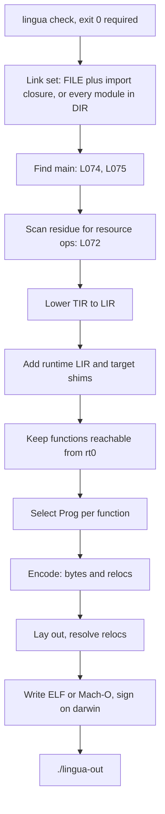

# Lingua 1 Native Backend

| | |
|---|---|
| **Document** | Design of `lingua build`, the native backend for `lingua1` |
| **Author** | placeholder |
| **Date** | 2026-10-23 |
| **Status** | Draft |
| **Audience** | Engineers implementing `src/build` |

This document specifies how `lingua build` turns a checked package into one executable. It extends [Lingua 1](lingua1.md), which stays normative for the language, the diagnostics, and the CLI. Changes this design still needs in `lingua1.md` are listed under [Proposed amendments to lingua1.md](#proposed-amendments-to-lingua1md) and are not in force until that document is edited.

---

## Overview

`lingua build` already has a contract in `lingua1.md`: run `check`, reject runtime resource calls (`L072`), require exactly one well-formed `main` (`L074`, `L075`), and write `./lingua-out` as one executable that prints the same exception and fault shapes as the interpreter. The code comes from a hand-written assembler in this crate, in the style of the Go assembler. There is no LLVM, no system assembler, and no system linker.

This document fills in the backend. It follows the Go toolchain's split. `cmd/compile` lowers to an IR and selects instructions into `obj.Prog`. `cmd/internal/obj` encodes each `Prog` with a per-architecture table. `cmd/link` lays out the whole program and writes the executable. Lingua does the same in one process with no intermediate object files:

```text
TIR runtime residue --lower--> LIR --select--> Prog --encode--> bytes + relocs --link--> lingua-out
```

v1 targets are `linux/amd64`, `linux/arm64`, and `darwin/arm64`. Any host builds any target, as with `GOOS`/`GOARCH`. Link mode follows Go. Linux output is a static ELF with no interpreter by default, and `--dynamic` makes an ELF that loads `libc.so.6`. darwin output is always a Mach-O that loads `libSystem`, because that is the only supported kernel interface on macOS. Both dynamic shapes use one import mechanism, described in [Link modes and imports](#link-modes-and-imports).

---

## Goals & Non-Goals

### Goals

- `lingua build` emits a working executable for `linux/amd64`, `linux/arm64`, and `darwin/arm64` from any host.
- One generic instruction form (`Prog`) and one encoding table per architecture. Instruction selection is per architecture. Everything above it is shared.
- An in-crate linker that writes ELF64 and Mach-O directly, static or dynamic, including the darwin ad-hoc code signature.
- One import mechanism for every dynamic binary, so that `--dynamic` on Linux and every darwin build share the shims, the call sequence, and the GOT layout.
- A runtime written once against LIR, plus a small per-target layer for process entry and system calls.
- Exception and fault output from the binary that is byte-identical to the interpreter's, by construction.
- Stage dumps for LIR and `Prog`, golden-tested the same way as `.tokens` and `.ast`.

### Non-Goals (v1)

- Re-running examples as native code. `lingua1.md` already excludes this.
- A Lingua shared library, foreign libraries, or FFI. Dynamic linking in v1 means the system C library only. Runtime resource operations stay `L072`.
- Lazy binding and PLT stubs. Every import is bound at load.
- Register allocation, SSA, inlining, or any optimization pass. Constant folding already happened at comptime.
- Debug info. No DWARF and no symbol table in v1. Both are later work.
- Windows, `darwin/amd64`, 32-bit targets.
- A garbage collector or any freeing of memory.
- Concurrency. `lingua1` has one thread.
- Readers for the LIR and `Prog` dumps.

---

## Key Decisions

**Go's pipeline, in one process.** Lowering, selection, encoding, and linking run back to back on the whole link set. There are no `.o` files and no archive format. Whole-program compilation is cheap at the sizes a `lingua1` package reaches, and it removes an object file format from the design. Separate compilation can be added later by serializing `Prog` lists; nothing in this design blocks it.

**LIR: one word per value, explicit checks.** Every Lingua value is one 64-bit word: an integer, a boolean, or a pointer. LIR is three-address code over virtual registers in basic blocks. Overflow, division by zero, and other faults are explicit ops that carry a site id. Nothing in LIR is target-specific except the sizes, which are fixed at 8 bytes on every v1 target.

**No register allocation in v1.** Every virtual register gets a stack slot. Instruction selection loads operands into fixed scratch registers, does the operation, and stores the result. The code is slow and correct, and selection stays a pure per-instruction expansion. `ponytail:` every vreg is spilled, so expect several times the instruction count of optimized code; linear-scan allocation over LIR is the upgrade path and does not change the ABI.

**Lingua ABI is stack-based, like Go ABI0.** Arguments and the result pass in the caller's outgoing area on the stack. All registers are caller-saved. Only the per-target shims speak the OS calling convention. A stack bound check in every prologue turns stack exhaustion into a fault with a span, not a segfault.

**Uniform boxed values.** `Int`, `Bool`, and `Nothing` are immediate words. `Text`, `List`, products, and sums are pointers to heap or read-only blocks with fixed layouts. Nominal types have the representation of their base. Match lowering, field access, and equality each have one shape.

**Bump allocation, never free.** `lingua1` values are immutable and acyclic, there is one thread, and a built program is a short-lived CLI process. A bump allocator over `mmap`'d chunks is enough. Reference counting is the upgrade path: immutable acyclic values never need a cycle collector.

**The runtime is LIR built in Rust.** Go writes its runtime in Go plus per-architecture assembly. Lingua has no second source language for the runtime, and writing it in `lingua1` would need raw memory access the language does not have. The runtime is therefore Rust code that builds LIR functions, compiled through the same selection and encoding as user code. Only process entry, the system-call shims, and the fault stub are written per target as `Prog` lists.

**Pre-rendered fault reports.** The checker already renders the exception and fault shapes. At build time, each fault site's full report text is rendered by that same Rust function and stored in read-only data. The runtime prints those bytes and exits 1. The binary cannot drift from the interpreter's format because it does not format anything.

**No pointers in static data.** Read-only data holds integers and bytes only. Code materializes every address with a PC-relative instruction (`LEAQ sym(SB)` on amd64, `ADRP`+`ADD` on arm64). The linker therefore never emits a rebase, a darwin PIE needs no fixups for Lingua data, and the only load-time fixups in any binary are the import slots.

**Static by default, like Go.** Linux binaries make raw system calls and are fully static unless `--dynamic` is given. macOS has no stable system-call ABI, and `darwin/arm64` requires executables to be loaded by `dyld` and to carry a code signature, so darwin binaries are always dynamic against `libSystem`. Go has done this on darwin since Go 1.11.

**One import mechanism.** A dynamic binary calls the C library through a table of 8-byte slots (the GOT) that the system dynamic linker fills at load. Code calls through a slot with an ordinary PC-relative load. The container writer is the only part that differs: ELF writes `GLOB_DAT` relocations and `DT_NEEDED`, Mach-O writes bind opcodes and `LC_LOAD_DYLIB`. A later FFI adds entries to the same table.

**Cross-compilation is the default shape.** Every target's tables, shims, and container writer are compiled into every `lingua` binary. `--target os/arch` picks one. No target needs a tool from that target's SDK.

---

## Proposed Design

### Driver



The order of the first four steps is `lingua1.md`'s. The link mode (static, or `--dynamic`) is fixed before `check` runs and only changes the shims and the container writer. `L072` is a scan of the whole link set's residue, not of reachable code, which matches `lingua1.md`: building a directory that contains `fulfillment.lf` fails even if `main` never calls `open_orders`. Reachability runs later and only trims the output.

The output is written to `./lingua-out.tmp`, given mode `0755`, and renamed to `./lingua-out`. A failed build leaves no partial binary.

### Targets

| Target | Container | Entry | Default kernel interface | `--dynamic` | Page alignment |
|---|---|---|---|---|---|
| `linux/amd64` | ELF64 `ET_EXEC`, `EM_X86_64` | `_rt0_linux_amd64` at `e_entry` | raw `syscall` | `libc.so.6` via `/lib64/ld-linux-x86-64.so.2` | 0x1000 |
| `linux/arm64` | ELF64 `ET_EXEC`, `EM_AARCH64` | `_rt0_linux_arm64` at `e_entry` | raw `svc #0` | `libc.so.6` via `/lib/ld-linux-aarch64.so.1` | 0x10000 (64 KiB kernels exist) |
| `darwin/arm64` | Mach-O `MH_EXECUTE`, `MH_PIE` | `_main` via `LC_MAIN` | `libSystem` | no change; always `libSystem` | 0x4000 |

`Process.os` is `"linux"` or `"macos"`. `Process.arch` is `"x86_64"` or `"aarch64"`. These are the target's values, not the host's.

### LIR

LIR is the target-independent lowered IR. A program is a list of functions and a list of read-only data symbols.

```text
LirProgram {
  functions: List<LirFn>
  rodata: List<RoData>
  sites: List<Site>             (* fault and exception sites; see Fault sites *)
}

LirFn {
  name: SymName                 (* "order.line_subtotal", "rt.alloc" *)
  params: u32                   (* v0 .. v(params-1) are the parameters *)
  vregs: u32                    (* total, parameters included *)
  blocks: List<Block>           (* blocks[0] is the entry *)
  stack_site: Option<SiteId>    (* None for nosplit runtime functions *)
}

Block { id: BlockId, insts: List<Inst>, term: Term }

Inst =
  | Const(v, i64)
  | Addr(v, SymName)            (* address of a function or rodata symbol *)
  | Move(v, a)
  | Load(v, a, off: i32)        (* 8-byte load from a + off *)
  | Store(a, off: i32, b)       (* 8-byte store *)
  | Load8(v, a, off: i32)       (* zero-extended byte; runtime only *)
  | Store8(a, off: i32, b)      (* low byte; runtime only *)
  | Bin(BinOp, v, a, b)         (* unchecked; runtime only *)
  | Chk(ChkOp, v, a, b, SiteId) (* checked Lingua arithmetic *)
  | Neg(v, a, SiteId)           (* checked unary minus *)
  | Cmp(CmpOp, v, a, b)         (* v = 1 or 0 *)
  | Call(Option<v>, SymName, List<a>)

BinOp = Add | Sub | Mul | And | Or | Shl | Shr | UDiv | URem
ChkOp = Add | Sub | Mul | Div | Rem
CmpOp = Eq | Ne | Lt | Le | Gt | Ge | ULt          (* signed except ULt *)

Term =
  | Jump(BlockId)
  | Branch(a, then: BlockId, else: BlockId)        (* a != 0 *)
  | Ret(Option<a>)
  | Raise(SiteId)                                  (* exception or fault; never returns *)
  | TailCall(SymName)                              (* tear down this frame, enter the callee *)
```

`Chk(Div)` and `Chk(Rem)` fault `L076` on a zero divisor and `L040` on `INT_MIN / -1` or `INT_MIN % -1`. The site carries the report for both codes, so a `Div` site has two pre-rendered texts (see [Fault sites](#fault-sites)). `TailCall(f)` expects `f`'s arguments already in this function's parameter vregs; `f` shares this function's incoming area and result slot (see Tail calls under [Lowering TIR to LIR](#lowering-tir-to-lir)), so it returns straight to this function's caller. `Bin`, `Load8`, and `Store8` are not produced by TIR lowering. They exist so the runtime can be written in LIR.

#### Lowering TIR to LIR

Lowering walks each `TirFn` in the runtime residue. A function whose body is `Primitive` becomes a call to the runtime routine for that primitive. The only allowlisted primitive is `money.percent`, which lowers to `rt.percent`.

| TIR | LIR |
|---|---|
| `Int(n)`, `Bool(b)`, `Nothing` | `Const` of `n`, `1`/`0`, `0` |
| `Text(s)` | `Addr` of a rodata Text block for `s` (interned per program) |
| `Local(x)` | the vreg bound to `x` |
| `List([e...])` | `Call rt.alloc(8 + 8n)`, store `n` at 0, each element at `8 + 8i` |
| `Record(T, [e...])` | `Call rt.alloc(8k)`, store field `i` at `8i` |
| `Variant(V, None)` | `Addr` of the rodata singleton for `V` |
| `Variant(V, Some(e))` | `Call rt.alloc(16)`, store tag at 0, payload at 8 |
| `Field(e, i)` | `Load(v, e, 8i)` |
| `Index` with `checked = false` | `Load(v, list, 8 + 8*index)` |
| `Index` with `checked = true` | `Call rt.list_index(list, index)`, which returns `Ok(elem)` or `Err(OutOfRange)` |
| `Add`, `Sub`, `Mul`, `Div`, `Rem` | `Chk` with a new site at the node's span |
| `Neg` | `Neg` with a new site |
| `Cmp` on integers or `Bool` | `Cmp` |
| `Cmp(Eq/Ne)` on `Text` or nominal text | `Call rt.text_eq`, then `Cmp Eq/Ne` against `1` |
| text with holes (`Concat`) | each part to a `Text` (an `Int` hole through `rt.int_to_text`), build a `List<Text>`, `Call rt.text_concat` |
| `Call(f, args)` | `Call`, with arguments padded to `f`'s tail-call group width |
| `IntIn(e, lo, hi)`, `IntAtLeast(e, lo)` | `Call rt.int_in_text` or `rt.int_in_int` with `lo`, `hi` (`INT_MAX` for `at least`) |
| `ClockNow` | `Call rt.clock_now` |
| `Log(e)` | `Call rt.log(e)` |
| `Match` | tag and literal tests, below |
| `If`, `ForList`, `ForRange`, `WhileIs` | blocks and branches, below |
| `Return(e)` | `Ret(e)` |
| `Return(Call(f, args))` in `f` itself | arguments into new vregs in source order, `Move`s into the parameters, `Jump` to the entry block |
| `Return(Call(g, args))`, `g` another user function | arguments into new vregs in source order, `Move`s into the parameters, `TailCall g` |
| `Assert(c, m)` | `Branch(c, next, fail)`, `fail` ends in `Raise` of a new exception site |
| `Fail(m)` | `Raise` of a new exception site |
| prelude `trim`, `lower`, `split`, `join`, `length`, `max` | `Call rt.trim` and so on. `length` is `Load(v, list, 0)`. `max` is `Cmp` and a branch |

`FsRead`, `CatalogColumns`, `ResourceCall`, `Quote`, and `Unquote` cannot appear in the runtime residue. `lingua1.md` rejects the first three before this point and removes the last two at splice. Lowering treats any of them as an internal compiler error, not a diagnostic.

**Tail calls.** A `return` of a call to a user function reuses the frame instead of growing the stack. The arguments are evaluated in source order into new vregs (through the checker's `Let` when named arguments are out of order), so an argument can still read the current parameters, and are then moved into the parameter vregs. A call of the enclosing function itself jumps to `blocks[0]`, after the prologue, so the stack check runs once per real call. A call of another function ends the block in `TailCall`, which tears the frame down and jumps to the callee's entry; its prologue and stack check run at the same depth as this function's did. Either way deep tail recursion, mutual or not, never faults `L077`. Only a call whose result is returned directly counts: `return 1 + g(n - 1)` still calls. Prelude calls are not tail calls.

A tail call leaves the callee's arguments in this function's incoming area, which the caller sized, and the callee writes its result where the caller reads it. So functions joined by tail calls form a group with one width, the largest parameter count among them. Every member takes that many parameters (`params=` in the dump), the words past its own are padding, and every call to a member passes a `const 0` in each padding slot. The result slot is then the same word for every member. Lowering first runs with each function's own width, where a tail call between different widths stays a `Call`, and records the tail calls; if a group needs widening, it lowers again with the group widths. A function in no group keeps its own width, so its LIR is unchanged. `ponytail:` a narrow function in a wide group pays padding at every call; sliding the return address per tail call is the upgrade, and needs callers that do not assume `SP` survives a call.

There are no runtime bound checks on integer subtypes. `lingua1` narrows only through `int_in` and `int_at_least`, which return `Result`, and through static adoption. Overflow checks are the only integer checks the backend inserts.

**Match.** A pattern compiles to a test that branches to the arm on success and to the next arm on failure. Arms are tried in source order. The checker has already proved exhaustiveness, so the block after the last arm's failure ends in `Raise` of an internal site that is unreachable in a checked program.

| Pattern | Test |
|---|---|
| `Wild` | always succeeds |
| `Bind(x)` | always succeeds; `Move` into `x`'s vreg |
| `Variant(V, p)` | `Load` tag at 0, `Cmp Eq` with `V`'s tag; on success test `p` against `Load` at 8 |
| `LitInt(n)` | `Cmp Eq` with `Const n` |
| `LitText(s)` | `Call rt.text_eq` with the rodata block for `s` |
| `List([p...])` | `Load` length at 0, `Cmp Eq` with `n`; then each `p_i` against `Load` at `8 + 8i` |

An expression-arm match writes each arm's value into one result vreg and jumps to a join block.

**Loops.** `ForList` keeps an index vreg and the length loaded once. `ForRange` evaluates `low` and `high` once, as `lingua1.md` requires, and increments with `Bin(Add)`: `i < high <= INT_MAX`, so `i + 1` cannot overflow. `WhileIs` tests the variant at the loop head, binds the payload, runs the body, and jumps back. None of the loops count fuel; `lingua1.md` makes fuel interpreter-only.

**Symbol names.** A user function is `<module>.<name>` (`order.line_subtotal`). A runtime routine is `rt.<name>`. A rodata Text block is `str.<n>`, a variant singleton is `var.<module>.<Type>.<Variant>`, and a site report is `site.<n>`. The names are internal. They appear in dumps and never in the binary, which has no symbol table in v1.

#### LIR dump

`lingua lir PATH` prints LIR for the user functions of `PATH`'s link set, where `PATH` is a file or a source root as for `build`, in module order and then source order. Runtime functions are not printed. The form is one function per paragraph:

```text
fn order.line_subtotal params=1 vregs=4 stack=site.0
b0:
  v1 = load v0, 8
  v2 = load v0, 16
  v3 = mul.chk v1, v2 @site.1
  ret v3

site.0 fault L077 order.lf:14:1
site.1 fault L040 order.lf:21:10
```

A `TailCall` prints as `tailcall m.is_odd`. Site lines name the code and the source position so a golden file shows which span each check will report. The report text itself is not printed.

### Value representation

Every value is one 8-byte word. Words are little-endian on every v1 target. Pointers are 8-byte aligned.

| Type | Word | Block layout |
|---|---|---|
| `Int`, every integer subtype, integer nominal (`Cents`) | the `i64` | none |
| `Bool` | `0` or `1` | none |
| `Nothing` | `0` | none |
| `Text`, text nominal (`CustomerId`) | pointer | `+0 len: i64` (bytes), `+8 bytes[len]` UTF-8, zero-padded to a multiple of 8 |
| `List<T>` | pointer | `+0 len: i64`, `+8 elem[0]`, `+16 elem[1]`, ... one word each |
| product with fields `f0 .. fk-1` | pointer | `+8i` field `fi`, declaration order |
| sum, including `Result` and `BoundsError` | pointer | `+0 tag: i64`, `+8 payload` (a word, or `0` for a zero-payload variant) |

Tags are the variant's index in declaration order. `Ok` is `0` and `Err` is `1`. `OutOfRange` is `0` and `NotAnInteger` is `1`. A zero-payload variant has one read-only singleton, `{tag, 0}`, and every use of it is that singleton's address. A one-payload variant is allocated at the construction site.

`Process` is a product in its prelude field order: `program`, `args`, `os`, `arch`, `pid`, `thread`, `parallelism`. `Thread` is `id`, `name`.

**Equality.** User `==` exists only on integers, `Bool`, `Text`, and nominal text (`lingua1.md`, Arithmetic: there is no user `==` on lists, products, sums, or `Result`). Integers and `Bool` compare as words. `Text` compares with `rt.text_eq`: equal lengths and equal bytes. The interpreter's structural equality covers compound values only because examples need it, and examples do not run natively. The binary therefore has no structural equality routine and no shape descriptors. If a later version adds `==` on compound types or native examples, shape descriptors in rodata are the way to add it.

### Memory

The heap is a bump allocator. Two words in `.bss` hold the current pointer and the chunk end.

```text
rt.alloc(bytes):
  n = (bytes + 7) & ~7
  if heap_ptr + n > heap_end:
    size = max(4 MiB, n rounded up to 64 KiB)
    base = mmap(size, read|write, private|anonymous)
    failure -> Raise(site.oom)
    heap_ptr = base
    heap_end = base + size
  p = heap_ptr
  heap_ptr = heap_ptr + n
  return p
```

`mmap` returns zeroed memory, so allocated blocks start zeroed. Memory is never freed. The rest of a chunk that cannot fit an allocation is abandoned. `ponytail:` never-free heap, so a long-running loop that allocates grows without bound; reference counting is the upgrade, since `lingua1` values are immutable and acyclic.

The interpreter's 64 MiB heap cap (`L047`) does not apply to the binary, the same way fuel does not. Allocation failure is `fault L047: out of memory` with no span line, because an allocation site is not tracked. See [Open Questions](#open-questions).

### Lingua ABI

All Lingua functions, user and runtime, use one convention. Only rt0 and the system-call shims also speak the OS convention, on the OS side of the shim.

- The caller stores argument `i` at `SP + 8i` and reserves `SP + 8n` for the result, where `n` is the argument count. The outgoing area sits at the bottom of the caller's frame and is sized for the caller's largest call.
- `CALL` (amd64) pushes the return address. `BL` (arm64) puts it in the link register, and the callee's prologue saves it.
- After the prologue, both architectures see the same frame. `FP` is `BP` on amd64 and `X29` on arm64.

| Address | Contents |
|---|---|
| `FP + 16 + 8(n)` | result slot (caller's outgoing area) |
| `FP + 16 + 8i` | argument `i` (caller's outgoing area) |
| `FP + 8` | return address |
| `FP + 0` | caller's `FP` |
| `FP - 8(k-params+1)` | slot of vreg `k`, for `k >= params` |
| `SP + 0 ..` | this function's outgoing area |

Parameters live in the caller's argument slots and are not copied. `n` is the callee's `params`, which for a function in a tail-call group is the group's width, so the caller's outgoing area also covers any function the callee tail calls (see Tail calls under [Lowering TIR to LIR](#lowering-tir-to-lir)). The frame size `F` is `8 * (vregs - params) + 8 * (max_call_args + 1)`, rounded up to 16. `SP` is 16-byte aligned at every call on both architectures.

All registers are caller-saved. There are no callee-saved registers in the Lingua ABI, so a shim must save any callee-saved register it uses on the OS side. `X18` is never used on arm64, because darwin reserves it.

**Scratch registers.** Selection uses fixed registers and nothing else.

| Arch | Operand scratch | Notes |
|---|---|---|
| amd64 | `AX`, `CX`, `DX`, `R11` | `DX:AX` for `IDIV`. `R11` for the stack check |
| arm64 | `X9`, `X10`, `X11`, `X12` | `X16`/`X17` are left to veneers and the darwin import sequence |

**Stack.** rt0 maps a 64 MiB stack with `mmap` and switches `SP` to its top before calling `main`. The OS main-thread stack is not used for Lingua code, so the bound is known exactly on every OS. `rt.stack_limit` is the stack base plus a 64 KiB reserve. The reserve is for nosplit runtime functions and for the `libSystem` calls they make.

Every function with a `stack_site` begins with a bound check:

```text
amd64:  LEAQ -(F+16)(SP), R11
        CMPQ R11, rt.stack_limit(SB)
        JCS  stack_fault                 (* unsigned below *)
arm64:  ADRP rt.stack_limit, X9
        LDR  rt.stack_limit, X9          (* page offset load *)
        SUB  $(F+16), RSP, X10
        CMP  X9, X10
        BLO  stack_fault
```

`stack_fault` raises the function's stack site, whose report is `fault L077: stack overflow` at the function's header span. `L077` is a new code; see [Proposed amendments](#proposed-amendments-to-lingua1md). Runtime functions on the fault path (`rt.fault`, the write shims) are nosplit: they have no check and run inside the reserve.

`ponytail:` fixed 64 MiB stack, so very deep recursion that is not a tail call faults with `L077` where Go would grow the stack; segmented or copied stacks are the upgrade and need a stack map, which v1 does not have.

### Fault sites

A site is a place where the binary can stop the program: a checked arithmetic op, an `assert`, a `fail`, an `or fail`, a stack check, a runtime `split` with an empty separator, and the allocator.

```text
Site {
  id: SiteId
  reports: List<{ code: ReportKind, text: SymName }>   (* one, or two for Div/Rem *)
}

ReportKind = Exception | Fault(code)                   (* L040, L046, L047, L076, L077 *)
```

At build time, the backend calls the same Rust functions the interpreter uses to render an exception or a fault for a span (`src/report.rs`), and stores each result as a rodata block in the Text layout: `{len, bytes}`. The text is exactly what the interpreter writes to stderr for that root, including the trailing newline. The file path in the report is the one the checker prints for that module, fixed at build time.

The shapes are `lingua1.md`'s, byte for byte: an exception or a fault is the header, the `-->` line, and the source line with carets under the span's first line. The gutter is at least two columns wide. The path is relative to the source root. A fault with no span (`L047` from the allocator) is the header line alone. A match that falls off its last arm raises an `internal` site whose report names the match's position.

A `Raise(site)` jumps to a per-function out-of-line stub that loads the report address into the first scratch register and jumps to `rt.fault`. `rt.fault` writes the block to fd 2 and exits with status 1. A `Div` or `Rem` site has two stubs, one per code.

```text
amd64 stub:  LEAQ site.1(SB), AX
             JMP  rt.fault(SB)
arm64 stub:  ADRP site.1, X9
             ADD  site.1, X9, X9
             B    rt.fault(SB)
```

`ponytail:` one rendered report per site, so binary size grows with the number of checked operations; sharing the source-line part of reports on the same line is the upgrade if size matters.

The span is the TIR node's span. A spliced node already has the call-site span (`lingua1.md`, Typed IR), so a fault inside a macro expansion points at the `comptime` call, as it does in the interpreter.

### Runtime

The runtime is built by Rust functions in `src/build/runtime.rs` that return `LirFn`s. It is added to every program and trimmed by reachability like user code. `ponytail:` reachability is not implemented yet, so every runtime routine is linked into every binary (about 10 KiB); add the walk under [Linker](#linker) when size matters.

Lowering adds `rt.entry`, which builds `Process` with `rt.process` when `main` takes one, calls `main`, and exits 0. rt0 calls it after switching stacks, so rt0 does not depend on `main`'s signature.

| Routine | Signature (words) | Notes |
|---|---|---|
| `rt.alloc` | `(bytes) -> ptr` | bump allocator above |
| `rt.fault` | `(report)` | per-target `Prog`; takes its argument in the first scratch register, not the stack, because it is entered by `JMP`. Aligns `SP` and calls `rt.die` |
| `rt.die` | `(report)` | writes the report to fd 2, exits 1. Also called directly by `rt.alloc` (`site.oom`) and `rt.split` |
| `rt.write_all` | `(fd, ptr, len)` | nosplit; loops until all bytes are written, retries `EINTR` |
| `rt.log` | `(text) -> 0` | writes the bytes and `"\n"` to fd 2 |
| `rt.clock_now` | `() -> i64` | `clock_gettime(CLOCK_REALTIME)`, returns `tv_sec` |
| `rt.text_eq` | `(a, b) -> 0/1` | length, then bytes |
| `rt.text_concat` | `(list) -> text` | one allocation of the summed length |
| `rt.int_to_text` | `(n) -> text` | decimal, `-` only if negative, handles `INT_MIN` |
| `rt.trim` | `(text) -> text` | strips U+0020, U+0009, U+000A, U+000D from both ends |
| `rt.lower` | `(text) -> text` | bytes `A`–`Z` to `a`–`z` |
| `rt.split` | `(text, sep, report) -> list` | empty `sep` dies with `report`, the address of the call's `L046` site report |
| `rt.join` | `(left, right) -> list` | new list, both element runs copied |
| `rt.list_index` | `(list, i) -> Result` | `Ok(elem)` or `Err(OutOfRange)` |
| `rt.int_in_text` | `(text, lo, hi) -> Result` | `lingua1.md` `int_in` table: optional `-`, digits, no spaces |
| `rt.int_in_int` | `(n, lo, hi) -> Result` | range test |
| `rt.percent` | `(part, of, round) -> i64` | below |

The text routines work on bytes. That is correct for UTF-8 because every character they inspect is ASCII, and an ASCII byte never occurs inside a multi-byte UTF-8 sequence. `split` matches separator bytes for the same reason.

**`percent` without a wide intermediate.** `lingua1.md` specifies `percent` with an arbitrary-precision product. The binary computes the same result in 64 bits. Write `of = 100a + b` with `a = of / 100` and `b = of % 100`. Then `part * of = 100 * (part * a) + part * b`, so:

```text
q = part * a + (part * b) / 100
r = (part * b) % 100
result = q + 1 if r >= 50 else q
```

`part * b <= 100 * 99`, and `part * a <= of`, so nothing overflows, and the result is at most `of`. The routine is the same LIR on both architectures. `round` is read and ignored, because `Rounding` has the one variant `half_up`. The `rt.percent` unit test checks both `lingua1.md` examples, `of = INT_MAX` for every `part` in `1 through 100` against a `u128` reference, and a sample of random inputs.

#### Per-target layer

Each target supplies rt0 and one shim per system operation, written as `Prog` lists. A shim takes Lingua ABI arguments from its frame, moves them to OS argument registers, performs the call, and stores the result. There are two shim sets per architecture:

- **Raw shims**, one set per `(os, arch)`, used by static Linux builds. They make the system call directly.
- **C shims**, one set per architecture, used by every dynamic build: Linux with `--dynamic` and every darwin build. They call the C library through an import slot (see [Link modes and imports](#link-modes-and-imports)). The call sequence is the architecture's C ABI and does not depend on the OS. The OS supplies only the symbol names and constants below.

| Shim | Raw (Linux) | C, Linux `--dynamic` | C, darwin |
|---|---|---|---|
| `rt.sys_write(fd, ptr, len) -> n` | `write` | `write` | `_write` |
| `rt.sys_exit(code)` | `exit_group` | `_exit` | `__exit` |
| `rt.sys_mmap(size) -> ptr or 0` | `mmap`; `-4095..-1` is failure | `mmap`; `MAP_FAILED` (`-1`) is failure | `_mmap`; `MAP_FAILED` is failure |
| `rt.sys_clock(buf)` | `clock_gettime(0, buf)` | `clock_gettime` | `_clock_gettime` |
| `rt.sys_getpid() -> n` | `getpid` | `getpid` | `_getpid` |
| `rt.sys_gettid() -> n` | `gettid` | `gettid` (glibc 2.30 or later) | `_pthread_threadid_np(0, buf)` |
| `rt.sys_getaffinity(buf) -> n` | `sched_getaffinity(0, 128, buf)`; the popcount is LIR (`rt.ncpu`) | `sched_getaffinity` | `_sysctlbyname("hw.activecpu", buf, &len, 0, 0)` |

`mmap` is called as `mmap(0, size, PROT_READ|PROT_WRITE, MAP_PRIVATE|MAP_ANON, -1, 0)`. `MAP_ANON` is `0x20` on Linux and `0x1000` on darwin. A failed `sched_getaffinity` gives a parallelism of 1, because `Process.parallelism` is at least 1.

Linux system-call numbers for the raw shims:

| Call | amd64 (`RAX`) | arm64 (`X8`) |
|---|---|---|
| `write` | 1 | 64 |
| `mmap` | 9 | 222 |
| `getpid` | 39 | 172 |
| `gettid` | 186 | 178 |
| `sched_getaffinity` | 204 | 123 |
| `clock_gettime` | 228 | 113 |
| `exit_group` | 231 | 94 |

Raw amd64 arguments go in `DI`, `SI`, `DX`, `R10`, `R8`, `R9`, and `syscall` clobbers `CX` and `R11`. Raw arm64 arguments go in `X0`–`X5`. C shims use `DI`, `SI`, `DX`, `CX`, `R8`, `R9` on amd64 and `X0`–`X7` on arm64. The Lingua ABI has no callee-saved registers, so a C shim needs no saves beyond its own frame.

**rt0.** Every target's rt0 does the same steps:

1. Read `argc` and `argv`. On Linux, static or dynamic, `argc` is at `SP` and `argv` starts at `SP + 8` on entry. A dynamic Linux entry also receives a finalizer pointer in `DX` (amd64) or `X0` (arm64) from `ld.so`; rt0 ignores it, because the program exits through `_exit`. On darwin, `dyld` calls `_main` with `argc` in `X0` and `argv` in `X1`, per the C ABI.
2. Map the 64 MiB stack, set `rt.stack_limit`, and switch `SP`.
3. If `main` takes `Process`, build it: `program` and `args` from `argv` (C strings copied into Text blocks), `os` and `arch` from rodata, `pid`, `thread` as `Thread(gettid, "main")`, `parallelism`.
4. Call `main` with the Lingua ABI.
5. Exit 0.

A dynamic Linux binary does not go through `__libc_start_main`. `ld.so` has already run `libc.so.6`'s initializers and set up thread-local storage before it jumps to `e_entry`, and the shims call only system-call wrappers whose one piece of libc state is `errno`. Go's internally linked dynamic binaries rely on the same property.

An argument that is not valid UTF-8 is copied with each invalid sequence replaced by U+FFFD, the same rule as Rust's `String::from_utf8_lossy`. That rule is not in `lingua1.md` yet; see [Open Questions](#open-questions).

### Link modes and imports

| Target | Default | `--dynamic` |
|---|---|---|
| `linux/*` | static: raw shims, no `PT_INTERP`, no imports | C shims, `PT_INTERP`, `DT_NEEDED libc.so.6` |
| `darwin/arm64` | dynamic: C shims, `LC_LOAD_DYLIB libSystem.B.dylib` | accepted, no change |

darwin is dynamic because macOS gives no other choice. It has no stable system-call ABI: Apple supports only `libSystem` as the kernel interface, and system-call numbers have changed between releases. Go called the kernel directly on darwin until Go 1.11 and moved to `libSystem` after that broke. Apple also does not support static executables on macOS. The supported shape is a Mach-O loaded by `/usr/lib/dyld` through `LC_MAIN`, and on `darwin/arm64` the kernel kills an executable at exec unless it carries a code signature, at least ad-hoc.

There is no `--static` flag. Static is already the Linux default, and darwin cannot be static. `lingua build --static` is a usage error (exit 2) with a message that says what to do: "static is the default on linux; darwin binaries always link libSystem; remove --static".

**Imports.** The link set's shims declare imports as `(library, symbol)` pairs. v1 has exactly one library per target: `libc.so.6` on Linux and `/usr/lib/libSystem.B.dylib` on darwin. Each distinct import gets one 8-byte slot, `got.<symbol>`, in a writable segment that becomes read-only after load. A C shim calls through its slot:

```text
amd64:  CALL  *got.write(SB)          (* ff 15 <pcrel32>: call [rip + disp] *)
arm64:  ADRP  got.write, X16
        MOVD  got.write, X16          (* LDR page-offset load *)
        CALL  (X16)                   (* BLR X16 *)
```

The slot is an ordinary data symbol, so these use the ordinary `Pcrel32`, `AdrpPage21`, and `LdrLo12` relocations. Encoding and layout do not know a slot from any other symbol. Only the container writer turns the slot list into load-time bindings:

| Container | Library | Per slot | Binding |
|---|---|---|---|
| ELF | `DT_NEEDED libc.so.6` | an undefined `STB_GLOBAL STT_FUNC` symbol in `.dynsym`, and an `R_X86_64_GLOB_DAT` (6) or `R_AARCH64_GLOB_DAT` (1025) entry in `.rela.dyn` | `DT_FLAGS = DF_BIND_NOW`, `DT_FLAGS_1 = DF_1_NOW`; `PT_GNU_RELRO` covers `.got` |
| Mach-O | `LC_LOAD_DYLIB`, ordinal 1 | an undefined symbol in `LC_SYMTAB`, an indirect-symbol entry for `__got` | non-lazy bind opcodes in `LC_DYLD_INFO_ONLY` |

All bindings are immediate. There is no PLT, no lazy-binding stub, and no `__stubs` section. A later FFI that resolves the Host ABI question in `lingua1.md` adds `(library, symbol)` pairs to the same table: another `DT_NEEDED` or `LC_LOAD_DYLIB`, more slots, and nothing new in selection or encoding.

**What is not settled.** These facts match Go's toolchain and Apple's and glibc's published behavior, but should be checked against Go's `cmd/link`, `cmd/internal/codesign`, and current systems before the PR that depends on each:

- Whether current `dyld` still accepts `LC_DYLD_INFO_ONLY` bind opcodes for new binaries, or whether `LC_DYLD_CHAINED_FIXUPS` is required. This design uses `LC_DYLD_INFO_ONLY` because the import set is seven non-lazy symbols. Switching to chained fixups changes only the Mach-O writer.
- The exact `CodeDirectory` version and fields `dyld` and the kernel require for an ad-hoc, linker-signed binary. The values below are taken from Go's `codesign` package as remembered, not re-verified.
- Whether `LC_SYMTAB` and `LC_DYSYMTAB` are required when the binary exports nothing. Go emits both; this design emits both, with the import symbols only.
- Whether glibc's `ld.so` requires `DT_HASH` or `DT_GNU_HASH` in an executable that exports nothing. This design emits a `DT_HASH` with one bucket, as a minimal table.
- Whether calling the C library on an `mmap`'d stack trips any stack-guard check, on glibc or on darwin. Go makes C-library calls from its own system stack, which is also not the main-thread stack, so this is expected to work.
- Dynamic Linux binaries need glibc 2.30 or later for `gettid`, and do not run on musl systems, whose dynamic linker has a different path. Static binaries run on both.

### Prog

`Prog` is the generic instruction form, after Go's `obj.Prog`. Selection emits a `Vec<Prog>` per function. Encoding is the only consumer.

```text
Prog {
  as_: As                 (* generic or arch opcode *)
  from: Addr
  reg: Option<Reg>        (* second source, three-operand forms *)
  to: Addr
}

As = generic: TEXT, LABEL, JMP, CALL, RET
   | per arch: a u16 range owned by that arch's table   (* MOVQ, IMULQ, ... | MOVD, MUL, SMULH, ... *)

Addr =
  | None
  | Reg(Reg)
  | Imm(i64)
  | Mem { base: Reg, off: i32 }
  | MemPre { base: Reg, off: i32 }     (* arm64 pre-index *)
  | MemPost { base: Reg, off: i32 }    (* arm64 post-index *)
  | Shifted { reg: Reg, op: Lsl | Lsr | Asr, amount: u8 }
  | Sym { name: SymName, off: i32 }    (* PC-relative reference; import slots are Syms *)
  | Label(LabelId)                     (* branch target in this function *)

Reg = u8, numbered by the arch table
```

The dump syntax is Go's: sources first, destination last, `(SB)` for symbols, offsets written `off(reg)`. `TEXT` opens a function and `LABEL` defines a branch target. Generic `JMP`, `CALL`, and `RET` are rewritten by each table into the architecture's forms, as in Go.

`lingua asm [--target os/arch] PATH` prints the `Prog` list of every user function in the link set, in the same order as `lingua lir`.

#### Instruction selection

Selection is a function per architecture from `Inst` to `Prog`s. Each `Inst` loads its operands from their slots into scratch registers, computes, and stores. A parameter's slot is `FP + 16 + 8i`; any other vreg's slot is `FP - 8(k-params+1)`. Block `i` is label `Li`. `L0` is emitted only when a self tail call jumps to the entry block.

| LIR | amd64 | arm64 |
|---|---|---|
| `Const(v, n)` | `MOVQ $n, AX` (imm64 if needed), store | `MOVD $n, X9` (table expands to `MOVZ`/`MOVK`), store |
| `Addr(v, s)` | `LEAQ s(SB), AX`, store | `ADRP s, X9`; `ADD s, X9, X9`, store |
| `Chk(Add)` | `ADDQ CX, AX`; `JOS stub` | `ADDS X10, X9, X11`; `BVS stub` |
| `Chk(Sub)` | `SUBQ CX, AX`; `JOS stub` | `SUBS X10, X9, X11`; `BVS stub` |
| `Chk(Mul)` | `IMULQ CX, AX`; `JOS stub` | `MUL X10, X9, X11`; `SMULH X10, X9, X12`; `CMP X11 ASR 63, X12`; `BNE stub` |
| `Chk(Div)` | test `CX` zero, test `AX = INT_MIN` and `CX = -1`; `CQO`; `IDIVQ CX` | the same two tests; `SDIV X10, X9, X11` |
| `Chk(Rem)` | as `Div`, result in `DX` | `SDIV`, then `MSUB X10, X9, X11, X11` |
| `Neg` | `NEGQ AX`; `JOS stub` | `NEGS X9, X11`; `BVS stub` |
| `Cmp` | `CMPQ AX, CX` (Go order: flags from `AX - CX`); `SETcc AL`; `MOVBQZX AL, AX` | `CMP X10, X9`; `CSET cc, X11` |
| `Call` | store args to `n(SP)`; `CALL f(SB)`; load result | the same with `BL f(SB)` |
| `Branch` | `TESTQ AX, AX`; `JNE then`; `JMP else` | `CBNZ X9, then`; `B else` |
| `TailCall(f)` | `MOVQ BP, SP`; `POPQ BP`; `JMP f(SB)` | restore `X29`/`X30` and `RSP`; `B f(SB)` |

The explicit `Div` tests come before the divide on both architectures. On amd64 `IDIV` traps on both cases, and on arm64 `SDIV` returns a value instead of faulting, so neither instruction's own behavior is the Lingua semantics.

#### Encoding tables

Each architecture has one table in `src/build/arch/<arch>.rs`, keyed by opcode and operand classes, after Go's `optab`:

```text
(As, class(from), class(reg), class(to)) -> fn(&Prog, &mut Vec<u8>, &mut Vec<Reloc>)
```

Operand classes are coarse: register, small immediate, large immediate, memory with 8-bit offset, memory with 32-bit offset, symbol, label. The table picks the encoding from the class. On arm64 a negative or unaligned memory offset selects the unscaled form (`LDUR`/`STUR`), and a large constant expands to `MOVZ` plus up to three `MOVK`. An operand combination with no row is an internal compiler error that names the `Prog`.

Branches inside a function are resolved by the table in a second pass over the function. amd64 always uses the 32-bit-displacement form of `Jcc` and `JMP`. arm64 conditional branches reach ±1 MiB, and a function larger than that is an internal error. `ponytail:` no branch shortening on amd64, so jumps are 4 bytes larger than they need to be; span-dependent shortening is the upgrade if text size matters.

| Reloc | Arch | Patched field |
|---|---|---|
| `Pcrel32 { sym, off }` | amd64 | 32-bit displacement from the end of the instruction (`CALL`, `JMP`, `LEAQ`, `RIP`-relative `CMPQ`) |
| `Call26 { sym }` | arm64 | `BL`/`B` imm26 |
| `AdrpPage21 { sym, off }` | arm64 | `ADRP` page delta |
| `AddLo12 { sym, off }` | arm64 | `ADD` imm12 |
| `LdrLo12 { sym, off }` | arm64 | `LDR` scaled imm12 |

There are no absolute relocations, by the static-data rule in [Key Decisions](#key-decisions). Import slots are filled by the system dynamic linker, not by these relocations.

### Worked example

`line_subtotal` from `order.lf`:

```lingua
fn line_subtotal(line: Line) -> Cents
  pure
  example "two cups"
    line: Line("cup", 500, 2)
    -> 1000
  end

  return line.price * line.quantity
end fn line_subtotal
```

**TIR.** `Line` has fields `name`, `price`, `quantity` at indexes 0, 1, 2.

```text
Return(Mul(Field(Local(line), 1), Field(Local(line), 2)) : Cents)
```

**LIR.** `v0` is `line`. The multiply has a site at its span.

```text
fn order.line_subtotal params=1 vregs=4 stack=site.0
b0:
  v1 = load v0, 8
  v2 = load v0, 16
  v3 = mul.chk v1, v2 @site.1
  ret v3
```

**Frame.** Three slots, no calls, so `F = round16(8*3 + 8*1) = 32`. `v0` is at `FP+16` and the result slot is at `FP+24`.

**amd64.**

```text
TEXT order.line_subtotal(SB)
  LEAQ  -48(SP), R11                  4c 8d 5c 24 d0
  CMPQ  R11, rt.stack_limit(SB)       4c 3b 1d <pcrel32>
  JCS   stack                         0f 82 <rel32>
  PUSHQ BP                            55
  MOVQ  SP, BP                        48 89 e5
  SUBQ  $32, SP                       48 83 ec 20
  MOVQ  16(BP), AX                    48 8b 45 10
  MOVQ  8(AX), AX                     48 8b 40 08
  MOVQ  AX, -8(BP)                    48 89 45 f8
  MOVQ  16(BP), AX                    48 8b 45 10
  MOVQ  16(AX), AX                    48 8b 40 10
  MOVQ  AX, -16(BP)                   48 89 45 f0
  MOVQ  -8(BP), AX                    48 8b 45 f8
  MOVQ  -16(BP), CX                   48 8b 4d f0
  IMULQ CX, AX                        48 0f af c1
  JOS   ovf                           0f 80 <rel32>
  MOVQ  AX, -24(BP)                   48 89 45 e8
  MOVQ  -24(BP), AX                   48 8b 45 e8
  MOVQ  AX, 24(BP)                    48 89 45 18
  MOVQ  BP, SP                        48 89 ec
  POPQ  BP                            5d
  RET                                 c3
LABEL stack
  LEAQ  site.0(SB), AX                48 8d 05 <pcrel32>
  JMP   rt.fault(SB)                  e9 <pcrel32>
LABEL ovf
  LEAQ  site.1(SB), AX                48 8d 05 <pcrel32>
  JMP   rt.fault(SB)                  e9 <pcrel32>
```

**arm64.**

```text
TEXT order.line_subtotal(SB)
  ADRP  rt.stack_limit, X9            <AdrpPage21>
  LDR   rt.stack_limit, X9            <LdrLo12>
  SUB   $48, RSP, X10                 ea c3 00 d1
  CMP   X9, X10                       5f 01 09 eb
  BLO   stack                         <imm19> 54
  STP   (X29, X30), -16(RSP)!         fd 7b bf a9
  MOVD  RSP, X29                      fd 03 00 91
  SUB   $32, RSP, RSP                 ff 83 00 d1
  MOVD  16(X29), X9                   a9 0b 40 f9
  MOVD  8(X9), X9                     29 05 40 f9
  MOVD  X9, -8(X29)                   a9 83 1f f8
  MOVD  16(X29), X9                   a9 0b 40 f9
  MOVD  16(X9), X9                    29 09 40 f9
  MOVD  X9, -16(X29)                  a9 03 1f f8
  MOVD  -8(X29), X9                   a9 83 5f f8
  MOVD  -16(X29), X10                 aa 03 5f f8
  MUL   X10, X9, X11                  2b 7d 0a 9b
  SMULH X10, X9, X12                  2c 7d 4a 9b
  CMP   X11 ASR 63, X12               9f fd 8b eb
  BNE   ovf                           <imm19> 54
  MOVD  X11, -24(X29)                 ab 83 1e f8
  MOVD  -24(X29), X9                  a9 83 5e f8
  MOVD  X9, 24(X29)                   a9 0f 00 f9
  MOVD  X29, RSP                      bf 03 00 91
  LDP   16(RSP)!, (X29, X30)          fd 7b c1 a8
  RET                                 c0 03 5f d6
LABEL stack
  ADRP  site.0, X9                    <AdrpPage21>
  ADD   site.0, X9, X9                <AddLo12>
  B     rt.fault(SB)                  <Call26>
LABEL ovf
  ADRP  site.1, X9                    <AdrpPage21>
  ADD   site.1, X9, X9                <AddLo12>
  B     rt.fault(SB)                  <Call26>
```

The byte columns are illustrative and are the kind of row the encoder tests check in. The negative-offset loads and stores show the table choosing `LDUR`/`STUR`. The checked-in test vectors are the authority, not this listing.

### Linker

The linker takes every reachable function's encoded bytes and relocations, the rodata blocks, and the `.bss` words, and produces the file.

**Reachability.** Start at rt0. Follow `Call`, `Addr`, and site references. Keep what is reached. Unreached user functions and runtime routines are dropped.

**Layout.** Order is deterministic so that output is reproducible: rt0, then user functions in module order and source order, then runtime routines in a fixed order, then shims. Functions are 16-byte aligned. Rodata blocks are 8-byte aligned. Segments are aligned to the target's page size from the [Targets](#targets) table.

| Segment | Perm | Contents |
|---|---|---|
| text | R+X | file headers, code |
| rodata | R | Text blocks, variant singletons, site reports, `os`/`arch` strings |
| data | R+W | `.bss`: `rt.heap_ptr`, `rt.heap_end`, `rt.stack_limit`, `rt.argp` (the entry `SP`, at `argc`, then `argv`). A dynamic binary adds the import slots (`.got` or `__DATA_CONST,__got`), read-only after load |

Relocations are resolved after layout, when every symbol has an address. A displacement that does not fit its field is an internal error.

**Reproducibility.** Two builds of the same sources for the same target are byte-identical. The output has no timestamp, no host path, and no random value. The darwin identifier in the code signature is the fixed string `lingua-out`.

#### ELF64 (linux)

| Field | Value |
|---|---|
| `e_type` | `ET_EXEC` |
| `e_machine` | `EM_X86_64` (62) or `EM_AARCH64` (183) |
| base address | `0x400000` |
| `e_entry` | address of `_rt0_linux_<arch>` |
| program headers | `PT_LOAD` text (R+X), `PT_LOAD` rodata (R), `PT_LOAD` data (R+W, `p_filesz = 0`), `PT_GNU_STACK` (R+W, not executable) |
| `PT_INTERP`, `PT_DYNAMIC` | absent by default; present with `--dynamic` |
| section headers | `.text`, `.rodata`, `.bss`, `.shstrtab`, plus the dynamic sections below when present, for `objdump` and `readelf` only |

By default the kernel maps the segments and jumps to `e_entry`, and there is nothing to relocate.

With `--dynamic` the file adds:

| Part | Contents |
|---|---|
| `PT_INTERP` | the target's dynamic linker path from the [Targets](#targets) table |
| `.interp`, `.dynsym`, `.dynstr`, `.hash`, `.rela.dyn` | in the rodata segment |
| `.dynamic`, `.got` | in the data segment |
| `PT_DYNAMIC` | covers `.dynamic` |
| `PT_GNU_RELRO` | covers `.dynamic` and `.got` |
| `.dynamic` entries | `DT_NEEDED libc.so.6`, `DT_HASH`, `DT_SYMTAB`, `DT_STRTAB`, `DT_STRSZ`, `DT_SYMENT`, `DT_RELA`, `DT_RELASZ`, `DT_RELAENT`, `DT_FLAGS = DF_BIND_NOW`, `DT_FLAGS_1 = DF_1_NOW`, `DT_NULL` |

The executable stays `ET_EXEC` at the fixed base, so the only relocations are the `GLOB_DAT` entries for import slots. Import symbols are unversioned and bind to glibc's default version.

#### Mach-O (darwin)

| Load command | Contents |
|---|---|
| `LC_SEGMENT_64 __PAGEZERO` | `0` to `0x100000000`, no access |
| `LC_SEGMENT_64 __TEXT` | file headers, `__text`, `__const` (rodata); R+X |
| `LC_SEGMENT_64 __DATA_CONST` | `__got`, one slot per import; R+W at load, read-only after `dyld` binds |
| `LC_SEGMENT_64 __DATA` | `__bss`; R+W |
| `LC_SEGMENT_64 __LINKEDIT` | bind opcodes, symbol and string tables, code signature |
| `LC_DYLD_INFO_ONLY` | non-lazy bind opcodes for the `__got` slots, ordinal 1 (`libSystem`) |
| `LC_SYMTAB`, `LC_DYSYMTAB` | the undefined import symbols, indirect symbol table for `__got` |
| `LC_LOAD_DYLINKER` | `/usr/lib/dyld` |
| `LC_MAIN` | `entryoff` of `_main` (rt0), stack size 0 |
| `LC_LOAD_DYLIB` | `/usr/lib/libSystem.B.dylib` |
| `LC_BUILD_VERSION` | platform macOS, `minos` 11.0, SDK 11.0, no tools |
| `LC_CODE_SIGNATURE` | offset and size of the signature at the end of `__LINKEDIT` |

`mh_flags` is `MH_NOUNDEFS | MH_DYLDLINK | MH_TWOLEVEL | MH_PIE`. The image base is `0x100000000`. Because all code addressing is PC-relative and static data holds no pointers, ASLR needs no rebase entries.

**Ad-hoc signature.** The signature is a `CS_SuperBlob` (magic `0xfade0cc0`) holding one `CS_CodeDirectory` (magic `0xfade0c02`). The linker writes it last, after every other byte of the file is final.

| CodeDirectory field | Value |
|---|---|
| `version` | `0x20400` |
| `flags` | `CS_ADHOC` (`0x2`) \| `CS_LINKER_SIGNED` (`0x20000`) |
| `hashType` | SHA-256 (`2`), `hashSize` 32 |
| `pageSize` | `12` (log2 of 4096) |
| `codeLimit` | file offset of the signature |
| `nCodeSlots` | `ceil(codeLimit / 4096)` |
| `nSpecialSlots` | `0` |
| `identOffset` | the string `lingua-out` |
| `execSegBase`, `execSegLimit` | file offset and size of `__TEXT` |
| `execSegFlags` | `CS_EXECSEG_MAIN_BINARY` (`0x1`) |

Code slot `i` is the SHA-256 of file bytes `[4096 i, min(4096 (i+1), codeLimit))`. All multi-byte fields of the blob are big-endian, unlike the rest of the Mach-O file. SHA-256 is implemented in the crate, about a hundred lines, tested against the FIPS 180-4 examples. The crate has no dependencies today and does not take one for a single hash.

### CLI

`lingua build` keeps its `lingua1.md` interface, including `--dynamic`, and gains `--target`. Two dump commands are added beside `lex` and `parse`.

```text
lingua build [--source-root PATH] [--target OS/ARCH] [--dynamic] [--refresh | --offline] [PATH ...]
lingua lir PATH
lingua asm [--target OS/ARCH] PATH
```

`--dynamic` is described in [Link modes and imports](#link-modes-and-imports); `--static` is a usage error with the message given there. `--target` defaults to the host. An unsupported or malformed value is exit 2, and the message lists the supported targets: `linux/amd64`, `linux/arm64`, `darwin/arm64`. A host that is not one of those targets must pass `--target`, and the error for a missing one says so. `lingua lir` and `lingua asm` run `check` first and exit 1 with its diagnostics if it fails. They do not apply `L074`, so a library module with no `main` still dumps. `lingua asm` without `--target` uses the host, and on an unsupported host it uses `linux/amd64` so goldens are stable.

### Testing

| Layer | Test | Files |
|---|---|---|
| Lowering | `lingua lir` against a checked-in `.lir` per fixture | `examples/build/*.lf`, `*.lir` |
| Selection | `lingua asm --target T` against a checked-in `.<arch>.asm` per fixture and arch | `examples/build/*.amd64.asm`, `*.arm64.asm` |
| Encoding | one row per table entry: `Prog` text, expected bytes in hex | `src/build/arch/<arch>_tests.rs` |
| Runtime | each `rt.*` routine run through the LIR interpreter below, plus `percent` against `u128` | `src/build/runtime` |
| Containers | parse the written ELF (static and `--dynamic`) and Mach-O headers back and check the fields in the tables above; check the import slots, `GLOB_DAT` entries, bind opcodes, and CodeDirectory hashes | `tests/build_container.rs` |
| End to end | build and run each fixture for the host target; compare exit code, stdout, stderr | `examples/build/*.stderr`, `*.exit`, `tests/build_examples.rs` |

**Encoder vectors.** Expected bytes are produced once with a reference assembler (`llvm-mc` or the platform assembler) when a table row is added, then checked in. Tests never run an external assembler, so CI needs no toolchain beyond Rust.

**LIR interpreter.** A small evaluator for LIR in test code runs runtime routines on every host without a native build. It is about as large as the routine set it tests and is not part of the shipped binary. `ponytail:` test-only LIR evaluator; drop it if end-to-end tests come to cover every routine on every CI target.

**Parity.** A function example cannot expect a fault, and a failing example stops the build, so parity is not checked through examples. Instead `src/eval/tests.rs` runs each `tests/e2e` fixture's `main` on the example interpreter (with fuel raised so full programs finish) and compares its logs and its report with the fixture's expected stderr. The end-to-end test checks the binary's stderr against the same file. Both reports come from the shared renderer in `src/report.rs`. The cases the interpreter skips are native-only: `L077` and tail calls 100000000 deep. Fixtures cover `assert`, `fail`, `or fail`, `L040` on `+`, `*`, `-`, unary `-`, `/`, and `%`, `L076`, `L046`, and `L077`. The smoke program `main.lf` from `lingua1.md` is a fixture.

**CI.** `linux/amd64` builds and runs end-to-end tests, static and `--dynamic`. `linux/arm64` runs them when an arm64 runner is available, and otherwise runs every layer except end to end. `darwin/arm64` end-to-end tests run on developer machines. Every target's dumps, encoder vectors, and container checks run on every CI host, because cross-building needs nothing from the target.

---

## Data Model

The backend adds no persistent artifact other than `./lingua-out`. In memory it holds, per build:

| Structure | Owner | Lifetime |
|---|---|---|
| `LirProgram` | `src/build/lir` | lowering through selection |
| `Vec<Prog>` per function | `src/build/arch` | selection through encoding |
| encoded function: `Vec<u8>`, `Vec<Reloc>`, label offsets | `src/build/arch` | encoding through layout |
| symbol table: name to segment and offset | `src/build/link` | layout through write |
| output image: `Vec<u8>` | `src/build/link` | written once, then signed on darwin |

Proposed module layout:

```text
src/build/mod.rs          driver: link set, L072/L074/L075, target choice, write
src/build/lir.rs          LIR types, the builder, dump
src/build/lower.rs        lowering from TIR, sites
src/build/runtime.rs      rt.* routines as LIR builders
src/build/lir_eval.rs     test-only LIR evaluator
src/build/prog.rs         Prog, Addr, As generic range, dump
src/build/arch/amd64.rs   selection and encoding table
src/build/arch/arm64.rs   selection and encoding table
src/build/target/         rt0, raw shims per os/arch, C shims per arch
src/build/link/imports.rs import table and GOT slots, shared by ELF and Mach-O
src/build/link/elf.rs     ELF64 writer, static and --dynamic
src/build/link/macho.rs   Mach-O writer, bind opcodes, code signature
src/build/sha256.rs       SHA-256
```

---

## Risks

| Risk | Likelihood | Mitigation |
|---|---|---|
| darwin rejects the binary after an OS update (fixup format, signature rules), or a glibc release changes what `ld.so` requires of an executable | Medium | Follow Go's darwin linker output, which Apple's releases are tested against in practice. Container tests check fields. Darwin end-to-end tests run before each release |
| Encoder emits a wrong byte sequence for a rare operand class | Medium | One vector per table row, from a reference assembler. An operand combination with no row is an internal error, not a guess |
| Spill-everything code is too slow for real programs | Medium | Acceptable for `lingua1`, whose programs are small CLIs. Linear scan is the upgrade and does not change the ABI or LIR |
| Never-free heap exhausts memory in a long loop | Low | `fault L047` with a clear header, not a crash. Reference counting is the upgrade |
| Deep recursion hits the 64 MiB stack | Low | `fault L077` with the function's span |
| Binary output drifts from interpreter output | Low | Reports are rendered by the interpreter's own function at build time. Parity fixtures |
| Misaligned `SP` at a `libSystem` call on arm64 | Low | Frames are multiples of 16 by construction. Container and end-to-end tests on darwin |
| `percent` 64-bit identity is wrong | Low | Exhaustive test at `of = INT_MAX`, random tests against `u128` |

---

## Alternatives Considered

**LLVM or Cranelift.** `lingua1.md` rejects LLVM. Cranelift would produce better code, but its object output still needs a system linker for ELF and Mach-O, which this design avoids, and it adds a large dependency to a crate that has none. The hand-written assembler is the decision already made.

**Emit assembly text and run the system assembler and linker.** Simple to start. It makes `lingua build` depend on a C toolchain on the host, removes cross-compilation, and contradicts "no system assembler on the core path".

**Emit C.** Same toolchain dependency, and overflow checks in C need compiler builtins whose availability varies.

**Ship the interpreter in the binary.** Serialize the TIR residue and link the interpreter as the runtime. Smallest backend by far, and parity is free. It still needs a native linker for the interpreter itself, makes every binary the size of the interpreter, and is not native code. Kept in reserve if the native backend stalls.

**Register-based ABI.** Go moved from ABI0 to a register ABI in Go 1.17 for speed. Without a register allocator there is nothing to gain, and a stack ABI keeps selection a per-instruction expansion. Revisit with linear scan.

**Raw system calls on darwin.** What Go did before 1.11. It broke across macOS releases and does not solve the code-signing requirement. Rejected.

**Dynamic by default on Linux.** Would make every Linux build depend on glibc's version and path, and lose the run-anywhere property of a static binary. Go defaults to static for the same reason. `--dynamic` is there for systems that require going through libc.

**PLT stubs and lazy binding.** The standard ELF shape for calls into a shared library. With a handful of imports, lazy binding saves nothing, and a direct GOT call is one shape on both containers. Rejected.

**A `--static` flag.** It would be a no-op on Linux and an error on darwin. A usage error that says what to do covers the one case where someone types it.

**Tracing GC.** Needs stack maps and pointer maps for every frame and block. `lingua1` values are immutable and acyclic, so reference counting reclaims everything a tracing collector would, without either map. Neither is needed for v1.

**Structural equality in the binary.** Would need shape descriptors in rodata. Nothing native uses it, because user `==` is only on scalars and Text and examples are not run natively.

**Rendering reports at run time from a span table.** Store file, line, column, caret width, and the source line, and format in the runtime. That is a second implementation of the report format in LIR, and the two could drift. Pre-rendering costs a few hundred bytes per site and removes the formatter from the runtime.

---

## Proposed amendments to lingua1.md

The link-mode wording in `lingua1.md` already matches this design: static by default on Linux, `--dynamic` links the system C library, darwin always links `libSystem`, and `L070` is retired. The changes below are still proposals and are not in force until `lingua1.md` is edited.

1. **`--target OS/ARCH`** on `lingua build`, defaulting to the host, with the supported list and exit 2 for an unknown value. `--static` is a usage error with the message in [Link modes and imports](#link-modes-and-imports).
2. **`L077`: stack overflow.** "The native binary's stack is exhausted. Fault header, not an exception, exit 1. The span is the header of the function whose prologue failed. Native only." The interpreter does not use `L077`: it caps nested calls at 10 000 per example and reports that as `L047`, the implementation-limit code.
3. **Native `L046` and `L047` shapes.** A runtime empty `split` separator in the binary is `fault L046: split on an empty separator` with the `split` call's span block, exit 1. `L077` carets the function header, `fn` through the return type. Heap exhaustion in the binary is `fault L047: out of memory` with no span, exit 1.
4. **`lingua lir FILE` and `lingua asm [--target OS/ARCH] FILE`**, added to the stage-dump table and to the CLI listing. Not lossless; there is no reader.
5. **argv encoding.** A `Process.program` or `Process.args` entry that is not valid UTF-8 has each invalid sequence replaced with U+FFFD.
6. **Typed IR additions** (`src/tir.rs`): `TirKind::Concat` for text with holes, spans on `Assert`, `Fail`, and `TirFn`, a `tag` on variant symbols, and `TirProgram`/`TirModule` carrying each module's printed path and source text for pre-rendered reports.

---

## Open Questions

**Foreign libraries.** Dynamic linking in v1 loads only the system C library. A foreign library needs the Host ABI that `lingua1.md` leaves open for `L072`: argument and `Result` layout across the boundary and ownership of resources. Once that is specified, a foreign library is one more `(library, symbol)` import, a `DT_NEEDED` or `LC_LOAD_DYLIB` entry, and more GOT slots. Nothing in the import mechanism has to change. Whether such a library may be static (an archive linked at build) is part of that question, not of this design.

**`L077` versus reusing `L047`.** `L047` is the implementation-limit code and already covers heap. Stack exhaustion could be `L047` with summary "stack overflow" instead of a new code. A new code keeps one meaning per code, which is the catalog's stated rule.

**Out-of-memory span.** Passing a site id to every `rt.alloc` call would give `L047` a span, at the cost of one argument per allocation. Not done in v1.

**Host ABI for resource calls.** Unchanged from `lingua1.md`. The Lingua ABI here is internal and is not that boundary. `L072` stays.

**Platform details** listed under [What is not settled](#what-is-not-settled) are to be verified before PR 18.5 and PR 18.6.

---

## References

- Rob Pike, *The Design of the Go Assembler*, GopherCon 2016, <https://go.dev/talks/2016/asm.slide>.
- Go source: `cmd/internal/obj` (`Prog`, `Addr`, per-arch `optab`), `cmd/link/internal/ld` (`elf.go`, `macho.go`), `cmd/internal/codesign`, `runtime/sys_darwin_arm64.s`, `runtime/rt0_linux_amd64.s`.
- Go 1.11 release notes: darwin system calls go through `libSystem`. Go 1.16 release notes: `darwin/arm64` binaries are ad-hoc signed by the linker.
- Go internal ABI specification, `src/cmd/compile/abi-internal.md` (ABI0 and ABIInternal).
- *System V Application Binary Interface*, AMD64 and AArch64 supplements; *ELF-64 Object File Format*.
- Arm, *Arm Architecture Reference Manual for A-profile*, A64 instruction encodings.
- Intel, *Intel 64 and IA-32 Architectures Software Developer's Manual*, Volume 2.
- *ELF Handling For Thread-Local Storage* and the glibc `elf/rtld.c` source, for what `ld.so` sets up before `e_entry`.
- Apple, `mach-o/loader.h` and `Kernel/kern/cs_blobs.h` from the open-source XNU and `cctools` releases.
- NIST FIPS 180-4, *Secure Hash Standard*.

---

## PR Plan

These PRs replace PR 18 in `lingua1.md`. They stack in order, and each depends on PR 14 and PR 15 through PR 18.1. `L072`, `L074`, and `L075` behave as PR 18 specifies from PR 18.3 on. `--dynamic` is an unknown flag until PR 18.6. `lingua build` prints "not implemented" for a target until the PR that adds it.

### PR 18.1 — LIR and lowering

- **Files/components:** `src/build/lir.rs`, `src/build/mod.rs` (link set only), `lingua lir`, `examples/build`.
- **Depends on:** PR 14, PR 15.
- **Changes:** LIR types, lowering of every runtime TIR form, site allocation with pre-rendered reports through the interpreter's renderer, the `lingua lir` dump, the test-only LIR evaluator. Goldens for `line_subtotal`, `order_total`, `parse_discount`, `next_pow2`, and the `main.lf` smoke program. No machine code.

### PR 18.2 — Runtime in LIR

- **Files/components:** `src/build/runtime`.
- **Depends on:** PR 18.1.
- **Changes:** Every `rt.*` routine in the runtime table except the shims, tested through the LIR evaluator. `rt.percent` tests from [Runtime](#runtime).

### PR 18.3 — `Prog`, amd64, ELF, linux/amd64 runtime

- **Files/components:** `src/build/prog.rs`, `src/build/arch/amd64.rs`, `src/build/target/linux_amd64.rs`, `src/build/link/elf.rs`, `lingua asm`, `tests/build_examples.rs`.
- **Depends on:** PR 18.2.
- **Changes:** Generic `Prog` and dump. amd64 selection and table with encoder vectors. Stack check and `L077`. rt0 and raw shims. Static ELF writer and linker. `lingua build` runs `check`, applies `L072`, `L074`, `L075`, and writes `./lingua-out` for `linux/amd64`. The `main.lf` smoke program builds and prints `ok` to stderr. End-to-end and parity fixtures run in CI.

### PR 18.4 — arm64 and linux/arm64

- **Files/components:** `src/build/arch/arm64.rs`, `src/build/target/linux_arm64.rs`.
- **Depends on:** PR 18.3.
- **Changes:** arm64 selection and table with encoder vectors, unscaled offsets, `MOVZ`/`MOVK` expansion, branch range check. Linux arm64 rt0 and raw shims. 64 KiB segment alignment.

### PR 18.5 — Mach-O and darwin/arm64

- **Files/components:** `src/build/link/imports.rs`, `src/build/link/macho.rs`, `src/build/sha256.rs`, `src/build/target/c_arm64.rs`, `src/build/target/darwin_arm64.rs`.
- **Depends on:** PR 18.4.
- **Changes:** The shared import table and GOT slots. arm64 C shims. Mach-O writer, `libSystem` bind opcodes, ad-hoc code signature, SHA-256. Verify the items under [What is not settled](#what-is-not-settled) first and update this document with what was found. The smoke program and the parity fixtures build and run on `darwin/arm64`.

### PR 18.6 — `--dynamic` on Linux

- **Files/components:** `src/build/link/elf.rs`, `src/build/target/c_amd64.rs`, `src/build/target/linux_dynamic.rs`.
- **Depends on:** PR 18.5.
- **Changes:** amd64 C shims. Linux symbol names and constants for the C shims on both architectures. ELF dynamic sections, `PT_INTERP`, `GLOB_DAT` relocations, `DT_HASH`, `PT_GNU_RELRO`. `--dynamic` accepted on every target, a no-op on darwin. `--static` usage error. The smoke program and parity fixtures run as `--dynamic` builds on `linux/amd64` in CI.

### PR 18.7 — `--target`

- **Files/components:** `src/build/mod.rs`, `src/main.rs`.
- **Depends on:** PR 18.6. Requires amendment 1.
- **Changes:** `--target OS/ARCH` on `build` and `asm`, host default, exit 2 with the supported list. CI builds every target and link mode on every host and checks container fields; it runs only host binaries.
