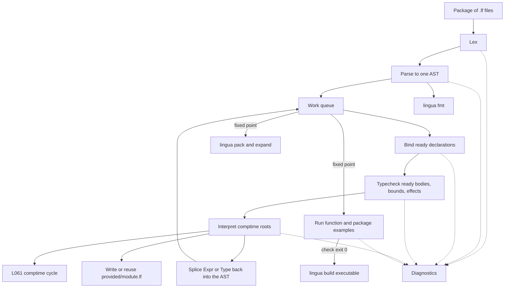
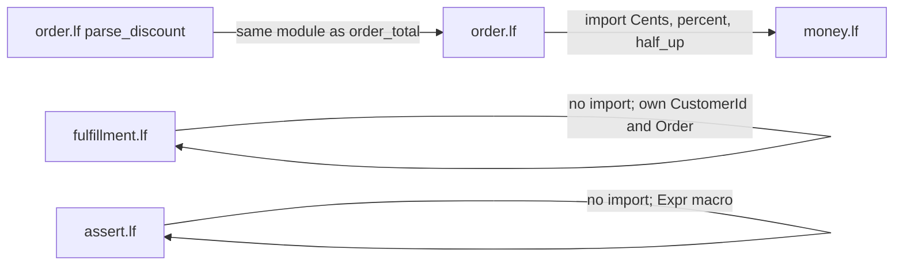
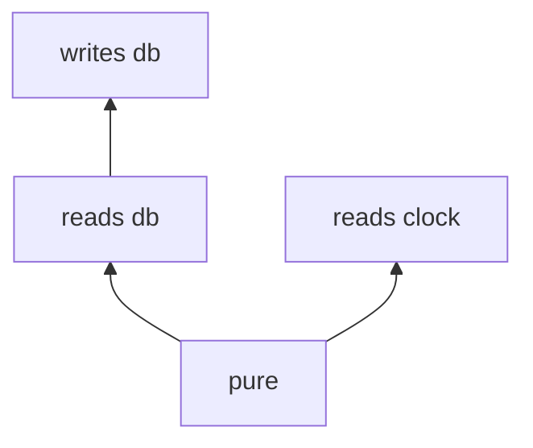

# Lingua 1

| | |
|---|---|
| **Document** | Lingua language design, version `lingua1` |
| **Author** | placeholder |
| **Date** | 2026-10-22 |
| **Status** | Draft |
| **Audience** | Senior engineers implementing the checker, interpreter, formatter, packer, and `lingua build` driver |

This document is the normative specification of Lingua 1. A program that parses under [Normative Grammar](#normative-grammar) and passes the type, effect, comptime, and example rules below is a legal `lingua1` program. The programs in [Normative Programs](#normative-programs) are the acceptance corpus. Source files use the extension `.lf` (lingua franca). The language name stays Lingua.

The checker, interpreter, and assembler are this Cargo package. The crate name is `lingua`, and the compiler is written in Rust. Programs in the language use the `.lf` extension.

---

## Overview

Lingua is a small language aimed at code that a language model writes and a checker immediately accepts or rejects. Humans read the same syntax. The surface stays inside the Python/TypeScript prior: `fn`, `match`, `->`, `List<T>`, double-quoted strings, and block closers spelled `end`. There is one grammar. A denser or minified spelling is a non-goal. SimPy and Token Sugar show that shortening a familiar syntax saves roughly 10–15% tokens and does not, by itself, stop incorrect programs. Lingua spends those tokens on rails a checker can reject: a required example above every function body, nominal types that block same-representation swaps, bounded integers in the Ada sense, closed matches, effect declarations, and `Result` for failures the program is designed to handle. Unrecoverable bugs are `assert` and `fail`, which are not `Result` and have no `catch`. The full pure language also runs at compile time: `const`, type bounds, package examples, macros that return `Expr`, and generative type bodies.

A file is one module. The source root is one package: a directory of `.lf` modules, with no package manager and no `package` keyword. Generation order inside a function is fixed, and the parser rejects a function that skips a slot: name and typed parameters, return type, effect, at least one `example`, then the body, then `end fn <name>`. Those examples sit above the body so they are still in the context window while the body is generated. The compiler runs them. Zero function examples is a syntax error. A package may also contain top-level `example` blocks; zero of those is legal. Imports name a binding and a module key only; the callee's real signature lives in the defining module and is pasted into the model prompt by a separate context packer, not by the grammar.

---

## Background & Motivation

Models generate Lingua the way they generate Python or TypeScript, then a checker runs before the text is trusted. Three results bound the design:

- Minifying a familiar grammar (SimPy, Token Sugar) reduces tokens but leaves an incorrect program looking like a shorter incorrect program.
- Prose constraints that the checker cannot execute do not measurably raise compliance (the compact-constraint encoding study). Lingua therefore has no `intent "..."` clause. An example's label is a diagnostic string. The input row and the expected result are the constraint.
- Bounded discrete types, as in Ada, catch index and range mistakes statically when the bounds are static, and force an explicit check when they are not. That is a headline feature, not a refinement footnote.

Today there is no Lingua grammar, checker, or toolchain. The pain this design removes is the one that shows up when a model edits a function it can no longer see the specification of: examples drift below the fold, imports repeat signatures that rot, `Int` arguments swap, partial matches compile, and bounds failures become panics. Each of those is a diagnostic in `lingua1`.

---

## Goals & Non-Goals

### Goals

- One concrete grammar a recursive-descent parser can implement, covering every construct in the normative programs.
- A checker that rejects: missing function examples, closer mismatches, unknown imports, implicit narrowing, non-exhaustive matches on closed types, effect violations, `while` loops that do not assign the scrutinee, positional calls that could swap same-typed arguments, comptime cycles, runtime values in comptime contexts, and example failures.
- Bounded integer subtypes with static rejection of bad literals, implicit elimination to a wider bound or to `Int`, and explicit checking conversions that return `Result`.
- Nominal types, including unbounded `type CustomerId = Text`, so same-representation values do not interchange.
- Expected failures as `Result<T, E>`. Unrecoverable bugs as `assert` / `fail`, with no `catch`. No null. No implicit truthiness.
- An interpreter inside the compiler for comptime values, const initializers, generative types, macro splices, and examples. `lingua build` then emits the runtime residue as one executable, static by default where the OS allows it.
- Diagnostics with a stable code, one issue each, a source span, a one-line summary, and `help:` on `L002`, `L003`, `L010`, `L011`, `L016`, `L021`, `L028`, `L031`, `L032`, and `L069`. `L016` help prints the source root. Exceptions use one span-and-message shape in the interpreter and in the native binary.
- A formatter, a context packer, and `lingua expand` (`lingua fmt`, `lingua pack`, `lingua expand`) with the CLI in [API](#api--interface).

### Non-Goals (lingua1)

- A second, denser grammar, or a minified spelling of the same tree.
- An `intent` sentence, docstring contracts, or comment-as-spec. `//` comments are ignored by the checker.
- Signature-bearing imports. Qualified paths (`money.percent`). A package manager. Directory module keys (`"shop/money"`).
- Indentation as syntax. Semicolons. Automatic semicolon insertion. Backslash line continuations.
- User-defined generic types, Hindley–Milner inference, inheritance, reader macros, `macro_rules!` syntax, operator overloading, implicit numeric conversions other than the elimination and adoption rules in this document. A macro is an ordinary function that returns `Expr`, not a second grammar.
- Maps, fixed-size arrays, floating point, modular (wrap) integers, Ada `range <>` unconstrained array formals, multi-payload variants (use a product as the one payload), variant payloads with field names.
- Boolean `and` / `or` / `not`. Compound `/=` and `%=` (only `+=` exists). Range patterns. Trailing closures. `else if` as a distinct form (nest `else` and `if`).
- Effect rows (`reads db` and `reads clock` on the same function). More than one operation on a resource. Exporting or importing resources.
- Shadowing. Private visibility. Mutual recursion across modules (intra-module recursion is allowed).
- Exceptions, panics, or null as the response to a bounds failure. `Cents(n)` does not throw. Silent two's-complement wrap. `catch`, `throw`, and `raises`. Using `assert` for a missing row or a down network that the program is designed to handle.
- A separate `comptime fn` form, or inferring comptime because a runtime `let` happens to be foldable. Demoting a comptime context to runtime.
- Foreign shared libraries and FFI. Dynamic linking in lingua1 means the system C library only. A conformance mode that re-runs examples as native code. Baking the link mode into the grammar.
- A second compiler implementation beside this Rust crate.

---

## Key Decisions

**Example before body.** The parser accepts a function only in the order: header, effect, one or more `example` blocks, body, closer. Examples are still in context when the model emits the body. The compiler executes them, so the rail is not a comment. Zero examples is `L001`, not a later lint. A coverage lint may ask for more later; the grammar requires one. The one exception is the file-level entry `fn main`, which may have zero examples. Its body is the whole program, so an example would run the program under example fuel. `lingua build` is what runs it. An example written on `main` still runs.

**Keyword `example`, not `ex`.** The label is a string used only in diagnostics (`example "two cups" expected 1000 got 500`). The prose does not constrain behavior. Each parameter is bound by name. `->` introduces exactly one expected result. There is no assertion library and no `intent` clause, because non-executable prose does not buy compliance.

**Named file-level closers.** `end fn line_subtotal`, `end type Line`, and `end resource db` repeat kind and name. The name is a checksum: `end fn parse_discount` closing `line_subtotal` is `L002` at the closer. This is verbose and was kept on purpose. It is the cheapest token that catches a model closing the wrong declaration after a long body.

**Bare inner `end`.** `example`, `if`, `match`, `for`, and `while` close with `end` only. The kind on a file-level closer is what distinguishes declarations; inner blocks do not need a second checksum. Indentation is not the grammar. If indent and `end` disagree, `end` wins and the formatter repairs indent.

**Imports carry no signature; a context packer does.** The source form is `import percent, half_up from "money"`. The defining module is the only signature. The packer (`lingua pack`) is not a compiler phase and does not rewrite source. It prints the real signatures into the prompt. The checker still typechecks the call and quotes the real signature in the diagnostic. Rejected alternative: an import line that repeats the callee type. That line duplicates the defining module, rots, and fights the Python/TypeScript prior.

**Nominal types.** `type CustomerId = Text` and `type Cursor = Text` do not unify. A string literal adopts the expected nominal text type, so samples stay short. A `Text` variable does not. The same rule separates `type Cents = Int at least 0` from a different nominal type with the same range, and from the anonymous bound `Int at least 0`.

**Bounded subtypes and checking narrowing.** A bounded integer type has base `Int` and an inclusive range. `at least N` means `N through INT_MAX`, not an infinite integer. Values of the subtype eliminate implicitly to any wider anonymous bound and to `Int`. The reverse is not implicit. Checking introduction is `int_in` / `int_at_least`, both returning `Result<_, BoundsError>`. Literals outside the expected range are `L024` at compile time. `+` and `*` of non-negative operands synthesize `Int at least 0` and may adopt an expected nominal type whose range contains that result (`Cents`). `-` always synthesizes `Int`. `/` and `%` by a positive divisor may synthesize a bound from the operand ranges. `max(a: 0, b: expr)` restores a lower bound of `0`, which is why `order_total` can return `Cents` without a runtime check. Overflow of the implementation integer is a fault, not wrap and not `Result`.

**Closed match.** A match on a sum declared in the program, or on prelude `Result` or `BoundsError`, requires every variant. `_` on those types is `L032` and the diagnostic lists the variants. `_` is legal on open scrutinees: `Text`, `Int`, integer bounds, and lists. List patterns are exact-length. No fallthrough. First match wins.

**`let` / `var` / `set`.** `let` is the runtime immutable binding. It binds once. A second binding of the same name anywhere in the enclosing scope chain is `L013`. No shadowing in lingua1, including pattern bindings, parameters, and prelude names. `var` is the only mutable binding. `set` assigns to a `var`. `set x += e` is the only compound assignment and is sugar for `set x = x + e` in a checking context of `x`'s type. `set` on a `let` is `L014`. `const` is not a `let`: it is the comptime binding, legal at file level and inside functions, and it is specified with comptime below.

**`while` assignment.** `while name is Variant(pattern)` is the only `while`. Every path that returns to the condition must `set` that name. A path that `return`s (including `or return`) does not. Missing assignment is `L030`. This is a generation rail, not a termination proof. Fuel is the backstop.

**Positional calls only when parameter types are pairwise distinct.** Names are always allowed, including on `fs.read` (`path:`) and `catalog.columns` (`table:`). If two parameters have the same type, those arguments must be named. The formatter preserves names the author wrote and never invents or drops them. Evaluation is left to right in source order. This is why `db.open_orders(customer, after: cursor)` may mix a positional `CustomerId` with a named `Cursor`, and why `max`, `split`, and `join` in the normative programs pass same-typed arguments by name. `fs.read("openapi.json")` and `catalog.columns("orders")` stay legal because each has one parameter.

**Effects.** A function has exactly one of `pure`, `reads <resource>`, `writes <resource>`, or `reads clock`. `pure` may call only `pure`. `reads R` may call `pure` and `reads R`. `writes R` may call `pure`, `reads R`, and `writes R`. `reads db` and `reads clock` do not mix; pass `now` into the pure or `reads db` logic. `log` is ambient, returns `Nothing`, and must not be observable to Lingua code. Clock is not ambient.

**`Result` and `or return`.** Expected failures are values. `e or return` propagates `Err` only when the error type equals the enclosing function's error type. `e or return expr` evaluates `expr` only on `Err` and returns it; `expr` must have the function's return type. That is the mapping form (`or return Err(BadQuantity)`). Bare `or return` across different error types is `L026`. Both forms are sugar for `match`. Bounds stay on this channel. `assert`, `fail`, and `or fail` are a separate unrecoverable channel: no type, not an effect, no `catch`. An example that expects `Err(...)` does not match an exception.

**Diagnostics.** One issue per diagnostic: code, one-line summary, span, and `help:` on `L002`, `L003`, `L010`, `L011`, `L016`, `L021`, `L028`, `L031`, `L032`, and `L069`. That is the same set as Goals and the diagnostics section. `L016` help prints the source root. The others list alternatives: a missing arm, a wildcard on a closed type, an unknown name, an unknown export, a bad closer, a non-unique positional parameter, a wrong arity, or an ambiguous package name. Codes are stable (`L001`). `lingua check --explain L001` prints the catalog text.

**One grammar.** File-level declarations, expressions, types, examples, and patterns are the EBNF in this document. The formatter and the packer are not second grammars. The packer does not parse a different import syntax.

**`Cents` lives in `money.lf`.** `percent` returns `Cents`, and `order.lf` imports `money`. Defining `Cents` in both files would create two nominal types or an import cycle. One definition, in the module that implements `percent`.

**`money.percent` is a primitive.** `part * of / 100` is not enough: `part * of` does not fit in `Int` when `of` is near `INT_MAX`, so the 64-bit `*` faults with `L040` before `/` runs. A loop that added `of`, `part` times, would also blow the example fuel limit on large `Cents`. The body is the keyword `primitive`, allowlisted to that one signature. The runner evaluates the math in this document with a wide intermediate. Untrusted `primitive` on any other function is `L049`. It cannot inject I/O.

**Implementation integer.** Signed 64-bit. `+`, `-`, `*`, `/`, and `%` have static type `Int` (then the bound rules may synthesize a tighter anonymous bound). `/` truncates toward zero. `%` has the sign of the dividend. The mathematical result must fit in signed 64-bit or the example faults with `L040`. No silent wrap. A zero divisor faults with `L076`.

**Upper bound of `at least`.** `Int at least N` is `N through 9223372036854775807`. There is no infinite integer in lingua1.

**No shadowing, monomorphic user code.** Prelude functions may be polymorphic (`join`, `length`). User functions and user types are monomorphic. The checker is bidirectional against declared types. It is not a unification engine. Empty list `[]` does not synthesize; it only checks against an expected element type.

**One file, one module, no import cycles.** The source root is a package of `.lf` files. `"money"` resolves to `{source_root}/money.lf`. There is no package manager. An import cycle is `L015`. A comptime value that depends on itself is `L061`, not a hang.

**`.lf`.** The extension is lingua franca. The language name is Lingua. Tools discover modules by `*.lf` directly in the package directory. They do not treat `provided/` as more modules.

**Package-level examples.** A top-level `example "label"` is a sibling of `fn`, `type`, `const`, and `resource`. It is not nested in a function. Statements are optional. `->` is one `Bool` check that must evaluate to `true`, or `-> exception "..."` when the block is required to abort. Zero package examples is legal. They run after the package is bound, so they may call functions declared later in the file or exported by any other module in the package. They are a comptime context. Functions still require one example before the body.

**Comptime is a use-site marker, not a function subset.** Every ordinary function is callable at compile time and at runtime. There is no `comptime fn`. `comptime next_pow2(100)` evaluates on the interpreter and yields a constant. A call without `comptime` is runtime. The compiler does not infer comptime from a runtime `let`. Type bounds, generative type bodies, `const` initializers, both kinds of `example`, package `comptime` blocks, and the body of a function that returns `Expr` or `Type` are comptime contexts. `comptime` written there is redundant, not an error. A comptime context never demotes to runtime: `const n = next_pow2(input)` is `L060` when `input` is runtime. `let` is the runtime immutable binding. Inside an ordinary function, `const folded = next_pow2(100)` or `let folded = comptime next_pow2(100)`. `const` is legal at file level and inside functions. A file-level `const` is exported. `const` does not bypass effects. A function that returns `Expr` or `Type` is not callable at runtime (`L063`) and is not copied into the residue except as the spliced tree.

**Interpreter, then a separate native driver.** `lingua check` parses one AST per package and interleaves bind, typecheck, comptime evaluation, and splice until a fixed point, then runs examples. Fuel is 100_000 steps for each comptime root, provider, and example. `lingua build` runs that check, then the native backend emits the runtime residue as one executable with the Lingua runtime linked in. Like Go, the default is static where the OS allows it (Linux). `lingua build --dynamic` links against the system C library instead of making raw system calls. darwin binaries always link `libSystem`, because macOS supports nothing else. There is never a shared Lingua library. The process starts at file-level `fn main() -> Nothing` or `fn main(process: Process) -> Nothing` (`pure` or `reads clock`). Any other parameter list, or any other return type, is `L075`. Zero mains, or more than one, in the link set is `L074` and no binary is written. A `main` with the wrong signature still counts toward `L074`. Code generation is a hand-written assembler: the compiler emits one generic instruction form, and a Rust table per architecture encodes it, in the style of the [Go assembler](https://go.dev/talks/2016/asm.slide). There is no LLVM and no system assembler on the core path. v1 does not re-execute examples on the native binary. Exceptions still use one span-and-message shape so a later backend cannot invent a second report.

**Type providers.** A type body may be fields, variants, or a comptime program that returns `Type`. `reads net`, `reads catalog`, and `reads fs` are legal on that body and on a file-level `const`, and the interpreter performs them during `lingua check`, `lingua expand`, `lingua pack`, and the check inside `lingua build`. They are not legal on ordinary functions. `reads db` remains the user-resource effect. Function examples still inject scripts and do not call production. The expansion is real AST. `lingua expand` prints it and `lingua pack` includes it. `check`, `expand`, `pack`, and the check inside `build` share one cache policy and write `{source_root}/provided/<module>.lf` when they run an effect. `--refresh` reruns effects. `--offline` fails with one `L071` per generated declaration that has no cache entry.

**Macros return `Expr`.** No reader macros and no `macro_rules!`. The call is `comptime assert_nonzero(total)`. An `Expr` parameter is the caller's AST, not the evaluated value. The interpreter splices the result before typechecking the surrounding body. Hygiene is the default. `quote` / `unquote` build nodes the grammar already has. A splice that is not one of those nodes is `L064`.

**Two failure channels.** `Result` and `or return` stay the value channel, including bounds via `int_in` / `int_at_least`. `assert cond, "message"`, `fail "message"`, and `e or fail "message"` are the exception channel: no type, not an effect, no `catch`. An example matches a fatal path with `-> exception "message"` and does not match it with `-> Err(...)`. Overflow stays `L040`. A zero divisor stays `L076`. Fuel exhaustion stays `L042`. None of them is catchable.

---

## Proposed Design

### Compilation pipeline

The pipeline is not a straight line. Parse produces one AST for the package. Bind, typecheck, comptime evaluation, and splice interleave, because a bound or a spliced body can depend on a value that does not exist until it runs. Examples run only after that work reaches a fixed point. `lingua fmt` stops after parse. `lingua pack` and `lingua expand` use the fixed point and do not need `lingua build`. `lingua build` is a separate driver: it runs `check`, then emits a native binary. The packer is not a phase of `check`.



**Work items.** After parse, the queue holds every file-level declaration and every package example. An item becomes ready when the names it needs are bound and, if those names are consts, generative types, or macro splices, their values are already in the AST.

| Item | Becomes ready when | Doing it |
|---|---|---|
| Bind a declaration | Imports of its module are bound | Resolve names that do not depend on a generative type. A reference to a generative type waits. |
| Typecheck a function, const, or alias bound | Callee signatures and named types are known. Macro calls in the body are spliced. | Ordinary type rules. A comptime context that still contains a runtime name is `L060` immediately, not a guess. |
| Evaluate a const, a bound, a generative body, or a `comptime` call | Every name it reads has a comptime value | Interpreter, fuel 100_000. Result replaces the expression or fills in the type. |
| Splice a `comptime` call whose type is `Expr` | The callee is typechecked and the argument ASTs are parsed | Replace the call with the returned tree before typechecking the parent. |
| Run examples | The queue has no ready item and no waiting item | Function examples, then package examples, source order. |

**Cycle rule.** Each evaluation records the item on a stack. Re-entering an item already on that stack is `L061`. The diagnostic lists the stack from the outermost const, bound, provider, or splice to the repeated one. The checker does not wait and does not retry that cycle. Fuel is a separate limit inside one item: a loop that is not a cycle still dies with `L042` at 100_000 steps.

**Fixed point.** The queue is done when every item is finished or diagnosed. A finished generative type is ordinary product or sum AST. A finished splice is an ordinary expression or statement. Downstream items then become ready. If an item is waiting and nothing else is ready, and the stack is empty, the remaining names are `L011` (or `L061` if the wait set points at itself).

If parse or the fixed point emits any diagnostic for a module, examples in that module do not run. Other modules still check. Example failures are diagnostics and do not suppress other examples in the package.

`lingua pack` and `lingua expand` branch from the fixed point. They do not require example success. A broken body still packs. `lingua build` runs only when `check` exits 0, and that exit includes the examples. It compiles the runtime residue: function bodies, with comptime calls and generative types already replaced by constants and ordinary types. It does not re-run examples. The v1 backend emits one executable. The Lingua runtime (value representation, `assert` / `fail` printing, overflow faults) is linked in. The binary never needs a shared Lingua library. It is static by default on Linux. `--dynamic` links the system C library, and darwin always links `libSystem`. Static versus dynamic is not syntax. The backend is specified in [build.md](build.md).

**Provider cache flags.** `check`, `expand`, `pack`, and the check inside `build` use the same policy. Default: reuse a cache entry when the file already contains that declaration; otherwise run the declared effect and write the cache. `--offline` never runs an effect; each missing declaration is `L071`. `--refresh` reruns effects and replaces the cache. `--refresh` together with `--offline` is exit 2. `pack` writes the cache when it runs an effect. It does not default to offline.

Formatter input is the parse tree before splice. It does not need types. A file that does not parse is not formatted. `lingua fmt` does not expand providers.

**Stage dumps.** The lex and parse outputs each have a text form that is a full record of that stage:

| Stage | Command | File | Form |
|---|---|---|---|
| Lex | `lingua lex FILE` | `.tokens` | One token per line: `line:col Kind(payload)`. The `Eof` token is omitted. |
| Parse | `lingua parse FILE` | `.ast` | One S-expression for the untyped AST of the file, in the form below. Spans are omitted. |

The `.ast` form:

- A node is `(head child ...)`. The head is a short kebab-case name for the node kind (`fn`, `let`, `or-return`, `ok-pat`), defined in `src/ast/dump.rs`, and children follow in [Untyped AST](#untyped-ast) field order.
- Every AST `String`, names included, is a double-quoted string escaped with `\"`, `\\`, `\n`, and `\t`. A bare atom is therefore always a head, a tag, `true` / `false`, an integer, or `nil` for an absent option. Names are quoted because `nil` is a legal `ident`.
- A list field is `(label item ...)`: `(params ...)`, `(args ...)`, `(then ...)`, `(else ...)`. When a list is a node's only payload, its items follow the head directly: `(text ...)`, `(statements ...)`, `(stmt-arm ...)`, `(list-pat ...)`.
- Tags are bare atoms. Effects are `pure`, `reads-clock`, `reads-net`, `reads-fs`, `reads-catalog`, `(reads "db")`, and `(writes "x")`. Operators are `add sub mul div rem eq ne lt gt le ge`. `Set` ops are `assign` and `add-assign`. Arm kinds are `expr-arms` and `stmt-arms`. Resource ops are `read` and `write`. A function body is `primitive` or `(statements ...)`. An expectation is `(value e)` or `(exception "m")`. Text parts are `(literal "...")` and `(hole e)`.
- The `broken` flag is a trailing `true` or `false` on `list` and `call`. An argument is `(arg "name" e)`, or `(arg nil e)` when it is positional.
- A node prints on one line when it fits in 80 columns. Otherwise the head and its leading atoms stay on the first line, and each remaining child goes on its own line, indented two spaces.

```lisp
(match (name "r")
  (arms
    (arm (ok-pat (bind "n")) (stmt-arm (return (name "n"))))
    (arm (err-pat (wild)) (stmt-arm (return (int 0)))))
  stmt-arms)
```

Each dump keeps everything the next stage reads. A `.tokens` file can feed the parser instead of re-lexing, and an `.ast` file can feed bind, typecheck, the interpreter, or `build` instead of re-parsing. This makes a stage testable on its own: golden tests compare a dump against a checked-in file, and a later phase can start from a hand-written `.ast` fixture. A tree read from an `.ast` file has no source positions, so its diagnostics have no span. lingua1 does not ship a reader for either form. The lossless rule exists so that one can be added later without changing the format.

**Source generation.** The front end runs in both directions. Each inverse goes back exactly one phase, so source generation is unparse followed by unlex:

```text
forward:  source --lex--> tokens --parse--> untyped AST
inverse:  untyped AST --unparse--> tokens --unlex--> source
```

| Inverse | Input | Output | Round trip |
|---|---|---|---|
| unparse | untyped AST | A token list in the [Formatter](#formatter) layout. unparse picks the line breaks and indent and gives each token its `line:col`. `broken` lists and calls get one element per line. Closers are generated: `end fn <name>`, `end type <name>`, or `end resource <name>` from the declaration, and bare `end` for every inner block. | `parse(unparse(a)) == a`, ignoring spans |
| unlex | token list | Source with each token's lexeme placed at its `line:col`, and line breaks from `Newline` tokens. Strings are re-escaped. | `lex(unlex(t)) == t` |

Layout belongs to unparse, and unlex makes no layout choices. That keeps unlex the exact inverse of lex for any token list, whether it came from lex, from unparse, or from an edit. The AST stores no closer. A tree that parsed already passed `L002` and `L003`, so the opener alone fixes the closer.

Neither inverse is byte-identical to the original file. Comments are not tokens and are not AST, so both inverses drop them. unlex also drops trailing whitespace, and it may spell a string escape differently than the author did. unparse also drops blank lines and the author's indentation. The round trip is the contract, and the composition holds too: `parse(lex(unlex(unparse(a)))) == a`, ignoring spans. These properties are tests: every lex and parse golden fixture also checks its round trip. Source generation lets a tool or a model edit a token list or a tree, then print source that the forward stages accept. With a dump reader, it also turns a hand-written `.tokens` or `.ast` file into `.lf` source.

### Module and file model

One file is one module. The module key is the file stem. There is no `module` keyword.

| Import string | Resolved file |
|---|---|
| `"money"` | `{source_root}/money.lf` |

The string must be one `ident` spelling: a letter followed by letters, digits, or `_`, or `_` followed by at least one letter, digit, or `_`. A lone `"_"` is `L016`. Anything else, including `"/"` or `"."`, is `L016`. The stem must equal the key.

**Source root.** One rule. Unless `--source-root` is set, walk upward from the file or directory argument looking for `lingua.toml`. A toml found on that walk makes its directory the root. If no toml is found and the flag is absent, the root is the directory that contains a file `PATH`, or the directory `PATH` itself. Several `PATH`s that imply different roots are a usage error (exit 2). `--source-root` overrides the walk and is the root for every `PATH`.

Every `PATH` must be that root directory, or a `*.lf` file directly in it. A file in a subdirectory, a directory that is not the root, or any path outside the root is `L016` with summary `path is outside the source root`. The `help:` line prints the root. The tool does not recurse. `provided/` is not scanned and its files are not modules.

`lingua.toml` is optional. A present `version` other than `lingua1` is `L050`. Absence of `version` means `lingua1`. The other legal keys are `[db] url`, a string read by `catalog.columns`, and `[net] allow_non_public`, a boolean. Absence of that boolean means false. Any other key is `L050`.

```toml
version = "lingua1"

[db]
url = "postgres://localhost/shop"

[net]
allow_non_public = false
```

**Package.** Every `*.lf` file directly in the source root is a module of that package. Subdirectories other than `provided/` are not modules in lingua1 (`L016` if an import uses a slash; the directory is not scanned). `provided/` is the provider cache, not a set of importable modules. A directory argument that is the root lists those `*.lf` files in lexicographic path order.

**Exports.** Every file-level type name, variant constructor, function name, and file-level `const` is exported. Resource names are not exports. `import db from "fulfillment"` is `L010`, and the help list omits `db`. Package-level lookup does not see resources, so `L069` does not consider them. Same-module effects still see the resource declared in that module. `provide` names are exported types of the module that contains the comptime block. There is no private. Importing a sum type also binds its constructors. Importing a constructor by itself is legal (`import half_up from "money"`). Importing both `Rounding` and `half_up` binds the same constructor once and is not a duplicate. Importing the same name twice is `L017`.

**Cycles.** Imports form a DAG. The checker depth-first searches imports, records the stack, and emits `L015` with the cycle (`order -> money -> order`). Type-only cycles are still cycles. Functions in one module may be mutually recursive. Declaration order inside a file does not matter.

**What a body may call.** Parameters, locals, pattern bindings, file-level functions, consts, and constructors of the current module, names imported into this file, prelude names, and operations of a resource that the function's effect puts in scope. Nothing else. Same-module calls are required (`order_total` calls `line_subtotal`); they are not "imports." A package-level `example` or package-level `comptime` block may also call any exported name of any module in the package, without an import. If two modules export the same name, that use is `L069` and lists both files. Function bodies do not get this package-wide view.

**Prelude collision.** A file-level declaration whose name is a prelude name is `L017`. Prelude is not a file and cannot be imported.



`parse_discount` lives in `order.lf` with `Discount`, so the sample does not import `Discount`. `fulfillment.lf` does not share `Order` with `order.lf`. The two `Order` types are different nominal types in different modules. `CustomerId` in `fulfillment.lf` is not `CustomerId` anywhere else.

### Name resolution

Collect every file-level declaration and every import, then bind bodies.

Visible names, from innermost scope outward:

1. Pattern bindings of the current arm or `while`, `for` index or element, `let` and `var` of the current block.
2. Parameters of the current function.
3. File-level names of the current module: functions, types, constructors, file-level consts, and `provide` names. A resource name is visible in that same module and is not an export. Its operation is in scope only under the matching `reads` or `writes` effect.
4. Imports.
5. Prelude.

A package-level `example` or a package-level `comptime` block adds one outer step: any exported name of any module in the package. Resource names are not on that step. If two modules export the same name, `L069` lists both files. Function bodies do not take that step.

A binding is illegal if that name is already visible in any outer scope of the same function, in the module, in imports, or in the prelude (`L013`). This includes binding `text` twice, binding a parameter name with `let`, and using `trim` as a pattern variable. Scopes of distinct `example` blocks do not see each other or the body. The body does not see example bindings.

An unknown name is `L011`. The `help:` line lists every name visible at that scope. The list is small (prelude is fixed; user modules in the samples export a handful of names). Cap the printed list at 64 names; if more are visible, print 64 and the count of the rest.

An unknown field or resource operation is `L011` and lists the fields or operations.

### Lexical structure

Source is UTF-8. A BOM (U+FEFF) is `L004`, as is any other bad byte sequence. Identifiers are ASCII. Strings hold Unicode scalar values with no normalization.

**Layout.** Space and tab separate tokens and are otherwise ignored. They are not indent tokens. Newline (`\n`, `\r\n`, or `\r`) is a token. A `//` comment runs to the end of the line and does not consume the newline, so a comment does not glue two lines into one statement. Comments are not attached to the AST for checking. The formatter preserves their text.

**One statement per line.** A newline ends a simple statement. A newline does **not** end a construct while `()` or `[]` are unbalanced, nor while a `match` arm block or a `fn` / `type` / `if` / `for` / `while` / `example` / `resource` / `comptime` block is open. Extra newlines between statements, between example blocks, and before a function body are layout, not a new statement: the grammar's `stmt-seq` and the `{ newline }` around `fn-tail` accept them, and `lingua fmt` keeps exactly one blank line before the body or `primitive` and no other blank line inside a declaration. An example binding may put the expression on the following lines: newlines between `:` and the expression are ignored, which is what makes the pagination script parse. Inside `quote` `( )` only, newlines are not ignored. Newlines before the quoted statement or expression are skipped. A quoted statement keeps its own terminating newline, and a missing newline before `)` is `L001`. Newlines after that statement and before `)` are skipped. There is no backslash continuation. Newlines inside `<>` are `L001` (type arguments are one line). A newline inside a string or an interpolation hole is `L004`. The parser records whether a list literal or a call contained a newline; the formatter uses that bit and does not invent new breaks.

**Keywords.** Case-sensitive. An identifier with keyword spelling is not an identifier.

```text
assert at catalog clock comptime const else end example exception fail false fn
for from fs if import in int_at_least int_in is least let match net
nothing or provide pure quote reads resource return set through
true type unquote until var while writes
Ok Err
```

`Ok`, `Err`, `nothing`, `true`, `false`, `clock`, `catalog`, `net`, `fs`, `int_in`, and `int_at_least` are keywords so user code cannot shadow them. `half_up` is not a keyword. `log` is a prelude name, not a keyword. `comptime`, `const`, `assert`, `fail`, `quote`, `unquote`, `provide`, and `exception` are keywords.

**Identifiers and `_`.** A lone `_` is the wildcard lexeme, not an identifier. An identifier is either `letter (letter | digit | "_")*` or `_` followed by at least one letter, digit, or `_` (`_foo`, `__`). `letter` is `A`–`Z` or `a`–`z`. The lexer classifies keywords before returning `ident`. A module key is that same `ident` spelling inside the import string, so `"_"` alone is `L016` and `"_money"` is the file `_money.lf`. The wildcard token and the module key do not share a production: one is a lexeme, the other is string contents.

**Integers.** A digit string whose value is outside `0` through `INT_MAX` (`9223372036854775807`) is `L005` at the token. No hex, no underscores, no leading `+`. Negative values are unary `-` in expressions and an optional `-` in the bound literal syntax. `INT_MIN` (`-9223372036854775808`) is not a source literal. A digit string longer than 20 characters is `L005` without computing a big integer. Leading zeros count toward those 20 characters, so a zero-padded in-range value whose token is longer than 20 characters is still `L005`.

**Operators and punctuation.** Longest match, except `>` is never joined into `>>`. Each `>` is its own token, so `List<List<Int>>` is two closes. `>=` is one token because `=` follows. `/` is a token unless another `/` follows. `//` is the longer match, so it starts a comment: `a/b` is three tokens and `a // b` is `a` followed by a comment.

```text
_ ( ) [ ] , . : + - * / % = -> += == != < > <= >=
```

`_` is one token. It is not punctuation that joins with a following ident: `_foo` is a single ident, and `_` with nothing after it is the wildcard.

`<` and `>` are always those tokens. The parser, not the lexer, decides type arguments versus comparison, by context: after a type atom, `<` opens type arguments; in an expression, `<` is a comparison. `>>` cannot occur as one token, so nested type arguments are deterministic in a recursive-descent parser.

**Strings.** Double quotes only. No raw strings, no single quotes, no multiline strings.

| Source | Meaning |
|---|---|
| `\"` | `"` |
| `\\` | `\` |
| `\n` | U+000A |
| `\t` | U+0009 |
| `{{` | `{` |
| `}}` | `}` |
| `{ cmp-expr }` | interpolation hole |
| any other `\` | `L004` |
| a lone `}` | `L004` |

A hole is parsed as `cmp-expr` (no `match`, no `or return`, no newline). Nested strings inside the hole are allowed. The hole expression must have a `Text` conversion or the typechecker emits `L022`:

| Type | Rendered text |
|---|---|
| `Int` and any integer subtype, nominal or not | decimal, no leading `+`, minus only if negative |
| `Text` | the text |
| nominal text (`CustomerId`, `Cursor`) | the underlying text |
| anything else | `L022` |

`log` uses the same conversion because its parameter is `Text`; the caller writes `"loaded {n} orders"` rather than passing an `Int` directly.

**Limits.** Source file size at most 1 MiB (`L047`). Parser nesting of `()`, `[]`, `match`, and `fn` at most 64 (`L047`). A list literal of more than 10_000 elements is `L047`.

### Operator precedence and associativity

Lowest precedence first.

| Precedence | Form | Associativity |
|---|---|---|
| 1 | `e or return` / `e or return m` / `e or fail m` | `or return` is tried before `or fail`. The operand of `or return` is a comparison-or-tighter expression (`cmp-expr`). The operand of `or fail` is an `expr`. `L068` then requires that operand to be a hole-free string literal |
| 2 | `==` `!=` `<` `>` `<=` `>=` | none; `a == b == c` is `L001` |
| 3 | `+` `-` (binary) | left |
| 4 | `*` `/` `%` | left |
| 5 | unary `-`, unary `comptime` | prefix; they do not stack. `-foo.bar` is `-(foo.bar)`. `comptime` binds tighter than `+` and `-`. Both together are written `comptime (-e)` |
| 6 | call, index, field | left |

There is no `and`, `or` (boolean), or `not`. Keyword `or` appears only in `or return` and `or fail`. `+=` is the only compound assignment. There is no `/=` or `%=`.

Evaluation of a call is left to right in source order, including named arguments written out of signature order, then the call. Binary operators evaluate the left operand, then the right, then the operation. `or return` evaluates the mapping expression only on `Err`. `or fail` evaluates the message expression only on `Err`. `if` and `match` evaluate one branch. `for low until high` evaluates both bounds once, on entry. A `comptime` call is not evaluated at runtime; the interpreter replaces it before the runtime residue is emitted.

### Implementation integer and overflow

`Int` is signed 64-bit, range `-9223372036854775808` through `9223372036854775807`.

The static type of binary `+`, `-`, `*`, `/`, and `%` on integer operands, **before** bound synthesis and adoption, is `Int`. Bound synthesis may replace that with an anonymous bound (next section). It never replaces it with `Result`.

Evaluation uses the mathematical value. If that value is outside signed 64-bit, the example faults with `L040`. The fault is not a Lingua value, not an exception the function can `match`, and not wrap. Unary `-` of a runtime value that does not fit (the only case is negating `INT_MIN`, which subtraction can produce: `(-9223372036854775807) - 1`) is the same fault.

`a / b` truncates toward zero. `a % b` has the sign of `a`, so `a == (a / b) * b + a % b` always holds. `7 / -2` is `-3` and `-7 % 2` is `-1`. `INT_MIN / -1` does not fit and is `L040`. `INT_MIN % -1` follows the identity and is the same `L040`.

A divisor of `0` in `/` or `%` faults with `L076`. It is the same class as `L040`: not a Lingua value, not an exception, and not matchable. A divisor that is the literal `0` (or `-0`) is `L076` at compile time, the same way `split` with the literal `""` is `L046` at compile time. Any other divisor is checked at run time.

Primitive `percent` does not use this 64-bit `*`; it uses a wide intermediate and only faults if the **final** `Cents` result does not fit, which it cannot when `of` is `Cents` and `part` is in `1 through 100`.

`L040` fails the root that overflowed: that example, or that comptime item. It is not an exception and not `Result`. It is the same class of implementation limit as fuel. Other examples still run. A comptime `L040` fails the check. A runtime `L076` fails its root the same way.

### Types

User code is monomorphic and checked bidirectionally.

- `check(e, T)` — `e` is allowed to be `T`.
- `synth(e)` — `e` produces a type without an expected type.

`return e` checks `e` against the function's return type. `let x: T = e` and `var x: T = e` check `e` against `T`. `let x = e` and `var x = e` synthesize `e`. `set x = e` checks `e` against the type of `x`. A call checks each argument against the parameter's type, so literals adopt. A function's return type is the declared type, not inferred from the body.

#### Sorts of types

| Type | Meaning |
|---|---|
| `Int` | implementation integer |
| `Text` | UTF-8 text |
| `Bool` | `true` or `false` only |
| `Nothing` | the type of `log` and of a diverging match used as a statement. Value `nothing` |
| `List<T>` | finite list, prelude |
| `Result<T, E>` | `Ok(T)` or `Err(E)`, prelude, closed |
| `BoundsError` | `OutOfRange` or `NotAnInteger`, prelude, closed |
| nominal product | `type Line ... end type Line` |
| nominal sum | `type Discount ... end type Discount` |
| nominal newtype | `type Name = Base` with optional integer bound |
| anonymous integer bound | `Int at least N`, `Int in L through U` |

`List` and `Result` are the only generic type constructors. Users instantiate them (`List<Line>`, `Result<Discount, ParseError>`). Users cannot declare `type Pair<T>`.

#### Ranges

Every integer type has an inclusive static range inside the implementation integer.

| Spelling | Range |
|---|---|
| `Int` | `INT_MIN through INT_MAX` |
| `Int at least L` | `L through INT_MAX` |
| `Int in L through U` | `L through U`, require `L <= U` or `L024` |
| `type Name = <one of the above>` | that range, plus a fresh nominal id |

`L` and `U` in a type, and the bounds of `int_in` / `int_at_least`, are comptime expressions (`bound-expr` in the grammar, the same precedence as a sum). They must fold to integers. A runtime name in that position is `L060`, and the diagnostic tells the programmer to add `comptime` or to move the value into a comptime context. The compiler does not infer comptime because a runtime `let` happens to be a literal. `comptime` written on a bound is redundant and legal, which is why `money.lf` spells `through comptime next_pow2(100)`. `Int at least n` for a runtime parameter `n` is `L060`. That is the unconstrained-form non-goal. Dynamic ends exist only on `for i in low until high`, which is not a type. Pattern literals stay `int-literal`: optional `-` plus a digit token, not an expression.

The base of a bound is `Int`. `Text at least 0` is `L020`.

#### Elimination and introduction

Write `S <: T` only for the implicit eliminations below. Nominal introduction is not `<:`.

| Judgment | When |
|---|---|
| `NominalInt(id, R) <: Anonymous(R2)` | `R` contained in `R2` |
| `NominalInt(id, R) <: Int` | always |
| `Anonymous(R1) <: Anonymous(R2)` | `R1` contained in `R2` |
| `Anonymous(R) <: Int` | always |
| `NominalText(id) <: Text` | always |
| `T <: T` | always |

Not implicit, ever:

- `Int <: Cents`, `Anonymous <: Nominal`, `Nominal <:` a different `Nominal`.
- `Text <: CustomerId`, `CustomerId <: Cursor`.
- Any integer `<:` `Text`, or the reverse.

**Literal adoption** (checking mode). An integer literal whose value lies in `range(T)` checks as `T`, including a nominal `T`. Unary `-` of an integer literal is the same form: the value is `-V`, the node may still be `UnaryNeg` of `IntLit` in the untyped AST, and `L005` still applies to the digit token alone. Outside the range is `L024`, including `CentsOff(-1)` and `Line("x", -1, 1)`. It is not `L023`. A string literal checks as `Text` or as any nominal text type, and becomes that type. It does not check as an integer.

**Flexible literals.** In synthesis mode an integer literal is `Int` with a singleton range `{V}`, unary `-` of an integer literal is `Int` with singleton `{-V}`, and a string literal is `Text`. Match-arm join (below) can still adopt. An arm `-> -1` waits the same way an arm `-> 0` waits.

**Checking a synthesized type `S` against expected `T`.**

1. If `S` is `T`, accept.
2. If `S <: T` by the table above, accept (elimination).
3. If the expression is one of the adoption forms below and the form's result range is contained in `range(T)` (equal, for `int_in` / `int_at_least`), accept and give the expression type `T`.
4. If `T` is nominal or a tighter bound and `S` is an integer type that is not a subtype, `L023` (implicit narrowing). The `help:` line names the legal forms: a literal, unary `-` of a literal, `int_at_least` / `int_in`, or `max` / `+` / `*` / `/` / `%` whose static range already fits. A literal or unary-minus-of-literal whose value is outside `range(T)` does not reach this step; it is `L024`.
5. Otherwise `L020`.

Adoption forms. The expression itself must be one of these, not a variable that happens to have the anonymous type:

| Form | Adopt `T` when |
|---|---|
| Integer literal `V`, or unary `-` of an integer literal (value `-V`) | the value is in `range(T)`; otherwise `L024`, not `L023` |
| `max(...)` | static result range contained in `range(T)` |
| `+`, `*`, `/`, or `%` | static result range contained in `range(T)` |
| `int_in` / `int_at_least`, optionally under `or return` | success range **equals** `range(T)` |

A variable of anonymous type `Int at least 0` does **not** check as `Cents`. The sample therefore writes `let c: Cents = int_at_least(...)`, so the `int_at_least` expression is in a checking context. A later `CentsOff(c)` sees a variable that is already `Cents`.

**Nominal text wrap.** For `type Name = Text` (no bound), `Name(expr)` is a total function. `expr` must check as `Text` (a nominal text eliminates). The result is `Name`. This is the explicit conversion from `Text` to `CustomerId`. It is not a bounds check and it does not return `Result`. A literal `"c1"` where `CustomerId` is expected does not need the wrap. `CustomerId(cursor)` is legal because `Cursor <: Text` and the wrap re-nominalizes; it is explicit, so it is allowed. There is no `Cents(expr)` form. Integer narrowing goes through `int_in` / `int_at_least` only.

#### Arithmetic

Ranges used here are the ranges of the operand types, not the ranges after elimination to `Int`. A literal operand contributes its singleton range.

| Operator | Static result |
|---|---|
| `+`, `*` | If both ranges are contained in `0 through INT_MAX`, anonymous `Int at least 0`. Otherwise `Int`. |
| `-` | Always `Int`. `Cents - Cents` is `Int`. |
| `/` | If the divisor range is the singleton `{k}` with `k >= 1`, anonymous `Int in L1 / k through U1 / k`. Else, if the dividend range is contained in `0 through INT_MAX` and the divisor range in `1 through INT_MAX`, anonymous `Int in 0 through U1`. Otherwise `Int`. |
| `%` | If the divisor range is contained in `1 through INT_MAX`, with upper bound `U2`: anonymous `Int in 0 through U2 - 1` when the dividend range is contained in `0 through INT_MAX`, and anonymous `Int in -(U2 - 1) through U2 - 1` otherwise. Otherwise `Int`. |
| unary `-` | `Int`, singleton range `{-V}` if the operand is literal `V`. |

lingua1 does not compute a tighter upper bound than `INT_MAX` for `+` and `*`. Non-negative `+` is exactly the range of `Cents`, so in a checking context of `Cents` the adoption rule applies and no runtime bound check is inserted. The 64-bit overflow check is still inserted. `Int at least 0` is a statement about the lower bound, not a proof that the sum fits in 64 bits.

In the `/` and `%` rows, `L1 through U1` is the dividend range and `L2 through U2` is the divisor range. A literal divisor `k` is the singleton `{k}`. `L1 / k` and `U1 / k` truncate toward zero. Truncating division by a positive `k` is monotone, so the bounds hold for every dividend in range. A non-negative quotient never exceeds its dividend. A remainder is smaller in magnitude than its divisor and has the sign of its dividend. So `n % 100` with `n: Cents` is `Int in 0 through 99`, `n / 100` is `Int in 0 through 92233720368547758`, and `x % 2` with `x: Int` is `Int in -1 through 1`. A divisor range that starts at `1` or above cannot fault with `L076` and cannot overflow, because `INT_MIN / -1` needs a negative divisor. lingua1 does not bound a negative divisor or a divisor range that contains `0`. Those are `Int`.

`==` and `!=` require the same type after literal adoption. No elimination. `Cents == Int` is `L034`. `CustomerId == Cursor` is `L034`. `CustomerId == "c1"` is legal: the literal adopts. The result is `Bool`.

`<`, `>`, `<=`, `>=` require integer types. If either side is a nominal integer type, the other side must be that same nominal type or a literal that adopts it. Two different nominals are `L034`. Anonymous bounds and `Int` compare with each other after elimination to `Int`. The result is `Bool`. Relational operators are not used by the normative programs; `==` on `Text` is.

There is no user-level `==` on lists, products, sums, or `Result`. The example runner has its own structural equality, which does cover those types. That equality is not an operator in the grammar.

#### `max`

Prelude signature, effect `pure`:

```text
max(a: Int, b: Int) -> Int
```

Both parameters have type `Int`, so both arguments are named at the call. Parameters accept any integer type by elimination. For the static bound, each argument contributes its range; a literal contributes a singleton, not `INT_MIN through INT_MAX`.

```text
range(max(a, b)) = max(La, Lb) through max(Ua, Ub)
```

capped to the implementation range. If the lower bound is `L > INT_MIN` and the upper bound is `INT_MAX`, `synth` yields anonymous `Int at least L`. If both ends are strictly inside the implementation range, `synth` yields `Int in L through U`. If the range is the full `Int` range, `synth` yields `Int`.

`return max(a: 0, b: sum - off)` with `sum - off : Int`:

- `a` has range `0 through 0`.
- `b` has range `INT_MIN through INT_MAX`.
- result range is `0 through INT_MAX`, that is `Int at least 0`.
- the `return` checks against `Cents`.
- adoption succeeds. No `Result`, no runtime lower-bound check.

`max` is commutative at run time. The static rule looks at both arguments, so `max(a: sum - off, b: 0)` restores the same bound. If neither argument has a lower bound above `INT_MIN`, the result is `Int` and returning it as `Cents` is `L023`.

This rule is what makes the cents-off example typecheck: `200 - 500` is the `Int` `-300`, and `max` with literal `0` restores `Cents`. It is also why `max` cannot be "just" `fn max(a: Int, b: Int) -> Int` with no extra judgment: that signature alone cannot produce `Cents`.

#### `int_in` and `int_at_least`

Special forms, not ordinary functions (the folded bound integers determine the success type). Keywords.

```text
int_in(source, L through U) -> Result<Int in L through U, BoundsError>
int_at_least(source, L)     -> Result<Int at least L, BoundsError>
```

`L` and `U` are comptime expressions that fold to integers, `L <= U`, else `L024`. A runtime bound is `L060`. `source` checks as `Text` or as an integer type (integer types eliminate to `Int`).

| `source` | Success | Error |
|---|---|---|
| `Text` parsing as an optional `-` and digits, value in the requested range and in `Int` | `Ok(value)` | |
| `Text` that is empty, has spaces, or is not that shape (`trim` is separate; these forms do not trim) | | `Err(NotAnInteger)` |
| `Text` or `Int` whose value is outside the requested range, or outside `Int` | | `Err(OutOfRange)` |
| integer literal already outside the requested range | compile-time `L024`, not a runtime `Err` | |

The success value inside `Ok` has the anonymous bound, not a nominal type. Nominal adoption happens only in checking mode when the ranges are equal, which is why the parser sample annotates `let c: Cents`.

`int_in(n, 1 through 100)` used as the payload of `Percent` does not need a nominal type: `Percent`'s payload **is** the anonymous bound `Int in 1 through 100`. `let p = int_in(...) or return ...` synthesizes that bound, and `Percent(p)` accepts it.

Even when the source range is statically contained in the requested range, the type of the form is still `Result`. One syntax, one result shape.

#### Lists, indexing, `length`, `join`

`length(list: List<T>) -> Int at least 0`, effect `pure`. One parameter, so the call is positional. The result is anonymous, not a nominal type.

`join(left: List<T>, right: List<T>) -> List<T>`, effect `pure`. Both parameters have the same type, so both arguments are named. `T` is instantiated from a side that synthesizes. `[]` does not synthesize. If one argument is `[]` and the other synthesizes `List<T>`, check `[]` as that list. If both are `[]`, `L020`.

Indexing `e1[e2]`:

- `e1` must be `List<T>`.
- `e2` must be an integer type.
- If `e1` is a list **literal** of length `N` and `range(e2)` is contained in `0 through N-1`, the type is `T`. No runtime check. A `const` index has the singleton range of its folded value. A `let` does not: there is no constant propagation through `let`, and a runtime `let` is not promoted to comptime.
- If `e1` is a list literal of length `N` and `range(e2)` is disjoint from `0 through N-1`, `L024`.
- Otherwise the type is `Result<T, BoundsError>`. Out of range at run time is `Err(OutOfRange)`, not a trap and not null. A wider index, including `Int` and `Int at least 0` against a dynamic list, takes this path. The programmer writes `or return` or `match`.

Bounded discrete types are legal index types. `type Ix = Int in 0 through 2` indexing a three-element list literal has type `T`. Indexing a runtime `List<T>` with `Ix` is still `Result`, because the list's length is not the bound of `Ix`.

#### Products, sums, `Result`

Products have one or more named fields, declaration order, type fixed in the `type` declaration. Construction uses the type name as a function whose parameters are the fields. Zero-field products are illegal. Field access `e.field` requires a product. Unknown field: `L011` listing the fields.

Sums have one or more variants. A variant has zero payloads or one payload type. Zero-payload variants are written bare (`NoDiscount`, `Done`, `half_up`, `Empty`). One-payload variants are written `Name(expr)` with exactly one positional argument and no parameter name (`More("p2")`, `Percent(10)`, `CentsOff(500)`, `UnknownDiscount(text)`). `Done()` is `L028` (wrong arity on a zero-payload variant). A payload that needs several fields is a product type used as the one payload.

`Ok(expr)` and `Err(expr)` always take one positional argument. In checking mode against `Result<T, E>`, `Ok` checks its argument as `T` and `Err` checks its argument as `E`. They synthesize only if the argument synthesizes and an expected `Result` is available; a bare `Ok(1)` with no expected type is `L020` (the error side, or the success side, is unknown). `return Ok(collected)` has an expected type from the function, so it synthesizes nothing and checks.

`[]` checks as `List<T>` for whatever element type is expected and does not synthesize. `[e, ...]` synthesizes `List<S>` if every element synthesizes the same `S`, with literal adoption against the first element that synthesizes a non-flexible type. `[Order("a"), Order("b")]` synthesizes `List<Order>`.

#### Match

`match` is an expression when every arm is an expression arm, and a statement when every arm is a statement arm. Mixing the two classes is `L001`.

- Expression arm: `pattern -> expr` on one line, `expr` not starting with `return`.
- Statement arm: `pattern -> return expr` on one line, or `pattern ->` and a statement block on the following lines.

Statement-arm blocks end at the next arm or at the match's `end`, not at an inner `end`. The arm-start predicate is normative and is the one place the parser backtracks: at a statement boundary inside a match, if `pattern "->"` parses, a new arm starts. See the grammar.

The scrutinee is evaluated once. Arms are tried in order. First success wins. No fallthrough. A binding in a pattern is immutable and scoped to that arm. Two bindings of the same name in one pattern are `L013`. A later arm that cannot match because a previous arm is `_` or covers the same constructor and the same literals is `L033`.

**Closed scrutinees.** Sum types declared in any module, plus `Result` and `BoundsError`. Every variant appears exactly once as the outermost pattern of some arm. `_` is `L032` and the diagnostic lists the variants, even if every variant is also listed. Missing variants are `L031` and the diagnostic lists the missing ones. Payload patterns are required in the sense that a one-payload variant is written `Name(inner)` or, if the payload is ignored, `Name(_)`. A zero-payload variant is written bare. `Name(_)` on a zero-payload variant is `L020`.

**Open scrutinees.** `Text`, `Int`, anonymous and nominal integer types, `List<T>`. `_` is legal. A match without `_` is `L031`, because lingua1 has no range patterns and list patterns do not cover every length. Help text: add `_`.

**List patterns** have a fixed length. No rest pattern. `["percent", n]` matches a list of length 2 whose first element equals `"percent"` and binds `n: Text`. `["none"]` does not match `["none", ""]` or `["percent", "10", "extra"]`. Those fall through to a later arm. Element patterns are whatever `pattern` allows: literal, binding, `_`, nested variant, nested list.

**Arm join** for expression matches. Each arm is synthesized, except flexible literals, which wait. Flexible literals are integer literals, unary `-` of an integer literal, and string literals. The non-literal arms must all synthesize the same type `T` (`L020` with both types if not). Waiting literals are then checked against `T`, and an integer value outside that range is `L024`. If every arm is a flexible literal and the match is in checking mode, the literals check against the expected type. If every arm is a flexible literal and the match is synthesized, the type is `Int` (integer literals, including unary `-`) or `Text` (string literals); mixing those is `L020`.

`let off = match discount ...` synthesizes. `percent(...)` and `c` both synthesize `Cents`, so `T` is `Cents`, and `0` is checked against `Cents`. `off` has type `Cents`.

**Statement matches** do not yield a value. Every path through every arm must `return` or diverge (`L012` on the arm that falls off). The parser sample's match is a statement match: every arm returns.

Matching a product or a `Bool` is `L020`. Use fields or `if`.

#### `or return`

`e` must synthesize or check as `Result<S, E1>`.

**`e or return`.** The enclosing function's return type must be `Result<R, E2>` with `E1` identical to `E2` (same nominal, same parameters). Otherwise `L026`, and the diagnostic prints both error types. The desugaring is TIR, not source. It is not a `match` the user writes, and it is not required to be derivable as an expression-arm or statement-arm match. The success arm is the payload expression. The `Err` arm is a `Return` of `Err` applied to that payload. See `TirArm` in the typed IR. The type of the expression is `S`. The payload binding is not a source binding; it cannot collide with user names.

**`e or return m`.** `m` is checked against the function's full return type and is evaluated only on `Err`. The original error is discarded. Same TIR shape: success arm is the payload, `Err` arm is `Return` of `m`.

User matches on `Result` are source, and they use the `"Ok" "(" pattern ")"` and `"Err" "(" pattern ")"` pattern productions. `Ok` and `Err` stay keywords.

`int_in(...) or return Err(BadQuantity)` uses this form because `BoundsError` is not `ParseError`. Bare `or return` there is `L026`. On `Ok`, the type of the expression is the success type, checked against the expected type of the `let` if there is one (`let c: Cents = ...` adopts).

`db.open_orders(...) or return` uses the bare form because both error types are `DbError`. The success type is `Page`.

#### `if`, bindings, loops

`if cond` checks `cond` as `Bool`. Anything else, including `Result` and `Int`, is `L027`. There is no implicit truthiness. `else` is optional. `if` is not an expression.

`let` and `var` without an annotation synthesize the initializer. With an annotation, they check it. A second binding of a visible name is `L013`. `set name = e` requires `name` to be a `var` in scope (`L014` if it is a `let`, a parameter, or a pattern binding). `set name += e` requires that and requires the variable's type to be an integer type (`L035` otherwise). It checks `name + e` against the variable's type, so `Cents += Cents` adopts `Cents` back.

`for x in e` checks `e` as `List<T>` and binds `x: T` in the body.

`for i in low until high` evaluates `low` and `high` once. Both must be integer types. If `high <= low`, the body runs zero times (a negative `high` does not fault). Otherwise `i` takes the values `low, low+1, ...` stopping before `high`. The type of `i`:

- `low` and `high` are literals `L` and `U` with `L < U`: anonymous `Int in L through (U-1)`.
- otherwise: anonymous `Int at least L0` where `L0` is the static lower bound of `low` if that bound is `>= 0` and `low`'s upper bound equals its lower bound (a literal); otherwise `Int`.

The normative shape `for index in 0 until n` therefore gives `index` the type `Int at least 0` when `n` is not a literal. The range is fixed on entry. Assigning a `var` that was read to compute `n` does not extend the loop.

`while name is Variant(inner)`:

- `name` is a `var` already in scope. It is not bound by the `while`.
- The type of `name` is a closed sum.
- `Variant` is a variant of that sum. `inner` binds the payload the same way a match arm would. A zero-payload variant is written `while name is Done`.
- The payload binding is in scope in the body and is immutable.

**Definite assignment.** On entry to the body, `name` is marked "not yet assigned on this path." `set name = ...` marks the path assigned. `return`, `or return`, `fail`, and `or fail` mark the path as exiting the function. `assert` does not: the condition may be true and the path continues. `if` requires every fall-through path to be assigned; an `if` without `else` that assigns only inside the `if` leaves the fall-through path unassigned. At `end`, every path that reaches `end` must be assigned. Otherwise `L030`, pointing at the `while` and naming the variable. Nested loops have independent marks. The assignment must be of that variable, not merely a call that might assign it.

`for` has no assignment requirement. A `while` that assigns `next = next` typechecks and is stopped by fuel if it never leaves the variant.

#### Return paths

Every function whose body is statements (not `primitive`) must `return` or diverge on every path (`L012`). `fail` diverges. `or fail` diverges on `Err` and continues with the success value on `Ok`. `assert` does not diverge: a true condition falls through. A statement after a diverging statement is `L018`. A `match` statement in which every arm returns or fails makes the following statement unreachable.

Expression statements are legal only when the expression's type is `Nothing` (`L029`). `log(...)` is the prelude case. Discarding an `Int` or a `Result` is `L029`.

#### Worked check of `order_total`

`var sum: Cents = 0` checks literal `0` against `Cents`. In range. `sum: Cents`.

`set sum += line_subtotal(line)` desugars to `set sum = sum + line_subtotal(line)`. `line_subtotal` returns `Cents`. Both operands of `+` are non-negative, so `+` synthesizes `Int at least 0`. Expected type is `Cents`. Adoption applies.

`percent(p, sum, half_up)`: `p` is `Int in 1 through 100`, `sum` is `Cents`, `half_up` is `Rounding`. Three distinct parameter types, positional call, result `Cents`.

`CentsOff(c)` in the match yields `Cents`. The literal arm `0` adopts `Cents`. `off: Cents`.

`sum - off` synthesizes `Int`. `max(a: 0, b: sum - off)` synthesizes `Int at least 0` and the `return` adopts `Cents`.

`return line.price * line.quantity` in `line_subtotal`: `Cents` times `Int at least 1`, both non-negative, synthesizes `Int at least 0`, return expects `Cents`, adoption applies. The product is not a `Result`.

#### Subtype judgment summary

```text
Γ ⊢ e ⇒ T          synthesize
Γ ⊢ e ⇐ T          check

Γ ⊢ n ⇒ Int{n}                         integer literal, synthesis
Γ ⊢ n ⇐ T          if n ∈ range(T)     literal adoption, else L024

Γ ⊢ e1 ⇒ Nom(id, R)
Γ ⊢ e1 ⇐ Int                            elimination
Γ ⊢ e1 ⇐ Anonymous(R2)   if R ⊆ R2

Γ ⊢ e1 ⇒ T1    Γ ⊢ e2 ⇒ T2
T1, T2 both ⊆ 0..INT_MAX
Γ ⊢ e1 + e2 ⇒ Int at least 0
Γ ⊢ e1 * e2 ⇒ Int at least 0
Γ ⊢ e1 - e2 ⇒ Int

Γ ⊢ e1 ⇒ T1 (range L1..U1)    Γ ⊢ e2 ⇒ T2 (range {k}), k ≥ 1
Γ ⊢ e1 / e2 ⇒ Anonymous(L1/k..U1/k)     truncated toward zero

Γ ⊢ e1 ⇒ T1 ⊆ 0..INT_MAX    Γ ⊢ e2 ⇒ T2 ⊆ 1..INT_MAX
Γ ⊢ e1 / e2 ⇒ Anonymous(0..U1)          when the singleton rule does not apply

Γ ⊢ e1 ⇒ T1    Γ ⊢ e2 ⇒ T2 ⊆ 1..U2
Γ ⊢ e1 % e2 ⇒ Anonymous(0..U2-1)        if T1 ⊆ 0..INT_MAX
Γ ⊢ e1 % e2 ⇒ Anonymous(-(U2-1)..U2-1)  otherwise

any other / or % ⇒ Int

Γ ⊢ max(a: e1, b: e2) ⇒ Anonymous(max(L1,L2)..max(U1,U2))
   with singleton ranges for literals

Γ ⊢ e ⇒ Anonymous(R)
T nominal or anonymous, R ⊆ range(T), e is an adoption form
equal ranges when e is int_in or int_at_least
Γ ⊢ e ⇐ T                               adoption

Γ ⊢ e ⇒ S
S <: T
Γ ⊢ e ⇐ T                               elimination

Γ ⊢ e ⇒ Result<S, E>
return type of function is Result<_, E>
Γ ⊢ (e or return) ⇒ S

Γ ⊢ e ⇒ Result<S, E1>
Γ ⊢ m ⇐ return-type-of-function
Γ ⊢ (e or return m) ⇒ S

Γ ⊢ e ⇒ Result<S, E>
message is a hole-free string literal
Γ ⊢ (e or fail message) ⇒ S
(* Err aborts the root with that message; the payload is discarded *)
```

### Effects

Exactly one effect line, immediately after the header and before examples.

| Effect | May call | Name brought into scope |
|---|---|---|
| `pure` | `pure` functions, `log` | — |
| `reads R` | `pure`, other `reads R`, `log`, `reads` operations of `R` | resource `R` |
| `writes R` | `pure`, `reads R`, `writes R`, `log`, `reads` and `writes` operations of `R` | resource `R` |
| `reads clock` | `pure`, other `reads clock`, `log`, `clock.now()` | keyword `clock` |

`R` is a resource declared in the **same** module. Resources are not imported. `clock` is not a declarable resource (`clock` is a keyword). `writes clock` is a syntax error. A function cannot both read `db` and read `clock`. The `reads clock` function gets an `Int` and passes it down:

```lingua
type CustomerId = Text

fn stamped(customer: CustomerId) -> Int
  reads clock
  example "fixed now"
    clock: [1700000000]
    customer: "c1"
    -> 1700000000
  end

  return clock.now()
end fn stamped
```

`clock.now() -> Int`. It does not return `Result`. In an example, each call pops the next injected timestamp. In the built binary it returns Unix seconds since 1970-01-01 00:00:00 UTC as `Int`. That native call is not scripted and is not `L072`.

Calling across the lattice is `L025`. The diagnostic names the caller effect and the callee effect. `log` is the only exemption. `log` returns `Nothing`, so its result cannot flow into a value. In an example the runner records the text and discards it. In the built binary `log` writes the text and a newline to stderr. There is no `read_log`. Logs do not participate in example equality.



`reads db` and `reads clock` are incomparable. `reads net`, `reads fs`, and `reads catalog` are not on this lattice. They are legal only on a generative type body, a package `comptime` block, or a file-level `const`. Writing them on a function is `L025`. `writes`, `reads clock`, `reads <ident>`, and `writes <ident>` on a const, a generative type, or a package `comptime` block are `L025`. A user-resource effect is only a function effect. `reads clock` stays on the function lattice and pops an example script. On a function, `reads <ident>` names the resource declared in that module; if none exists, the name is `L011`. A const or generative type that calls `http_get` must say `reads net`. A pure const that calls it is `L025`. The effect does not widen inside the initializer: `const` does not bypass effects.

Ordinary functions still have exactly one effect clause. A generative type's effect clause is required and may be `pure`. A file-level `const` with no effect clause is `pure`. An inner `const` has no effect clause of its own. Inside a function it uses that function's effect and cannot exceed it. Inside a generative body or a package `comptime` block it uses that block's effect, which is why `const body = http_get(...)` under `reads net` is not `L025`. A `const` in any other position is `pure`.

**Resource declaration.** A resource has exactly one operation in lingua1. The operation has no body and no example. The marker under the signature is `reads` or `writes` (not `pure`), meaning "this operation requires that capability on the enclosing resource." The block below is the operation inside `fulfillment.lf`, not a second module.

```lingua
resource db
  fn open_orders(customer: CustomerId, after: Cursor) -> Result<Page, DbError>
    reads
end resource db
```

Inside `reads db` or `writes db`, `db.open_orders` has exactly that signature. `customer: CustomerId` and `after: Cursor` are different nominal types, so a swapped variable is `L020` even if both are passed positionally. The sample names `after` and passes `customer` positionally; both are legal because the types are pairwise distinct. `"c1"` and `"start"` are literals adopting the expected nominal text type.

A function example never calls production. It pops the injected script. `reads db` on a function names the user resource declared in that module. It does not enable `catalog.columns`. A file-level `const`, a generative type, or a package `comptime` block that declares `reads catalog` calls the prelude metadata operation during `lingua check`, `lingua expand`, `lingua pack`, and the check inside `lingua build`. That spelling is the keyword `catalog`, not the ident `db`, so a module may contain `resource db` and `reads catalog` without those names being the same effect. `open_orders` is not a builtin. In a function example it only pops the script. At runtime the v1 binary has no database client. A linked runtime residue that calls `db.open_orders` is rejected by `lingua build` with `L072`. No database plugin is added to make that call succeed. `catalog.columns` is the metadata operation those tools actually run. Its signature is in the prelude table. It is not a second operation on `resource db`.

### Compile-time execution

The full pure language runs at compile time. There is no `comptime fn`. Every ordinary function is callable at compile time and at runtime. A function whose result is `Expr` or `Type` is the exception: a runtime call is `L063`, and the function is emitted only as the spliced tree. The marker is the use site.

`comptime next_pow2(100)` evaluates on the interpreter and yields a constant. A call without `comptime` is a runtime call. The compiler does not infer comptime because a runtime `let` could be folded.

These positions are comptime contexts. `comptime` written in them is optional and redundant, not an error. A comptime context never demotes to runtime.

- Type bounds and type bodies, including a generative body.
- `const` initializers, at file level and inside a function.
- Both kinds of `example`.
- A package-level `comptime` block.
- The body of a function whose declared result is `Expr` or `Type`. That is the one exception to "a function body is not a comptime context." Calling that function without `comptime`, and outside a comptime context, is `L063`. It is not emitted in the runtime residue except as the tree spliced at the call. `let` and `var` in that body are `L062`. An ordinary function such as `next_pow2`, invoked from a comptime root, is not itself a comptime context: its `let`, `var`, and `while` stay legal.

`const n = next_pow2(input)` is `L060` when `input` is a runtime value. It does not become a runtime binding. Inside a function, a folded value is written `const folded = next_pow2(100)` or `let folded = comptime next_pow2(100)`. The first initializer is a comptime context, so the call needs no marker. The second initializer is runtime, so the marker is what moves the call onto the interpreter.

`let` or `var` in a comptime context is `L062`. Bind with `const`. An ordinary function body is not a comptime context, even when a comptime caller is running that body. `var`, `let`, and `while` inside `next_pow2` are locals of that invocation. `L062` does not apply to them. `const` inside that body still cannot read a runtime parameter. The body of a function that returns `Expr` or `Type` is the exception: that body is a comptime context, and `let` or `var` there is `L062`.

`const` is legal at file level and inside functions. A file-level `const` is exported. A file-level `const` with no effect clause is `pure`. An effect clause on a file-level `const` may be `pure`, `reads net`, `reads fs`, or `reads catalog`. `writes` and `reads clock` on a const are `L025`. An inner `const` has no effect clause. It inherits the enclosing function's effect, or the enclosing generative body or package `comptime` block's effect, and cannot exceed it. `const` does not bypass effects: a pure const that calls `http_get` is `L025`.

An effectful file-level const matches `const-decl`: the effect is on its own line, and `=` is on the line after the effect. This one is not in the acceptance corpus, because the corpus performs no provider effect.

```lingua
const schema_text: Text
  reads fs
  = fs.read("openapi.json") or fail "schema unavailable"
```

`money.lf` locks the rules with a pure function, a file-level const, and a bound that writes the marker anyway:

```lingua
const page_cap: Int at least 1 = next_pow2(100)

type Batch = Int in 1 through comptime next_pow2(100)
```

`next_pow2(100)` is `128`. `page_cap` folds because the initializer is a comptime context. The bound folds because a bound is a comptime context; the word `comptime` is redundant there and is still accepted. Neither declaration changes `percent` or the order totals.

### Value errors and exceptions

Two channels. They do not overlap.

**Value channel.** `Result<T, E>`, with `E` an ordinary sum, written in the function type. Propagation is `or return` or `or return Err(...)`. An example that expects `Err(BadQuantity)` passes when the function returns that value. Parse failures, missing rows, and a down network that the program is designed to handle belong here. Bounds stay here: `int_in` and `int_at_least` return `Result`, and there is no `Cents(n)` cast that throws.

**Exception channel.** Unrecoverable, the same class of bug as a failed assertion. No type, not in the signature, not an effect, no `raises`, no `catch`, no `throw`.

```lingua
assert factor != 0, "factor must be non-zero"
fail "schema unavailable"
const body = http_get(url) or fail "schema unavailable"
```

`assert condition, "message"` requires `condition` to check as `Bool`. `fail "message"` diverges. `e or fail "message"` requires `e` to be `Result<S, E>`, has type `S`, and on `Err` discards the payload and aborts with the string. That lowering is TIR `Match`, the same shape as `or return`, with `Fail` in the `Err` arm. It is not a source match and there is no `TirKind.OrFail`. The message of `assert`, `fail`, and `or fail` is a string literal with no holes (`L068`).

The abort applies to the root that is running:

| Root | Result |
|---|---|
| `lingua build` binary | Exit 1. Print the exception shape below. `main` returning `Nothing` is process exit 0. Overflow and a zero divisor are exit 1 with the fault header. |
| `example` that did not expect it | That example fails with `L057`. Other examples in the package still run. |
| const, generative type, macro, or other comptime root | The check fails with `L058`. |

An example may expect the fatal path. The message matches exactly:

```lingua
example "zero factor is a bug"
  n: 10
  factor: 0
  -> exception "factor must be non-zero"
end
```

`-> Err(...)` does not match an exception (`L057`). A value returned where the example expected an exception, or an exception whose message differs, is `L059`. A value mismatch that stays on the `Result` channel is still `L043`.

Overflow stays `L040`. A zero divisor stays `L076`. Fuel exhaustion stays `L042`. A failed `assert` is an exception, not `L040`. `L040`, `L042`, and `L076` are not catchable and are not `Result`.

Both engines use one shape. The native binary does not invent a second report. argv fills the `Process` value passed to `main`. stdin is ignored. The entry point is specified under API.

```text
exception: factor must be non-zero
  --> order.lf:12:3
   |
12 |   assert factor != 0, "factor must be non-zero"
   |   ^^^^^^
```

A fault is a different header, same span style:

```text
fault L040: arithmetic overflow
  --> money.lf:40:12
```

A zero divisor uses the same header: `fault L076: division by zero`.

`L042` is interpreter-only. The native binary does not apply the 100_000 fuel cap. Overflow, a zero divisor, and exceptions do apply to the binary.

### Type providers

A type body is either ordinary fields or variants, or a comptime program that returns a `Type`. `Type` is a record, a sum, or a module of those. The generative form is chosen when the first body line is an effect. `comptime` on the block is optional. The effect is not. The normative spelling uses `const`, because `let` in that body is `L062`.

```lingua
type Customers
  reads net
  comptime
    const body = http_get("https://api.example.com/openapi.json") or fail "schema unavailable"
    return schema(body: body, name: "Customer")
  end
end type Customers
```

`http_get(...) or fail "..."` promotes `Err` to an exception. In a type body that exception fails the check (`L058`). The success type is `Text`.

`reads net`, `reads catalog`, and `reads fs` are legal on a generative type body, a package `comptime` block, and a file-level `const`. The interpreter performs those effects during `lingua check`, `lingua expand`, `lingua pack`, and the check inside `lingua build`, under the same `--offline` / `--refresh` rules. This is the exception to the rule that function examples never touch a database, network, filesystem, or clock. Ordinary function examples still use injected scripts and do not call production. A provider effect runs only when the declaration writes it. `writes`, `reads clock`, and a user-resource `reads` or `writes` on a generative type, a file-level const, or a package `comptime` block are `L025`. A generative effect clause is required and may be `pure`.

**Control flow in a generative body.** Every path `return`s a `Type` (one record or one sum). Falling off the body is `L012`. A `return` of any other type is `L020`. `fail` aborts the check with `L058`. `provide` in a generative body is `L067`.

**Control flow in a package `comptime` block.** There is no value to return. A `return` is `L012`. Falling off the `end` is success. `provide` binds a name as the statements run. `fail` is `L058`.

The result is real AST after evaluation, not an erased phantom. Downstream items on the work queue see an ordinary product or sum. `lingua expand` prints that definition. `lingua pack` includes the expanded text in the prompt header. The tool that ran the effect writes `{source_root}/provided/<module>.lf`. The file is ordinary `type` declarations in source order, one per generated name, with no effect clause and no body program. A `pure` generative type is cached the same way. `provided/` is not a set of importable modules.

`L071` is one diagnostic per generated declaration whose effect is `reads net`, `reads fs`, or `reads catalog` and whose name is absent from that module's cache file. The span is the type name or the `provide` name. A pure generative type has no effect to skip, so `--offline` still requires its cache entry too: the declaration is missing from the cache file. The summary names the declaration and the cache path.

A generative `type Name` must return one record or one sum. `types_from_openapi` of a document with several schemas returns a module `Type`, and using that as the body result is `L073`. One named schema is `schema(body: body, name: name)`. Both parameters are `Text`, so the call is named. Several generated types from one query use `provide` inside a package-level comptime block. Each name is then an ordinary exported type. `provide` parses as a statement anywhere. Outside a package `comptime` block that is `L067`, not `L001`.

```lingua
comptime
  reads net
  const body = http_get("https://api.example.com/openapi.json") or fail "schema unavailable"
  provide Customer = schema(body: body, name: "Customer")
  provide Invoice = schema(body: body, name: "Invoice")
end
```

`Customers` above is grammar and is not part of the acceptance corpus. The corpus does not open a socket. The effectful file-level const in [Compile-time execution](#compile-time-execution) is the `const-decl` spelling: the effect is its own line, and `=` is the next line.

**Cache and expand fixture.** One OpenAPI document, one schema:

```json
{
  "components": {
    "schemas": {
      "Customer": {
        "type": "object",
        "properties": {
          "id": { "type": "string" },
          "name": { "type": "string" }
        },
        "required": ["id", "name"]
      }
    }
  }
}
```

`schema` of that document and the name `Customer`, returned from `type Customer`, expands to exactly:

```lingua
type Customer
  id: Text
  name: Text
end type Customer
```

`lingua expand` prints that text and a trailing newline. `lingua pack`, when `Customer` is imported, puts the same text in the header under a line `# expanded`. The cache file `provided/<module>.lf` is that same declaration. A second `provide` in the same block is the next declaration in the file, in source order.

**One operation per resource still holds.** `fulfillment.lf` declares `resource db` with `open_orders`. That operation is scripted in function examples and has no v1 runtime backend (`L072` from `lingua build`). `catalog.columns` is a prelude operation. The keyword is `catalog`, not the resource name `db`. It is in scope only where `reads catalog` is declared:

```lingua
type OrderRow
  reads catalog
  comptime
    const cols = catalog.columns("orders") or fail "schema unavailable"
    return record_from_columns(cols)
  end
end type OrderRow
```

`catalog.columns` reads `[db] url` from `lingua.toml`. A missing URL is `Err(NotConfigured)`, which `or fail` turns into an exception and `L058`. It does not call `open_orders`. The server is PostgreSQL: the URL scheme is `postgres` or `postgresql`. Any other scheme is `Err(DbUnavailable("unsupported scheme"))`. The argument is one table name in schema `public`. The success value is that table's columns in ordinal order. A missing table is `Err(DbUnavailable("no such table"))`. A connection or query failure is `Err(DbUnavailable(reason))`. `L072` is the build-time rejection of a runtime `open_orders`, and the check-time rejection when the host has no way to open a socket or read a file at all. A `Result` from a provider that did run, including a timeout, is not `L072`.

Column fixture. `catalog.columns("orders")` returning these columns:

```text
[Column("id", "integer"), Column("name", "text"), Column("active", "boolean")]
```

`record_from_columns` of that list, as the result of `type OrderRow`, expands to exactly:

```lingua
type OrderRow
  id: Int
  name: Text
  active: Bool
end type OrderRow
```

### Macros

A macro is an ordinary function whose result type is `Expr`. There are no reader macros and no `macro_rules!`. The call site is marked `comptime`. Because the result is `Expr` and the call is in statement or expression position, the interpreter's result is spliced before typechecking the surrounding body. A splice that is not a node the grammar already has is `L064`. A statement splice in expression position, or the reverse, is `L065`. Macros do not add syntax.

Parameters of type `Expr` at a `comptime` call are passed as AST, not evaluated first. `comptime assert_nonzero(total)` passes the name expression `total`, not the number `total` currently holds.

`quote` builds AST using the same grammar as source. `unquote` inserts an `Expr` into that tree. `unquote` outside `quote` is `L066`. Both are legal only in a comptime context. The body of a function that returns `Expr` or `Type` is a comptime context for that reason. Calling it at runtime, or using `Expr` or `Type` as a runtime type, is `L063`. Inside an example or other comptime context the `comptime` marker on the call is redundant and legal.

Hygiene is the default. A binder the splice introduces is a fresh symbol and does not capture a caller local of the same spelling. `unquote` is the only way the caller's AST enters the splice. `assert_nonzero` introduces no binder; the rule still applies to a quote that contains `let` or `var`.

A name in the quote that is not under `unquote` is resolved when the macro body is checked, not at the call. The scope stack, innermost first, is: binders in the quote (fresh symbols), the macro function's parameters and locals, the macro's module, the macro's imports, the prelude. The caller's locals are not on that stack. An unresolved name is `L011` on the macro, at the ident in the quote. `quote(log("hi"))` therefore means the prelude `log`, even if the caller has a local named `log`.

`quote` parentheses skip newlines only in the two slots before the quoted statement or expression and after that statement's terminating newline. That terminating newline is required before `)`. The one-line spelling `quote(assert 1 != 0, "nonzero")` is `L001`. The corpus file writes the newline after `(`.

```lingua
fn assert_nonzero(value: Expr) -> Expr
  pure
  example "wraps a check"
    value: quote(1)
    -> quote(
      assert 1 != 0, "nonzero"
    )
  end

  return quote(
    assert unquote(value) != 0, "nonzero"
  )
end fn assert_nonzero
```

The example binding evaluates `quote(1)` to the AST of the literal `1`. The body unquotes that AST. The expected tree is the concrete statement `assert 1 != 0, "nonzero"`, so a wrong splice fails the example. The runner compares `Expr` with structural equality, not with user `==` (`==` does not apply to `Expr`). The function example does not call `assert_nonzero`.

`assert.lf` also has a package example that does call it. The call is in statement position, so the splice is the statement `assert 0 != 0, "nonzero"`, and the arrow expects that exception. The check runs the other examples in the package even though this one takes the fatal path on purpose.

### Examples

An example is a compile-time check, not a unit-test file and not a docstring. Failure is a diagnostic. `lingua check` runs every example on the interpreter after the fixed point. Function examples stay above the body and are a comptime context, so calls inside them are not marked `comptime` again. Their inputs are comptime values. They still do not run against production resources.

**Package examples.** A top-level example has optional statements and one result arrow. It is also a comptime context. `let` and `var` in either kind of example are `L062`; bind with `const`. A package example's `-> expr` must have type `Bool` and passes only when the value is `true` (`L056` when it is `false`, printing the expression). `-> exception "message"` passes only when that block aborts with that exact message. Zero package examples is legal. Package examples run after function examples, in source order across the package. Statements and the arrow may call any pure export of any module in the package, which is why `order_total([], NoDiscount) == 0` and `comptime assert_nonzero(0)` are legal. They may not call a `reads` or `writes` function (`L025`). Resource names are not exports and are not visible here.

`return` in a package example is `L012`. There is no function to return from. Falling off the statements is required: the arrow then runs. If the statements raise an exception and the arrow is `-> expr`, that is `L057`. If they finish and the arrow is `-> exception`, that is `L059`. A `fail` or a failed `assert` is the exception path, not a returned value.

**Function-example shape.** The arrow is the expected return value, not a `Bool`, unless the function returns `Bool`. `-> exception "message"` is the other legal arrow and does not compare a `Result`.

**Shape.**

```text
example "<label>"
  <name>: <expr>
  -> <expr>
end

example "<label>"
  <name>: <expr>
  -> exception "<message>"
end
```

A function example uses one of the two arrows. The input rows are omitted for a package example. The package example's value arrow has type `Bool`.

The label is a string with no interpolation holes (`L068` if there is a hole). The same code covers an `assert` or `fail` message and the string of `-> exception`. The label is printed in `L043` and does not affect the check. Every parameter is bound exactly once by name (`L044` if missing, `L045` if unknown, `L017` if duplicated). A `reads` or `writes` function also binds the resource name. A `pure` function that binds `db` or `clock` is `L045`. A `reads clock` function binds `clock`, not a user resource.

Expressions in a function example's input row and expected result are ordinary expressions checked against the parameter type, the resource script type, or the return type. They may call pure prelude functions and constructors. They must not call the function under test, any other user function, or any `reads` / `writes` function (`L025`). That prelude-only rule does not apply to package-example statements or to the package-example arrow. The function examples in the normative programs only need literals, lists, and constructors.

**Resource scripts.** The binding's expected type is `List<Return>` where `Return` is the operation's return type. Elements are consumed FIFO, one per call. Extra elements are not an error. A call when the list is empty fails the example with `L041`; the function does not see a `Result`. Arguments are evaluated left to right before the pop, and are **not** matched against the script. A function that ignores `customer` can still pass. The mitigation is the expected result, not argument recording. This is a known gap (severity medium), accepted so the pagination sample stays a list of pages.

If `Return` is `Result<S, E>` and a script element checks as `S`, the runner wraps `Ok`. That coercion is example-only. `Page` is not a subtype of `Result<Page, DbError>`. An element that is already `Err(...)` checks as the `Result` and is returned as written. `clock.now()` returns `Int`, so the script is `List<Int>` and no wrap applies.

**Equality.** After the body returns, the runner compares the value to the expected expression with structural equality: `Int` by value, `Text` by scalar sequence, nominal types by underlying value and identical nominal id, lists by length and elements, sums by variant and payload, `Result` by side and payload. No user-defined equality. Mismatch:

```text
L043: example "two cups" expected 1000 got 500
```

**Sandbox.**

| Allowed | Not allowed |
|---|---|
| Interpret TIR for the example | Production network, filesystem, database, or clock |
| Read the example's bindings and script | A resource the example did not inject |
| `log` (discarded) | `primitive` other than allowlisted `money.percent` |
| Pop the script | `http_get` or `fs.read` (those are const and provider effects, not example effects) |

Fuel per example, and per comptime root or provider execution, is **100_000** steps. One step is one TIR expression node evaluated, one statement entered, or one loop back-edge. A primitive call costs one step, not a step per digit. Exceeding fuel is `L042` for that root. Heap per root is **64 MiB** (`L047`). These limits exist because `while`-assignment does not prove termination: `set next = More(cursor)` on every iteration typechecks and must not hang the compiler. The same cap stops a comptime loop.

All examples run even if an earlier example in the same function fails, provided typecheck succeeded. Order is source order. The runner is deterministic.

**`percent` primitive.** Allowlist: module key `money`, function name `percent`, effect `pure`, signature

```text
percent(part: Int in 1 through 100, of: Cents, round: Rounding) -> Cents
```

Any other `primitive` is `L049`. The implementation computes, with an arbitrary-precision intermediate:

```text
product = part * of          # mathematical, of >= 0, 1 <= part <= 100
q = floor(product / 100)
r = product - q * 100
result = q + 1  if round is half_up and r >= 50
         q      otherwise
```

`half_up` rounds ties away from zero on these non-negative inputs (`r >= 50`). `result` is between `0` and `of` inclusive, so it fits in `Cents` whenever `of` does. Worked values the examples lock in: `percent(10, 1200, half_up) = 120`, `percent(1, 150, half_up) = 2`.

An attacker-controlled `money.lf` that marks this signature `primitive` still runs this math, not native code. If they write a Lingua body instead of `primitive`, the function is ordinary interpreted code and is not the intrinsic.

### Formatter

`lingua fmt` reprints the parse tree. It is unparse then unlex (see [Source generation](#compilation-pipeline)), with the comments from the input put back. It does not typecheck and does not run examples. `lingua fmt --check` exits 1 when the file would change, and writes nothing.

Canonical layout:

- Indent is two spaces per open construct (`fn`, `type`, `resource`, `example`, `comptime`, generative body, `if`, `else`, `match`, match-arm block, `for`, `while`).
- Indent is computed from `end` and from match-arm extent, never from the input indent.
- One statement per line. The formatter does not wrap expressions and does not move a break into or out of a list or a call. If the parser saw a newline inside `[]` or `()`, the reprint is broken: one element or argument per line, trailing comma, closing delimiter on its own line at the opening indent. Otherwise the list or call is one line. Example bindings may keep `[` on the line after `:`.
- One blank line between top-level declarations. One blank line between the last `example` and the body or `primitive`. No other blank lines inside a declaration.
- No blank line between the header, the effect, and the first example.
- One space after `,` and `:`. No space before `,` or `:`. One space around `=`, `+=`, `->`, and binary operators. No space before `(`. No space immediately inside `()` or `[]`.
- Argument and field names the author wrote are preserved. Positional arguments stay positional.
- Closers are generated from the opener: `end fn <name>`, `end type <name>`, or `end resource <name>` at file level, and `end` for inner blocks. A file with a wrong closer is `L002` or `L003` and does not parse, so `fmt` never formats it and never "fixes" a checksum.
- Comments stay on the line they occupied relative to the following token: a full-line comment is indented to the next statement; a trailing comment stays trailing, with one space before `//`.
- File ends with exactly one newline. Tabs become spaces. Trailing whitespace is removed.
- `fmt` is idempotent.

### Context packer

`lingua pack <file>` is a prompt tool. It is not a compiler phase and it does not write the `.lf` file. It runs from the fixed point, so a generative type is already expanded, and it does not require examples to succeed. The expansion is printed in the header. When pack runs a provider effect it writes `provided/<module>.lf` under the same `--offline` / `--refresh` policy as `check`.

It resolves the file's imports (so imported modules must parse and bind far enough to expose signatures). It prints a header, then the **original** source bytes unchanged. If an import cannot be resolved, the header contains the diagnostic and the exit code is 1. The current file is not required to typecheck: the model is often editing a broken body. The packer still does not invent a signature.

Included for each imported name:

- Functions: the signature line and the effect. Not the body, not the examples.
- Types: the full type declaration (the declaration is the interface, including variants). A generative type is printed in its expanded form, the same text as `provided/<module>.lf`, under a line `# expanded`.
- A constructor imported alone: the parent type declaration, expanded if the parent was generative.
- A file-level `const`: the `const` line, its effect if it has one, and the folded value as a literal.

Not included: bodies of imported functions, comments from the imported file, transitive imports' source. `order.lf` importing `percent` does not pull `percent`'s examples into the prompt. The model sees the signature once, in the header, and the call site in the unchanged source.

```text
# lingua pack order.lf
# module order
# source root: /src
# language: lingua1

# import Cents from "money"
# defined in money.lf
type Cents = Int at least 0

# import half_up from "money"
# defined in money.lf
type Rounding
  half_up
end type Rounding

# import percent from "money"
# defined in money.lf
# percent(part: Int in 1 through 100, of: Cents, round: Rounding) -> Cents
#   pure

# --- source (unchanged) ---
import Cents, percent, half_up from "money"
...
```

The header is comment-shaped so a human can read it. It is not Lingua syntax and must not be written back into the file. `lingua check` on a file that contains the header is not a supported mode.

### Prelude

Ambient in every module. Not imported. Not exported by user modules.

| Name | Signature | Effect | Notes |
|---|---|---|---|
| `Int` `Text` `Bool` `Nothing` | types | | `true`, `false`, `nothing` are keywords |
| `List` | `List<T>` | | |
| `Result` `Ok` `Err` | `Result<T, E>` | | closed; `Ok` and `Err` are keywords |
| `BoundsError` | `OutOfRange`, `NotAnInteger` | | closed; constructors are prelude names |
| `trim` | `(text: Text) -> Text` | `pure` | remove leading and trailing U+0020, U+0009, U+000A, U+000D only |
| `lower` | `(text: Text) -> Text` | `pure` | `A`–`Z` to `a`–`z`; every other scalar unchanged |
| `split` | `(text: Text, separator: Text) -> List<Text>` | `pure` | both parameters are `Text`, so **named**. Empty separator is `L046` (compile-time if the argument is the literal `""`, otherwise at run time). `split(text: "percent:10", separator: ":")` is `["percent", "10"]`. `split(text: "bogof", separator: ":")` is `["bogof"]`. `split(text: "a::b", separator: ":")` is `["a", "", "b"]`. Leading and trailing separators produce empty strings |
| `join` | `(left: List<T>, right: List<T>) -> List<T>` | `pure` | list concatenation, **not** text join. Same element type. Named arguments |
| `max` | `(a: Int, b: Int) -> Int` | `pure` | plus the bound rule. Named arguments |
| `length` | `(list: List<T>) -> Int at least 0` | `pure` | function, not a method |
| `log` | `(message: Text) -> Nothing` | ambient | legal in any effect |
| `int_in` | special form | `pure` | |
| `int_at_least` | special form | `pure` | |
| `clock.now` | `() -> Int` | `reads clock` | only in scope under `reads clock` |
| `Expr` | comptime AST of one expression or one statement | | not a runtime type (`L063`) |
| `Type` | comptime record, sum, or module of those | | not a runtime type (`L063`) |
| `quote` | `(body) -> Expr` | `pure` | body is parsed AST; only inside comptime |
| `unquote` | `(piece: Expr) -> _` | `pure` | only inside `quote` (`L066`); splices `piece` into the quoted tree |
| `http_get` | `(url: Text) -> Result<Text, NetError>` | `reads net` | prelude. HTTPS GET only. See providers |
| `NetError` | `NetUnavailable(Text)`, `BadStatus(Int)` | | closed sum. `NetUnavailable` is not `DbError.Unavailable` |
| `fs.read` | `(path: Text) -> Result<Text, FsError>` | `reads fs` | keyword call `fs.read(path)`. Path must stay under the source root |
| `FsError` | `NotFound(Text)`, `EscapesRoot(Text)`, `BadEncoding(Text)` | | closed sum |
| `types_from_openapi` | `(body: Text) -> Type` | `pure` | see OpenAPI subset below. One schema: that product or sum. Several: a module `Type` |
| `schema` | `(body: Text, name: Text) -> Type` | `pure` | one named schema as a product or sum. Unknown name: `fail "unknown schema"` |
| `Column` | `name: Text`, `sql_type: Text` | | prelude product |
| `Process` | `program: Text`, `args: List<Text>`, `os: Text`, `arch: Text`, `pid: Int at least 1`, `thread: Thread`, `parallelism: Int at least 1` | | prelude product. The optional parameter of `main`. See Entry |
| `Thread` | `id: Int`, `name: Text` | | prelude product. The main thread |
| `record_from_columns` | `(columns: List<Column>) -> Type` | `pure` | product `Type`. See column mapping below |
| `catalog.columns` | `(table: Text) -> Result<List<Column>, DbMetaError>` | `reads catalog` | keyword call `catalog.columns(table)`. One parameter, so positional is legal. Not a method of `resource db`. In scope only under `reads catalog` |
| `DbMetaError` | `NotConfigured`, `DbUnavailable(Text)` | | closed sum. `DbUnavailable` is not `NetUnavailable` and not `DbError.Unavailable` |

`percent` is not prelude. `Rounding` is not prelude. `Cents` is not prelude. `http_get`, `fs.read`, and `catalog.columns` are not callable from a `pure` function or from a function example. Prelude constructors are one binding each: `NetUnavailable`, `BadStatus`, `NotFound`, `EscapesRoot`, `BadEncoding`, `NotConfigured`, `DbUnavailable`, `OutOfRange`, `NotAnInteger`. `fulfillment.lf`'s `Unavailable` is a different nominal variant and is legal because it does not reuse those spellings.

**`http_get`.** HTTPS GET only. The URL must start with `https://`; otherwise `Err(NetUnavailable("not https"))`. Status 200 through 299 returns `Ok` of the body. Any other status is `Err(BadStatus(code))`. A transport failure is `Err(NetUnavailable(reason))`. No request body, no method other than GET. At most 3 redirects. A further redirect, or a redirect onto a non-HTTPS URL, is `Err(NetUnavailable("too many redirects"))` or `Err(NetUnavailable("not https"))`. Connect timeout is 5 seconds. Total time, including redirects, is 30 seconds. A timeout is `Err(NetUnavailable("timeout"))`, not a hang and not `L072`. The resolved address must be public. Loopback, link-local (including cloud-metadata addresses such as `169.254.169.254`), private (RFC 1918), and IPv6 unique-local addresses are `Err(NetUnavailable("non-public address"))` unless `lingua.toml` sets `[net] allow_non_public = true`. A body larger than 1 MiB is `L047`. The call runs only under a declared `reads net`. Fuel does not count socket wait. The timeouts do.

**`fs.read`.** The path is resolved against the source root. After resolving `.` and `..`, and without following a symlink that leaves the root, the path must stay under the source root. Otherwise `Err(EscapesRoot(path))`. A missing file is `Err(NotFound(path))`. The file must be UTF-8 text of at most 1 MiB (`L047` above that). Bad UTF-8 is `Err(BadEncoding(path))`. The call runs only under a declared `reads fs`.

**`catalog.columns`.** Reads `lingua.toml` key `[db] url`. Absence is `Err(NotConfigured)`. The server is PostgreSQL (`postgres` or `postgresql` URL schemes). Connect timeout is 5 seconds. The metadata query timeout is 30 seconds. A timeout is `Err(DbUnavailable("timeout"))`, not `L072` and not a hang. The host may be localhost: the URL is the user's explicit database, and the non-public ban on `http_get` does not apply. The call does not read rows and does not run `open_orders`. `sql_type` is PostgreSQL's lowercase `typname` (`integer`, `bigint`, `boolean`, `text`, not `int` or `bool`). If the interpreter was built with no database client at all, the check fails with `L072` before a `Result` is produced.

**OpenAPI subset.** `types_from_openapi` and `schema` accept one JSON object. The only object they read is `components.schemas`, a JSON object of schema objects. Any other JSON is `fail "unsupported schema"`. Each schema is one of:

- `{ "type": "object", "properties": { "<field>": { "type": "string" | "integer" | "boolean" } }, "required": ["<field>", ...] }`. Every property appears in `required`. A missing `required` entry is `fail "optional property"`. Field types map string to `Text`, integer to `Int`, boolean to `Bool`.
- `{ "type": "string", "enum": ["A", "B"] }`. A sum of zero-payload variants, one per enum string. A string that is not an identifier is `fail "bad variant name"`.
- `{ "$ref": "#/components/schemas/<Name>" }` used as a field type. `Name` must be a schema in the same document. A cycle through `$ref` is `L061`.

No `allOf`, `oneOf`, arrays, or numeric formats. Those are `fail "unsupported schema"`. `schema(body: body, name: name)` returns that one product or sum. Both parameters are `Text`, so a positional call is `L021`. Unknown `name` is `fail "unknown schema"`. `types_from_openapi` returns that product or sum when `components.schemas` has one entry, and a module `Type` (the named products and sums in key order) when it has several. A generative `type` body that returns the module is `L073`.

**Column mapping.** `record_from_columns` builds one product. PostgreSQL `typname` values normalize before the product is built: `smallint`, `integer`, `bigint`, `int2`, `int4`, and `int8` become `Int`; `boolean` and `bool` become `Bool`; `text`, `varchar`, `character varying`, and `bpchar` become `Text`. Anything else is `fail "unknown sql type"`. An empty list is `fail "no columns"`. A `name` that is not an identifier is `fail "bad column name"`. A repeated name is `fail "duplicate column"`. Field order is list order. The orders fixture above is the normative input and output.

`split`'s separator and text share a type on purpose: a swapped positional call would still be `Text`. The name `separator:` is the rail.

### Diagnostics

One issue per diagnostic. The checker does not attach a second "note" diagnostic. The `help:` line is part of the same issue.

```text
L031: match on Discount is missing a variant
  --> order.lf:40:3
   |
40 |   match discount
   |   ^^^^^
   |
   = help: legal alternatives: NoDiscount, Percent, CentsOff
```

- Code: `L` and three digits. Stable. Reusing a code for a different meaning is a breaking change. New codes in a later lingua1 patch are not breaking if old codes keep their meaning.
- Summary: one line, no period required, no newline.
- Span: `path:line:column`, 1-based, column counted in Unicode scalars. The caret covers the span on its first line only. Multi-line spans do not draw a multi-line box in lingua1.
- `help:` is required for `L002`, `L003`, `L010`, `L011`, `L016`, `L021`, `L028`, `L031`, `L032`, and `L069`. `L016` help prints the source root. The others list legal alternatives, comma-separated, in source order (declaration order for variants and fields, signature order for parameters, export list order for modules, defining-file order for `L069`). Resource names are not exports and are omitted from an `L010` list.
- Sort: file path, span start, code. Cap 100 diagnostics per file; the 100th is `L047` meaning "diagnostic limit."
- Syntax errors: report `L001`, skip tokens until after the next `end fn`, `end type`, or `end resource`, and resume at the next top-level declaration. Cap still applies. Cascades are possible and are not suppressed.
- Semantic errors: continue, so one function can report several.
- English only. `lingua check --explain CODE` prints the catalog paragraph and exits 0 when the code is allocated. An unknown code is exit 2 and a one-line usage error. That is the same rule as the API table.

**Catalog.**

| Code | Meaning |
|---|---|
| `L001` | Syntax error, including a missing function slot, mixed match-arm classes, or a closer that ended a different construct than the parser was in |
| `L002` | Closer name does not match the opener |
| `L003` | Closer kind does not match the opener (`end type` closing a `fn`) |
| `L004` | Bad token, bad escape, lone `}`, newline in a string, non-UTF-8, or a BOM |
| `L005` | Integer token outside `0 through INT_MAX`, or a digit string longer than 20 characters (leading zeros count) |
| `L010` | Import name is not exported; help lists the module's exports |
| `L011` | Unknown name, field, or operation; help lists what is visible |
| `L012` | A path falls off a function, a generative body, or a statement-arm without returning, or `return` appears in a package example or a package `comptime` block |
| `L013` | Duplicate binding, or a binding that shadows |
| `L014` | `set` on a `let`, parameter, or pattern binding |
| `L015` | Import cycle |
| `L016` | Module not found, bad module key, self-import, or a `PATH` outside the source root |
| `L017` | Duplicate declaration, duplicate import, or clash with the prelude |
| `L018` | Unreachable statement |
| `L020` | Type mismatch that is not specifically narrowing |
| `L021` | Positional argument for a parameter whose type is not unique |
| `L022` | No `Text` conversion for an interpolation hole |
| `L023` | Implicit narrowing or nominal introduction |
| `L024` | Literal or static bound violation, including `L > U` |
| `L025` | Effect violation |
| `L026` | `or return` with different error types and no mapping expression |
| `L027` | `if` condition is not `Bool` |
| `L028` | Wrong arity, unknown parameter name, or named argument on a variant payload |
| `L029` | Expression statement whose type is not `Nothing` |
| `L030` | `while` path returns to the condition without `set` |
| `L031` | Non-exhaustive match; help lists missing variants, or says add `_` for an open scrutinee |
| `L032` | `_` on a closed scrutinee; help lists variants |
| `L033` | Unreachable pattern |
| `L034` | Operator does not apply, or comparison across nominal types |
| `L035` | `+=` on a non-integer `var` |
| `L040` | Arithmetic overflow in an example, a comptime root, or the native binary. Fault header, not an exception. Still a sorted diagnostic and it counts toward the cap of 100 |
| `L041` | Example script exhausted |
| `L042` | Fuel exceeded (100_000) in an example, const, provider, or macro. Fault header, not an exception. Interpreter only. Still sorted and counted toward the cap. The native binary has no fuel cap |
| `L043` | Example value mismatch, including `-> Err(...)` versus a different value |
| `L044` | Example missing a parameter or resource binding |
| `L045` | Example binds a name that is not a parameter or the effect resource |
| `L046` | `split` on an empty separator |
| `L047` | Implementation limit (file size, depth, heap, list length, diagnostic cap) |
| `L049` | `primitive` is not the allowlisted `money.percent` signature |
| `L050` | `lingua.toml` `version` is not `lingua1`, or the file contains a key other than `version`, `[db] url`, and `[net] allow_non_public` |
| `L055` | Package-example `->` expression is not `Bool` |
| `L056` | Package-example `Bool` evaluated to `false` |
| `L057` | Example expected a value and the root raised an exception |
| `L058` | Exception aborted a const, provider, macro, or other comptime root. The check fails |
| `L059` | Example expected an exception but the message differed, a value was returned, or a package example fell off its statements without raising |
| `L060` | Runtime value used where a comptime value is required |
| `L061` | Comptime dependency cycle |
| `L062` | `let` or `var` in a comptime context. The fix is `const`. Does not apply inside an ordinary function that a comptime root called |
| `L063` | `Expr` or `Type` used as a runtime type |
| `L064` | Splice is not a node the grammar can parse |
| `L065` | Splice kind mismatch: statement splice in expression position, or the reverse |
| `L066` | `unquote` outside `quote` |
| `L067` | `provide` parsed outside a package-level `comptime` block. The statement is in the grammar; this code rejects the placement |
| `L068` | A string that must be a literal without holes is not: `assert` / `fail` / `or fail` message, an example label, or `-> exception` |
| `L069` | Ambiguous package-level name; help lists the defining files |
| `L071` | `--offline` and one generated declaration has no entry in `provided/<module>.lf`. One diagnostic per missing name |
| `L072` | A declared provider effect cannot be performed by the host at all, or `lingua build` sees a runtime resource operation with no backend (`open_orders`). A missing `[db] url` is `Err(NotConfigured)`. A timeout is `Err(NetUnavailable("timeout"))` or `Err(DbUnavailable("timeout"))`. Neither is this code |
| `L073` | `types_from_openapi` returned a module `Type` where one record or sum is required |
| `L074` | `lingua build` found no file-level `main`, or more than one, in the modules it is linking. No binary is written. A `main` with the wrong signature still counts toward this code |
| `L075` | A file-level `main` has a parameter list other than empty or one `Process`, or its return type is not `Nothing`. No binary is written. The effect rule stays `L025`. Zero or duplicate `main` stays `L074` |
| `L076` | Division by zero: the divisor of `/` or `%` is `0`. Compile-time if the divisor is the literal `0`, otherwise a fault in an example, a comptime root, or the native binary. Fault header, not an exception. Still sorted and counted toward the cap |

`L019`, `L036`–`L039`, `L048`, `L051`–`L054`, and `L070` are unused and reserved. `L070` formerly rejected `lingua build --dynamic`, which is now implemented.

`L040`, `L042`, and a runtime `L076` use the fault header (`fault L040: ...`) and are still sorted with every other diagnostic by file, span, and code. They count toward the cap of 100. An exception report from a built binary is not a compiler diagnostic and does not use that cap.

**Missing variant (`L031`).** Sketch, not a normative program:

```text
L031: match on Discount is missing a variant
  --> order.lf:48:3
   |
48 |   match discount
   |   ^^^^^
   |
   = help: legal alternatives: NoDiscount, Percent, CentsOff
```

The match had arms for `NoDiscount` and `Percent` only. `CentsOff` is the one missing. If the scrutinee had been a list, the help line would be `help: add a wildcard arm; list patterns are not exhaustive`.

**Closer name (`L002`).**

```text
L002: closer name does not match opener
  --> order.lf:18:1
   |
18 | end fn parse_discount
   |        ^^^^^^^^^^^^^^
   |
   = help: legal alternatives: line_subtotal
```

The caret covers the name, not `end fn`. `L003` is the same shape when the keyword is wrong, and the alternative is the opener's kind and name (`fn line_subtotal`).

**Unknown import (`L010`).**

```text
L010: money.lf does not export `percet`
  --> order.lf:1:8
   |
 1 | import percet from "money"
   |        ^^^^^^
   |
   = help: legal alternatives: Cents, Rounding, half_up, percent, PowStep, Go, Stop, next_pow2, page_cap, Batch
```

Export order is source order in the end-state `money.lf`: `Cents`, `Rounding`, `half_up` (constructors are exported at the variant), `percent`, then `PowStep`, `Go`, `Stop`, `next_pow2`, `page_cap`, `Batch`. PR 10's golden file is the prefix through `percent`. PR 14 adds the rest and updates that golden file in the same change.

**Example failure (`L043`).**

```text
L043: example "two cups" expected 1000 got 500
  --> order.lf:11:5
   |
11 |     -> 1000
   |     ^^^^^^^
```

No `help:` line. Rendering is decimal for integers, double-quoted for text, `Name` / `Name(...)` for variants, `[...]` for lists, `Ok` / `Err` for results.

### Risks

| Risk | Severity | Mitigation |
|---|---|---|
| Models omit names on `max`, `split`, and `join` because the sketch was positional | Medium | `L021` lists the parameter names. The packer prints real signatures. The normative programs show the named form |
| Example scripts do not check arguments, so a function can ignore `customer` and still pass | Medium | The expected list is still checked. Argument-keyed stubs are not lingua1; documented so nobody thinks they exist |
| `while`-assignment does not prove termination | Medium | Fuel 100_000, heap 64 MiB, in-process interpreter only. The emitted binary has no fuel cap: a `while` that assigns can hang at run time, and lingua1 accepts that. `L042` is interpreter-only |
| `max` / `+` / `*` adoption can rebuild a nominal type after elimination, so `return max(a: 0, b: dollars)` checks as `Cents` | Medium | It is an explicit `max`, not a coercion. Different nominals do not compare or flow into each other without that expression. `L023` covers the variable case |
| `primitive` looks like an FFI hook | High | Allowlist is one pure math function. Any other `primitive` is `L049`. No dynamic loading |
| Named closers add tokens and models will mismatch them | Low | That mismatch is the point of the rail (`L002`). A mismatched file does not parse, so the formatter never sees it and cannot rewrite the name |
| First-parse-error recovery cascades | Low | Cap 100. Semantic passes still report everything after a clean parse |
| 64-bit overflow fault is not a `Result`, unlike bounds | Low | Stated as an implementation limit, same class as fuel. Samples stay total. A later language version can add checked operators without pretending lingua1 wrapped |
| Packer header accidentally committed as source | Low | Header is not valid in the sense that `lingua pack` never writes it. A committed header fails parse (`#` is not `//`) |
| A declared provider effect performs network, filesystem, or database I/O during `lingua check`, `lingua expand`, `lingua pack`, or the check inside `lingua build` | High | The effect is written on the const or the generative type. Function examples still cannot call `http_get`, `fs.read`, or `catalog.columns`. `fs.read` rejects paths outside the source root. `http_get` is HTTPS GET, at most 3 redirects, 5s connect and 30s total, and rejects non-public addresses unless `[net] allow_non_public` is true. A timeout is `Err(NetUnavailable("timeout"))`, not a hang and not `L072`. `--offline` on those four commands refuses to run the effect without a cache entry (`L071`, one diagnostic per declaration) |
| `provided/<module>.lf` is edited by hand and diverges from a later `--refresh` | Medium | The cache is the reviewable diff. A check without `--refresh` uses the cache and does not silently re-query. `--refresh` is the explicit update |
| A comptime value depends on itself and the work queue waits | Medium | Re-entering the evaluation stack is `L061` and lists the stack. It is not a retry and not a hang. Fuel inside one item is still `L042` |
| Models treat `assert` / `fail` as the way to report a bad quantity or a missing row | Medium | Those stay `Result`. `-> Err(...)` does not match an exception (`L057`). `-> exception "..."` is exact. There is no `catch` |
| A dynamic binary loads a library other than the system C library | Low | The only `DT_NEEDED` or `LC_LOAD_DYLIB` entry is `libc.so.6` or `libSystem`. There is no FFI, so source cannot add one. Static versus dynamic is not syntax |
| A splice captures a caller local | Medium | Binders introduced by the splice are fresh. `unquote` is the only insertion of caller AST. A splice that is not a grammar node is `L064` |
| `catalog.columns` is mistaken for a second operation of `resource db` | Medium | One operation per resource. `open_orders` stays the scripted operation and is `L072` in a built binary. `catalog.columns` is prelude and only under `reads catalog` |

---

## Normative Grammar

### Convention

This is the `lingua1` grammar, written in ISO/IEC 14977 notation with three stated deviations:

1. Concatenation is juxtaposition, not a comma. The Lingua comma token is the terminal `","`.
2. `|` is ordered choice. The first alternative that succeeds is taken. It is not commutative ISO alternation.
3. The special sequences marked "predicate" may look ahead and backtrack. Everywhere else a recursive-descent parser does not need backtracking.

Other forms mean what ISO/IEC 14977 says:

| Form | Meaning |
|---|---|
| `"abc"` | terminal |
| `[ x ]` | optional |
| `{ x }` | zero or more |
| `( x )` | grouping |
| `A - B` | exception |
| `(* ... *)` | grammar comment, not a Lingua comment |
| `? ... ?` | special sequence, normative prose the parser implements |
| `Name = ... .` | production |

Lexemes `ident`, `wildcard`, `integer`, `string`, `newline`, and the punctuation tokens are terminals of the syntax grammar. Whitespace and `//` comments are not terminals. The parser discards `newline` inside `(` `)` and `[` `]` except inside `quote` `( )`. `quote-expr` discards newlines only in its own `{ newline }` slots, and the quoted statement's terminating newline stays a terminal of that statement. Inside `<` `>`, `newline` is `L001`. Keywords are not `ident`. A lone `_` is `wildcard`, not `ident`.

```text
(* ========== Lexical productions ========== *)

newline     = ? U+000A | U+000D U+000A | U+000D ? .
letter      = "A" | "B" | "C" | "D" | "E" | "F" | "G" | "H" | "I" | "J"
            | "K" | "L" | "M" | "N" | "O" | "P" | "Q" | "R" | "S" | "T"
            | "U" | "V" | "W" | "X" | "Y" | "Z"
            | "a" | "b" | "c" | "d" | "e" | "f" | "g" | "h" | "i" | "j"
            | "k" | "l" | "m" | "n" | "o" | "p" | "q" | "r" | "s" | "t"
            | "u" | "v" | "w" | "x" | "y" | "z" .
digit       = "0" | "1" | "2" | "3" | "4" | "5" | "6" | "7" | "8" | "9" .
raw-ident   = letter { letter | digit | "_" }
            | "_" ( letter | digit | "_" ) { letter | digit | "_" } .
wildcard    = "_" .
keyword     = "assert" | "at" | "catalog" | "clock" | "comptime" | "const"
            | "else" | "end" | "example" | "exception" | "fail" | "false"
            | "fn" | "for" | "from" | "fs" | "if" | "import" | "in"
            | "int_at_least" | "int_in" | "is" | "least" | "let" | "match"
            | "net" | "nothing" | "or" | "provide" | "pure" | "quote"
            | "reads" | "resource" | "return" | "set" | "through" | "true"
            | "type" | "unquote" | "until" | "var" | "while" | "writes"
            | "Ok" | "Err" .
ident       = raw-ident - keyword .
integer     = digit { digit } .
(* Value must be <= 9223372036854775807, else L005.
   More than 20 digit characters is L005 before the value is parsed.
   Leading zeros count toward the 20. *)

string      = '"' { string-item } '"' .
string-item = ? scalar except '"', '\', '{', '}', newline ?
            | "\\" ( "n" | "t" | "\\" | '"' )
            | "{{" | "}}"
            | "{" interp-expr "}" .
(* a newline in a string or hole is L004; a lone '}' is L004 *)

(* ========== Module ========== *)

module = { newline | import-decl | type-decl | fn-decl | resource-decl
         | const-decl | package-example | comptime-block | provide-stmt } .
(* A top-level provide-stmt parses and is L067. It is not an export. *)

import-decl = "import" ident { "," ident } "from" string newline .

type-decl = alias-decl | generative-decl | product-or-sum .

alias-decl = "type" ident "=" type-expr newline .

generative-decl =
    "type" ident newline
    effect
    [ "comptime" newline ]
    stmt-seq
    "end" newline
    "end" "type" ident newline .
(* Chosen when the first body line is an effect. The inner "end" closes
   the body. "comptime" is optional and redundant. *)

product-or-sum =
    "type" ident newline product-body "end" "type" ident newline
  | "type" ident newline sum-body "end" "type" ident newline .
(* predicate: if the first body line parses as field, choose product-body;
   otherwise choose sum-body. Try generative-decl before this group.
   Backtrack once. *)

product-body = field { field } .
field        = ident ":" type-expr newline .
sum-body     = variant { variant } .
variant      = ident [ "(" type-expr ")" ] newline .

resource-decl =
    "resource" ident newline
    resource-fn
    "end" "resource" ident newline .
resource-fn =
    "fn" ident "(" [ param { "," param } [ "," ] ] ")" "->" type-expr newline
    ( "reads" | "writes" ) newline .

fn-decl =
    "fn" ident "(" [ param { "," param } [ "," ] ] ")" "->" type-expr newline
    effect
    { newline }
    fn-examples
    { newline }
    fn-tail
    "end" "fn" ident newline .
fn-examples =
    ? predicate: the fn-decl ident is main ? [ example-list ]
  | example-list .
example-list = example-block { { newline } example-block } .
param    = ident ":" type-expr .
effect   = ( "pure"
           | "reads" "clock" | "reads" "net" | "reads" "fs" | "reads" "catalog"
           | "reads" ident | "writes" ident ) newline .
fn-tail  = "primitive" newline | stmt-seq .
(* "primitive" is not a keyword. The parser takes this alternative when
   the next token is the ident primitive and the token after it is newline.
   Any other primitive is still parsed here and rejected later as L049. *)

const-decl =
    "const" ident [ ":" type-expr ] newline effect "=" expr newline
  | "const" ident [ ":" type-expr ] "=" expr newline .
(* The second alternative is pure. File-level only.
   An inner const is const-stmt. *)

comptime-block =
    "comptime" newline
    [ effect ]
    stmt-seq
    "end" newline .
provide-stmt = "provide" ident "=" expr newline .
(* Also a stmt. Legal only as a direct statement of a package comptime
   block. Every other placement, including a generative body, is L067. *)

package-example =
    "example" string newline
    stmt-seq
    example-result
    "end" newline .

example-block =
    "example" string newline
    { example-bind }
    example-result
    "end" newline .
example-bind = ( ident | "clock" ) ":" { newline } expr newline .
    (* "clock" is a keyword; a reads clock example binds it *)
example-result =
    "->" "exception" string newline
  | "->" expr newline .

(* ========== Types ========== *)

type-expr  = type-atom [ type-bound ] .
type-atom  = ident [ "<" type-expr { "," type-expr } [ "," ] ">" ] .
type-bound = "at" "least" bound-expr
           | "in" bound-expr "through" bound-expr .
bound-expr  = sum-expr .
(* A bound-expr is a comptime context. It must fold to an integer
   or the checker emits L060. int-literal remains for patterns. *)
int-literal = [ "-" ] integer .

(* ========== Statements ========== *)

stmt-seq = { newline | stmt } .
(* Ordered choice tries newline first, so a blank line is layout and a
   statement keyword still starts stmt. The repeat stops at end, "->",
   or another token that is not a statement. *)

stmt = let-stmt | var-stmt | const-stmt | set-stmt | return-stmt
     | assert-stmt | fail-stmt | provide-stmt
     | if-stmt | for-stmt | while-stmt | expr-stmt .
(* Inside a match arm block, try arm-start before stmt.
   arm-start = pattern "->" . If it succeeds, the arm block ends
   and the match parser consumes the arm. If the next token is "end"
   and this match is the innermost open match, the arm block ends. *)

let-stmt    = "let" ident [ ":" type-expr ] "=" expr newline .
var-stmt    = "var" ident [ ":" type-expr ] "=" expr newline .
const-stmt  = "const" ident [ ":" type-expr ] "=" expr newline .
set-stmt    = "set" ident ( "=" | "+=" ) expr newline .
return-stmt = "return" expr newline .
assert-stmt = "assert" expr "," expr newline .
fail-stmt   = "fail" expr newline .
if-stmt     = "if" expr newline stmt-seq
              [ "else" newline stmt-seq ]
              "end" newline .
for-stmt    = "for" ident "in" expr [ "until" expr ] newline
              stmt-seq "end" newline .
while-stmt  = "while" ident "is" pattern newline
              stmt-seq "end" newline .
expr-stmt   = expr newline .

(* ========== Match ========== *)

match-expr =
    "match" expr newline
    arm { arm }
    "end" .

arm = pattern "->" arm-body .
arm-body =
    "return" expr newline
  | newline stmt-seq
  | ? next token is not "return" and not newline ? expr newline .
(* After parse, either every arm took the third alternative,
   or none did. Otherwise L001. *)

pattern =
    wildcard
  | "Ok" "(" pattern ")"
  | "Err" "(" pattern ")"
  | int-literal
  | string
  | "[" [ pattern { "," pattern } [ "," ] ] "]"
  | ident [ "(" pattern ")" ] .
(* Ok and Err always take one payload. while reuses pattern. *)
(* A string pattern with an interpolation hole is L001.
   A bare ident is resolved later: a variant constructor is a variant
   pattern; any other ident is a binding. *)

(* ========== Expressions ========== *)

expr     = match-expr | or-expr .
or-expr  = cmp-expr [ ( "or" "return" [ cmp-expr ] ) | ( "or" "fail" expr ) ] .
(* Parentheses are required: ISO concatenation binds tighter than "|".
   Ordered choice tries "or" "return" before "or" "fail".
   The operand of "or" "return" is cmp-expr. The operand of "or" "fail"
   is expr. L068 then requires a hole-free string literal. *)
cmp-expr = sum-expr [ cmp-op sum-expr ] .
cmp-op   = "==" | "!=" | "<" | ">" | "<=" | ">=" .
sum-expr = mul-expr { ( "+" | "-" ) mul-expr } .
mul-expr = unary { ( "*" | "/" | "%" ) unary } .
unary    = [ "-" | "comptime" ] postfix .
(* "comptime" and "-" do not stack in one unary. Write "comptime" "-" e
   as "comptime" "(" "-" e ")" if both are required. "comptime" binds
   tighter than "+" and "-". *)
postfix  = primary { suffix } .
suffix   = call-suffix | index-suffix | field-suffix .
call-suffix  = "(" [ arg { "," arg } [ "," ] ] ")" .
index-suffix = "[" expr "]" .
field-suffix = "." ident .
arg = [ ident ":" ] expr .

primary =
    string
  | list-lit
  | special-call
  | "true" | "false" | "nothing"
  | integer
  | "Ok" "(" expr ")"
  | "Err" "(" expr ")"
  | clock-now
  | fs-read
  | catalog-columns
  | quote-expr
  | unquote-expr
  | ident
  | "(" expr ")" .
quote-expr   = "quote" "(" { newline } ( stmt | expr ) { newline } ")" .
(* The general parenthesis rule does not apply here.
   { newline } before the statement or expression skips the newline
   after "(". Try a statement first when the next token is a statement
   keyword (assert, fail, let, const, var, set, return, provide, if,
   for, while, match). Otherwise parse an expression. quote(1) is an
   expression. A quoted statement includes its terminating newline.
   { newline } after that statement skips newlines before ")".
   quote(assert 1 != 0, "nonzero") on one line is L001. *)
unquote-expr = "unquote" "(" expr ")" .

list-lit = "[" [ expr { "," expr } [ "," ] ] "]" .
special-call =
    "int_in" "(" expr "," bound-expr "through" bound-expr ")"
  | "int_at_least" "(" expr "," bound-expr ")" .
(* The bounds are comptime contexts and must fold to integers. *)
clock-now = "clock" "." "now" "(" ")" .
fs-read   = "fs" "." "read" "(" [ "path" ":" ] expr ")" .
catalog-columns = "catalog" "." "columns" "(" [ "table" ":" ] expr ")" .
(* fs and catalog are keywords. These primaries are the only dot-calls
   on them. http_get stays an ident. *)

interp-expr = cmp-expr .
(* Interp mode: newline is L004; "match" and "or" "return" are L001;
   "(" re-enters interp-expr, not expr. *)
```

Closer names are parsed as written. The check that the name and kind match the opener is `L002` / `L003` and runs in the parser as soon as the closer is seen, using the open construct stack. `fn`, `type`, and `resource` closers repeat kind and name. Package examples, `comptime` blocks, and the inner body of a generative type close with bare `end`. A bare `end` where a named closer is required is `L003`. An inner construct closed by `end fn` is `L003`. `.lf` is not a grammar token. It is the file extension of a module.

`expr-stmt` of a `match-expr` is how a statement match is written. `let off = match ... end` is a `let-stmt` whose `expr` is a `match-expr`; the newline after `end` is the `let-stmt`'s newline.

### Corpus derivations

Each acceptance file derives under this grammar. A blank line inside a function is `{ newline }` between example blocks or before `fn-tail`. A lone `_` is the `wildcard` lexeme. `Ok` and `Err` in the corpus are expression primaries; a user match on `Result` uses the pattern productions instead.

**`money.lf`.** `type Cents = ...` is `alias-decl`. `Rounding` is `sum-body`. `percent` is `fn-decl`: effect `pure`, two `example-block`s with no extra newline between them, then `{ newline }` before `fn-tail` = `"primitive" newline`. `PowStep` is a sum. `next_pow2` is `fn-decl` with four examples, `{ newline }`, then `stmt-seq` (`var-stmt`, `while-stmt`, `return-stmt`). The `while` pattern `Go(p)` is `ident "(" ident ")"`. The arm `Go(_)` is `ident "(" wildcard ")"`. `page_cap` is the pure `const-decl` alternative (`=` on the header line). `Batch` is `alias-decl` whose bound contains `comptime`.

**`order.lf`.** One `import-decl`. Products and the `Discount` sum. Each function's blank line before the body is `{ newline }` before `fn-tail`. `order_total`'s match arms are expression arms, including the flexible literal `0`. The package example is `package-example`: `stmt-seq` is empty, then `example-result`. `parse_discount`'s `_` arm is `wildcard`. Its `Ok(...)` and `Err(...)` forms are primaries, not patterns.

**`fulfillment.lf`.** `resource-decl` with one `resource-fn`. `all_open_orders` uses `"reads" ident` (`db`). The blank line before the body is `{ newline }` before `fn-tail`. `while next is More(cursor)` reuses `pattern`. `DbError`'s variant `Unavailable` is an ordinary `ident` and does not spell a prelude constructor.

**`assert.lf`.** `quote(1)` is `quote-expr` of an expression, with both `{ newline }` slots empty. Each multi-line quote skips the newline after `(`, parses `assert-stmt` including that statement's newline, skips the newline before `)`, and then takes `)`. `unquote(value)` is `unquote-expr` inside the quoted statement; those parentheses follow the ordinary newline rule. The package example's statement is `expr-stmt` of a `comptime` call, then `-> exception`.

**Not in the corpus, and still derivable.** The effectful file-level const is the first `const-decl` alternative: header newline, `"reads" "fs" newline`, then `"="` and `fs-read`. `catalog.columns("orders")` is `catalog-columns`. `provide Customer = ...` inside a package `comptime` block is `provide-stmt` in that block's `stmt-seq`. The same statement in a function or a generative body parses and is `L067`.

---

## Normative Programs

The acceptance corpus is `money.lf`, `order.lf`, `fulfillment.lf`, and `assert.lf`. Observable results:

| Example | Result |
|---|---|
| `line_subtotal` two cups, price 500, quantity 2 | `1000` |
| empty cart, `NoDiscount` | `0` |
| pen 200 plus two cups at 500 is 1200; 10% half-up is 120; `1200 - 120` | `1080` |
| `CentsOff(500)` on a 200 subtotal | `0` |
| `parse_discount("percent:10")` | `Ok(Percent(10))` |
| `parse_discount("percent:0")` | `Err(BadQuantity)` |
| `parse_discount("bogof")` | `Err(UnknownDiscount("bogof"))` |
| two injected pages | `Ok([Order("a"), Order("b")])` |
| `next_pow2(1)`, `next_pow2(3)`, `next_pow2(4)`, `next_pow2(100)` | `1`, `4`, `4`, `128` |
| `page_cap` | `128`, from `next_pow2(100)` |
| `Batch` | `Int in 1 through 128` |
| package example on `order.lf` | `order_total([], NoDiscount) == 0` is `true` |
| `assert_nonzero` example | returned `Expr` is `assert 1 != 0, "nonzero"` |
| package example on `assert.lf` | exception `"nonzero"` |

`percent(10, 1200, half_up)` is `120`. `percent(1, 150, half_up)` is `2`. Both are examples on the primitive. `next_pow2` and `Batch` do not change those totals.

### Changes from the sketch, and why

The sketch does not typecheck under the rules the sketch itself asked for. The final files below are normative. Behavior of the three scenarios is unchanged.

1. **`Cents` moved to `money.lf` and imported.** `percent` returns `Cents`. If `order.lf` declared its own `Cents`, that would be a different nominal type, or `money` would have to import `order` and cycle. The alias form in the sketch is still legal; it is the first declaration of `money.lf`.
2. **`import Cents, percent, half_up from "money"`.** `half_up` is a constructor of `Rounding`, not a prelude name. Imports do not pull unmentioned names. One import line, comma-separated, is the only import form.
3. **`var sum: Cents = 0`.** A bare `0` synthesizes `Int`. `+=` of a `Cents` into an `Int` would check, because `Cents <: Int`, but then `sum` would be `Int` and `percent`'s `of: Cents` would be `L023`. The annotation both types the variable and adopts the literal.
4. **`return max(a: 0, b: sum - off)`.** Both parameters of `max` have type `Int`, so positional arguments are illegal (`L021`). The bound rule still sees the literal `0`.
5. **`split(text: text, separator: ":")`.** Both parameters are `Text`.
6. **`join(left: collected, right: page.orders)`.** Both parameters are `List<Order>` at the instantiation used here.
7. **`let c: Cents = int_at_least(n, 0) or return Err(BadQuantity)`.** `int_at_least` synthesizes anonymous `Int at least 0`. A variable of that type does not silently become nominal `Cents`. The annotation is the checking context that adopts it. `let p = int_in(n, 1 through 100) or return ...` needs no annotation: `Percent`'s payload is that same anonymous bound.
8. **Pagination declares `Order`, `DbError`, `Page`, `PageEnd`, and `resource db`.** The sketch called `db.open_orders` without a signature. `Order` has one field `id: Text` so `Order("a")` is the product constructor. `DbError` has one variant `Unavailable`. The function body and the example result are unchanged.
9. **`percent`'s body is `primitive`.** `part * of` can overflow `Int` before `/` runs, and a subtraction loop would exceed fuel on large values. Examples on `percent` still run.
10. **`next_pow2`, `page_cap`, and `Batch` live in `money.lf`.** The const initializer is a comptime context, so the call is not marked. The bound writes `comptime` anyway, which is redundant and legal. The order totals stay `0`, `1080`, and `0`.
11. **A package example on `order.lf`.** It is a sibling of the functions, not nested. `->` is a `Bool`. It calls `order_total` after the package is bound. The literal `0` adopts `Cents` on `==`.
12. **`assert.lf` is the macro.** The function example compares `Expr` trees. The package example splices `assert 0 != 0, "nonzero"` and expects that exception. `quote` is written across lines because a statement quote needs its newline before `)`.

`line.price * line.quantity` is unchanged: non-negative `*` adopts `Cents` in the return position.

### `money.lf`

```lingua
type Cents = Int at least 0

type Rounding
  half_up
end type Rounding

fn percent(part: Int in 1 through 100, of: Cents, round: Rounding) -> Cents
  pure
  example "ten percent of 1200 half up"
    part: 10
    of: 1200
    round: half_up
    -> 120
  end
  example "one percent of 150 rounds half up"
    part: 1
    of: 150
    round: half_up
    -> 2
  end

  primitive
end fn percent

type PowStep
  Go(Int)
  Stop(Int)
end type PowStep

fn next_pow2(n: Int at least 1) -> Int at least 1
  pure
  example "one stays one"
    n: 1
    -> 1
  end
  example "three rounds to four"
    n: 3
    -> 4
  end
  example "four stays four"
    n: 4
    -> 4
  end
  example "one hundred rounds to one twenty eight"
    n: 100
    -> 128
  end

  var state: PowStep = Go(1)
  while state is Go(p)
    if p >= n
      set state = Stop(p)
    else
      set state = Go(p + p)
    end
  end
  return match state
    Stop(p) -> max(a: 1, b: p)
    Go(_) -> 1
  end
end fn next_pow2

const page_cap: Int at least 1 = next_pow2(100)

type Batch = Int in 1 through comptime next_pow2(100)
```

### `order.lf`

```lingua
import Cents, percent, half_up from "money"

type Line
  name: Text
  price: Cents
  quantity: Int at least 1
end type Line

type Discount
  NoDiscount
  Percent(Int in 1 through 100)
  CentsOff(Cents)
end type Discount

fn line_subtotal(line: Line) -> Cents
  pure
  example "two cups"
    line: Line("cup", 500, 2)
    -> 1000
  end

  return line.price * line.quantity
end fn line_subtotal

fn order_total(lines: List<Line>, discount: Discount) -> Cents
  pure
  example "empty cart"
    lines: []
    discount: NoDiscount
    -> 0
  end
  example "percent applies to the sum"
    lines: [Line("pen", 200, 1), Line("cup", 500, 2)]
    discount: Percent(10)
    -> 1080
  end
  example "cents off cannot go negative"
    lines: [Line("pen", 200, 1)]
    discount: CentsOff(500)
    -> 0
  end

  var sum: Cents = 0
  for line in lines
    set sum += line_subtotal(line)
  end
  let off = match discount
    NoDiscount -> 0
    Percent(p) -> percent(p, sum, half_up)
    CentsOff(c) -> c
  end
  return max(a: 0, b: sum - off)
end fn order_total

example "empty cart totals zero"
  -> order_total([], NoDiscount) == 0
end

type ParseError
  Empty
  BadQuantity
  UnknownDiscount(Text)
end type ParseError

fn parse_discount(raw: Text) -> Result<Discount, ParseError>
  pure
  example "percent"
    raw: "percent:10"
    -> Ok(Percent(10))
  end
  example "zero is not a percent discount"
    raw: "percent:0"
    -> Err(BadQuantity)
  end
  example "unknown word"
    raw: "bogof"
    -> Err(UnknownDiscount("bogof"))
  end

  let text = lower(trim(raw))
  if text == ""
    return Err(Empty)
  end
  match split(text: text, separator: ":")
    ["none"] -> return Ok(NoDiscount)
    ["percent", n] ->
      let p = int_in(n, 1 through 100) or return Err(BadQuantity)
      return Ok(Percent(p))
    ["off", n] ->
      let c: Cents = int_at_least(n, 0) or return Err(BadQuantity)
      return Ok(CentsOff(c))
    _ -> return Err(UnknownDiscount(text))
  end
end fn parse_discount
```

### `fulfillment.lf`

`Order` is the smallest product that makes `Order("a")` a constructor call: one field, `id: Text`. `DbError` is the smallest closed error sum the function can return. `db.open_orders` is a resource operation, not an import. `"c1"` adopts `CustomerId`, `"start"` and `"p2"` adopt `Cursor`, and `"a"` / `"b"` adopt `Text`. The trailing comma in the example script is legal list syntax.

```lingua
type CustomerId = Text

type Cursor = Text

type Order
  id: Text
end type Order

type DbError
  Unavailable
end type DbError

type PageEnd
  More(Cursor)
  Done
end type PageEnd

type Page
  orders: List<Order>
  next: PageEnd
end type Page

resource db
  fn open_orders(customer: CustomerId, after: Cursor) -> Result<Page, DbError>
    reads
end resource db

fn all_open_orders(customer: CustomerId) -> Result<List<Order>, DbError>
  reads db
  example "two pages then Done"
    db: [
      Page([Order("a")], More("p2")),
      Page([Order("b")], Done),
    ]
    customer: "c1"
    -> Ok([Order("a"), Order("b")])
  end

  var collected: List<Order> = []
  var next: PageEnd = More("start")
  while next is More(cursor)
    let page = db.open_orders(customer, after: cursor) or return
    set collected = join(left: collected, right: page.orders)
    set next = page.next
  end
  return Ok(collected)
end fn all_open_orders
```

Walk of that example. `next` starts as `More("start")`, so the body runs with `cursor = "start"`. `open_orders` pops `Ok(Page([Order("a")], More("p2")))`. `join` builds `[Order("a")]`. `set next` satisfies the while-assignment rule. The second iteration pops `Ok(Page([Order("b")], Done))`. `collected` becomes `[Order("a"), Order("b")]`, `next` becomes `Done`, the condition fails, and the function returns `Ok(collected)`. The `or return` path would skip the assignment, which is legal because that path does not return to the condition. A third call would be `L041`.

`next_pow2(100)` walks `Go(1)`, `Go(2)`, `Go(4)`, `Go(8)`, `Go(16)`, `Go(32)`, `Go(64)`, `Go(128)`, then `Stop(128)`. `max(a: 1, b: 128)` restores `Int at least 1`. The `Go` arm is required because the match is closed and the checker does not prove the loop exits in `Stop`. `page_cap` folds to `128`. `Batch` folds to `Int in 1 through 128`. The package example on `order.lf` calls `order_total` with `[]` and `NoDiscount` and compares the `Cents` result to `0`.

### `assert.lf`

The function example does not call `assert_nonzero`. It supplies an `Expr` and expects an `Expr`. The package example is the splice: `comptime` is redundant inside the example and is written so the call-site rule is visible. After the splice the statement is `assert 0 != 0, "nonzero"`.

```lingua
fn assert_nonzero(value: Expr) -> Expr
  pure
  example "wraps a check"
    value: quote(1)
    -> quote(
      assert 1 != 0, "nonzero"
    )
  end

  return quote(
    assert unquote(value) != 0, "nonzero"
  )
end fn assert_nonzero

example "zero is fatal"
  comptime assert_nonzero(0)
  -> exception "nonzero"
end
```

---

## API / Interface

The lingua1 toolchain is `check`, `fmt`, `pack`, `expand`, and `build`. There is no library ABI in lingua1 and no language server. `build` emits the binary with the hand-written assembler. Exit codes are the same for every command:

| Exit | When |
|---|---|
| 0 | The command succeeded. `--explain` of a known code also exits 0. A built binary is not this table: its own `assert` / `fail` exits 1, and its own overflow exits 1, using the shapes in [Value errors and exceptions](#value-errors-and-exceptions). |
| 1 | One or more Lingua diagnostics, or `fmt --check` would change a file. |
| 2 | Usage error: unknown flag, `--explain` of an unknown code, path does not exist, `pack` given a directory, `--refresh` together with `--offline`. This is not a Lingua diagnostic and has no `L` code. |

```text
lingua --version
lingua lex FILE
lingua parse FILE
lingua check [--source-root PATH] [--refresh | --offline] [PATH ...]
lingua check --explain L031
lingua fmt [--check] [--source-root PATH] [PATH ...]
lingua pack [--source-root PATH] [--refresh | --offline] FILE
lingua expand [--source-root PATH] [--refresh | --offline] [PATH ...]
lingua build [--source-root PATH] [--dynamic] [--refresh | --offline] [PATH ...]
```

`--version` prints `lingua1` and nothing else.

`PATH` defaults to `.` for `check`, `fmt`, `expand`, and `build`. The source-root rule in [Module and file model](#module-and-file-model) decides the root: the upward `lingua.toml` walk, or `--source-root`. A directory argument is legal only when it is that root, and then it means every `*.lf` file directly in the root, in lexicographic path order. It does not recurse, and it does not treat `provided/` as modules. A path outside that root is `L016`. `fmt` rewrites `.lf` files in place unless `--check`. `pack` writes the prompt to stdout and never writes the source `.lf` file. It does write the provider cache when it runs an effect.

`check`, `expand`, `pack`, and the check inside `build` share one cache policy. Default: reuse a declaration already present in `{source_root}/provided/<module>.lf`; otherwise run the effect and write that declaration. `--offline` runs no provider effect and emits one `L071` per generated declaration that is absent, including a `pure` generative type. `--refresh` runs the effects again and replaces the cache. `--refresh` and `--offline` together are exit 2. `check` does not rewrite source `.lf` files.

`expand` runs the same fixed point as `check`, including that cache policy, and does not require examples to succeed. It then prints the expanded type text to stdout. `build` runs `check` and emits a binary only when `check` exits 0. The Lingua runtime is linked in, and the result never needs a shared Lingua library. On Linux the default is a static executable with no dynamic linker. `--dynamic` makes a Linux binary that loads `libc.so.6` through the system dynamic linker and calls it instead of making raw system calls. darwin binaries always load `libSystem`, so `--dynamic` there changes nothing. The output path is `./lingua-out`. Static versus dynamic is a flag, not syntax. A runtime residue that calls a resource operation (`open_orders`) is `L072` and produces no binary. Foreign shared libraries are out of scope. `build` does not re-run examples as native code.

**Entry.** The process starts at a file-level function:

```lingua
fn main() -> Nothing
fn main(process: Process) -> Nothing
```

The parameter list is empty, or one parameter of type `Process` with any name. The return type is `Nothing`. Any other parameter list, or any other return type, is `L075`. `main` may have zero examples (see [Example before body](#key-decisions)). The effect is `pure` or `reads clock`. Any other effect on `main` is `L025`. `lingua build FILE` links `FILE` and the modules in its import closure. The entry is `main` in `FILE`. A `main` in an imported module is a second `main`. `lingua build DIR` links every module directly in the source root, and `DIR` must be that root. A resource-operation call anywhere in that link set's runtime residue is `L072`, so building a directory that contains `fulfillment.lf` fails even when `main` does not call `open_orders`. Zero `main` functions, or more than one, is `L074`. A `main` with the wrong signature still counts toward `L074`. No binary is written.

**`Process`.** The runtime fills it once, before `main` runs:

| Field | Value |
|---|---|
| `program` | argv[0] |
| `args` | argv after the program name, in order. Empty when there are none |
| `os` | Target operating system as the runtime reports it, such as `"linux"` or `"macos"` |
| `arch` | Target architecture, such as `"x86_64"` or `"aarch64"` |
| `pid` | Process id |
| `thread` | The thread running `main`: `id` is its OS thread id, and `name` is always `"main"` |
| `parallelism` | Hardware threads available to the process, at least 1 |

`os` and `arch` are `Text` because lingua1 has no closed list of targets. lingua1 has no concurrency, so the whole program runs on that one thread. `Process` is an ordinary value. It is not global, not an effect, and not a keyword. `main` passes the fields a function needs as arguments, so that function stays `pure` and its examples bind plain values. An example on `main(process: Process)` binds `process` like any parameter, with a `Process(...)` constructor. `main` may still have zero examples.

stdin is ignored in v1. `log` writes its text and a newline to stderr and returns `nothing`. `main` returning `Nothing` is process exit 0. An exception is exit 1 and the exception shape. Overflow is exit 1 and `fault L040`. A zero divisor is exit 1 and `fault L076`. Native `clock.now()` returns Unix seconds since 1970-01-01 00:00:00 UTC as `Int`. It is not scripted and it is not `L072`. Example-time `clock.now` still pops the script, and example-time `log` is still discarded.

The PR 18 smoke program is `main.lf`. It is not a fifth acceptance-corpus behavior file. Its import closure is `order.lf` and `money.lf`. `lingua build main.lf` succeeds. `lingua build` of the directory that contains `fulfillment.lf` is `L072`.

```lingua
import order_total, NoDiscount from "order"

fn main() -> Nothing
  pure

  let total = order_total([], NoDiscount)
  log("ok")
  return nothing
end fn main
```

`check` on a set of files checks each module and the modules it imports, once. A syntax or type diagnostic skips examples for that module only. `check` is usable in a tree that does not yet contain `build`.

`lex` and `parse` print the [stage dumps](#compilation-pipeline) for one file to stdout. On a diagnostic they exit 1 and print nothing to stdout.

The checker does not expose a stable library API in lingua1. The AST and typed IR below are the internal interface the Rust modules share. The token stream and the untyped AST have the lossless text forms described in Stage dumps. Serializing the typed IR is not a requirement.

---

## Data Model

The compiler does not store a database of its own. Its persistent artifacts are `.lf` source files, an optional `lingua.toml` (`version`, `[db] url`, `[net] allow_non_public`), and the provider cache `provided/<module>.lf`. That cache is expanded Lingua text, regenerated by `--refresh`, and not an importable module. The in-memory model is one untyped AST per package, a symbol table, and a typed IR. The interpreter inside `lingua check`, `expand`, `pack`, and the check inside `build` executes comptime roots on that IR. Examples run only in `check` and in the check inside `build`. `catalog.columns` may read an external database when a const or generative type declares `reads catalog`. That connection is not this data model.

### Source positions

```text
Pos  { line: u32, col: u32 }          (* 1-based Unicode scalar column *)
Span { file: String, start: Pos, end: Pos }
```

Every AST node carries a `Span`. Diagnostics use that span and nothing inferred from whitespace.

### Untyped AST

Produced by the parser. Names are strings. Sugar is still present (`or return`, `+=`, examples as data, not yet desugared).

```text
Module {
  span: Span
  key: String
  imports: List<Import>
  decls: List<Decl>
}

Import { span, names: List<String>, path: String }

Decl =
  | Alias    { span, name, ty: TypeExpr }
  | Product  { span, name, fields: List<Field> }
  | Sum      { span, name, variants: List<Variant> }
  | Generative { span, name, effect: Effect, body: List<Stmt> }
  | Resource { span, name, op: ResourceOp }
  | Function { span, name, params: List<Param>, ret: TypeExpr,
               effect: Effect, examples: List<Example>, body: FnBody }
  | Const    { span, name, ty: Option<TypeExpr>, effect: Effect, init: Expr }
  | PackageExample { span, example: Example }
  | ComptimeBlock { span, effect: Effect, body: List<Stmt> }
  | Provide  { span, name, init: Expr }
      (* top-level only; always L067. The same fields as Stmt.Provide *)

Field      { span, name, ty: TypeExpr }
Variant    { span, name, payload: Option<TypeExpr> }
Param      { span, name, ty: TypeExpr }
ResourceOp { span, name, params: List<Param>, ret: TypeExpr,
             effect: Read | Write }

FnBody = Primitive | Statements(List<Stmt>)

Effect = Pure | ReadsClock | ReadsNet | ReadsFs | ReadsCatalog
       | Reads(String) | Writes(String)

Expect = Value(Expr) | Exception { message: String }
Example { span, label: String, bindings: List<Bind>, body: List<Stmt>,
          expect: Expect }
    (* body is the stmt-seq of a package example; empty for a function example *)
Bind    { span, name, value: Expr }

TypeExpr =
  | Named(Span, String)
  | Apply(Span, String, List<TypeExpr>)
  | AtLeast(Span, TypeExpr, Expr)     (* comptime, folded before TIR *)
  | Range(Span, TypeExpr, Expr, Expr)

Stmt =
  | Let    { span, name, ty: Option<TypeExpr>, init: Expr }
  | Var    { span, name, ty: Option<TypeExpr>, init: Expr }
  | Const  { span, name, ty: Option<TypeExpr>, init: Expr }
  | Set    { span, name, op: Assign | AddAssign, value: Expr }
  | Return { span, value: Expr }
  | Assert { span, cond: Expr, message: Expr }
  | Fail   { span, message: Expr }
  | If     { span, cond: Expr, then: List<Stmt>, else: Option<List<Stmt>> }
  | ForList  { span, name, iter: Expr, body: List<Stmt> }
  | ForRange { span, name, low: Expr, high: Expr, body: List<Stmt> }
  | WhileIs  { span, name, pattern: Pattern, body: List<Stmt> }
  | Provide  { span, name, init: Expr }
      (* legal only when this stmt is a direct child of a package ComptimeBlock *)
  | ExprStmt { span, expr: Expr }

Expr =
  | IntLit(Span, i64)
  | Text(Span, List<TextPart>)
  | BoolLit(Span, bool)
  | NothingLit(Span)
  | Name(Span, String)
  | ListLit(Span, List<Expr>, broken: bool)
  | Call(Span, Expr, List<Arg>, broken: bool)
  | Field(Span, Expr, String)
  | Index(Span, Expr, Expr)
  | UnaryNeg(Span, Expr)
  | Binary(Span, BinOp, Expr, Expr)
  | Comptime(Span, Expr)
  | OrReturn(Span, Expr, Option<Expr>)
  | OrFail(Span, Expr, Expr)
  | Match(Span, Expr, List<Arm>, ArmKind)
  | IntIn(Span, Expr, Expr, Expr)       (* bounds fold to i64 before TIR *)
  | IntAtLeast(Span, Expr, Expr)
  | Quote(Span, QuoteBody)
  | Unquote(Span, Expr)
  | ClockNow(Span)
  | FsRead(Span, Expr)
  | CatalogColumns(Span, Expr)

QuoteBody = QuotedStmt(Stmt) | QuotedExpr(Expr)

TextPart = Literal(String) | Hole(Expr)
Arg      = { span, name: Option<String>, value: Expr }
Arm      = { span, pattern: Pattern, body: ArmBody }
ArmKind  = ExprArms | StmtArms
ArmBody  = ExprArm(Expr) | StmtArm(List<Stmt>)
BinOp    = Add | Sub | Mul | Div | Rem | Eq | Ne | Lt | Gt | Le | Ge

Pattern =
  | Wild(Span)
  | LitInt(Span, i64)
  | LitText(Span, String)
  | Bind(Span, String)
  | OkPat(Span, Pattern)
  | ErrPat(Span, Pattern)
  | VariantPat(Span, String, Option<Pattern>)
  | ListPat(Span, List<Pattern>)
```

`IntIn` and `IntAtLeast` are their own nodes, not `Call`, because the bounds are comptime expressions and the success type depends on the folded integers. `Ok` and `Err` expressions are `Call` nodes whose callee is `Name("Ok")` or `Name("Err")`. `Ok` and `Err` patterns are `OkPat` and `ErrPat`, because those words are keywords and are not `ident`. After binding, the expression names resolve to prelude constructors. `FsRead` and `CatalogColumns` are their own nodes, parallel to `ClockNow`, because `fs` and `catalog` are keywords. `Quote` and `Unquote` survive until the comptime interpreter splices them. They are not nodes in the runtime residue. A finished splice is an ordinary `Stmt` or `Expr`. A finished generative type is a `Product` or a `Sum`. A `Provide` statement is `L067` unless its parent is a package `ComptimeBlock`. A top-level `Decl.Provide` is the same rejection.

### Symbols and resolved types

The binder assigns a `SymbolId` (a dense `u32`) to every prelude name, declaration, parameter, local, and pattern binding. An AST name that fails to resolve never becomes a `SymbolId`; that is `L011` or `L010`.

```text
Symbol {
  id: SymbolId
  name: String
  kind: SymbolKind
  ty: Type                 (* filled by the typechecker; binder may leave a hole *)
  effect: Option<Effect>   (* functions and resource ops *)
  mutable: bool            (* var only *)
  span: Span
  module: String
}

SymbolKind =
  | Type { kind: TypeKind }
  | Variant { parent: SymbolId, payload: Option<Type> }
  | Field { parent: SymbolId, index: u32 }
  | Function
  | Const
  | Resource
  | ResourceOp { resource: SymbolId }
  | Param
  | Local
  | PreludeFn
  | PreludeType

TypeKind = Product | Sum | Newtype { base: Type, range: Option<Range> }

Type =
  | Int | Text | Bool | Nothing
  | Nominal(SymbolId)
  | List(Type)
  | Result(Type, Type)
  | Bound { lo: i64, hi: i64 }          (* anonymous; hi may be INT_MAX *)
  | ExprAst | TypeAst                     (* comptime only; runtime use is L063 *)

Range { lo: i64, hi: i64 }
```

`Nominal` for `Cents` points at the newtype symbol whose range is `0 through INT_MAX`. Anonymous `Int at least 0` is `Bound { lo: 0, hi: INT_MAX }` and is not the same `Type` as that nominal. The adoption rules in the typechecker produce a `Nominal` type on the TIR node; they do not unify the two.

User functions have no type parameters. Prelude instantiations (`join`, `length`) store the substituted `Type` on the call node. There is no type-variable sort in `Type`.

### Typed IR

The typechecker lowers sugar and drops source-only nodes. The runner executes only TIR. A TIR expression's type is stored on the node; the runner trusts it and still checks overflow, fuel, and scripts dynamically.

```text
TirFn {
  id: SymbolId
  effect: Effect
  params: List<SymbolId>
  ret: Type
  body: TirBody
  examples: List<TirExample>
}

TirBody = Primitive | Stmts(List<TirStmt>)

TirExample {
  label: String
  span: Span
  kind: FunctionExample | PackageExample
  inputs: List<{ param: SymbolId, value: TirExpr }>
  script: Option<TirExpr>       (* the resource or clock list *)
  expect: TirExpect
}

TirExpect = Value(TirExpr) | Exception { message: String }

TirStmt =
  | Let(SymbolId, TirExpr)
  | Set(SymbolId, TirExpr)       (* += already lowered to Set(x, Add(x, e)) *)
  | Return(TirExpr)
  | Assert(TirExpr, String)        (* message already checked as a hole-free literal *)
  | Fail(String)
  | If(TirExpr, List<TirStmt>, List<TirStmt>)
  | ForList(SymbolId, TirExpr, List<TirStmt>)
  | ForRange(SymbolId, TirExpr, TirExpr, List<TirStmt>)
  | WhileIs { scrutinee: SymbolId, variant: SymbolId,
             payload: Option<SymbolId>, body: List<TirStmt> }
  | Match(TirExpr, List<TirArm>) (* statement arms; body is Stmts *)
  | Expr(TirExpr)                (* type Nothing *)

TirExpr { ty: Type, span: Span, kind: TirKind }

TirKind =
  | Int(i64) | Text(String) | Bool(bool) | Nothing
  | Local(SymbolId)
  | List(List<TirExpr>)
  | Record(SymbolId, List<TirExpr>)
  | Variant(SymbolId, Option<TirExpr>)
  | Call(SymbolId, List<TirExpr>)
  | Field(TirExpr, u32)
  | Index { list: TirExpr, index: TirExpr, checked: bool }
  | Neg(TirExpr)
  | Add(TirExpr, TirExpr) | Sub(TirExpr, TirExpr) | Mul(TirExpr, TirExpr)
  | Div(TirExpr, TirExpr) | Rem(TirExpr, TirExpr)
  | Cmp(CmpOp, TirExpr, TirExpr)
  | Match(TirExpr, List<TirArm>)   (* expression arms *)
  | IntIn(TirExpr, i64, i64) | IntAtLeast(TirExpr, i64)
  | ClockNow
  | FsRead(TirExpr)
  | CatalogColumns(TirExpr)
  | ResourceCall(SymbolId, List<TirExpr>)
  | Log(TirExpr)
  | Quote(QuoteBody)               (* comptime IR only, until splice *)
  | Unquote(TirExpr)               (* comptime IR only, until splice *)

TirArm {
  span: Span
  pat: TirPat
  body: Expr(TirExpr) | Stmts(List<TirStmt>)
}

TirPat =
  | Wild
  | Bind(SymbolId)
  | Variant(SymbolId, Option<TirPat>)  (* Ok and Err are prelude variant symbols *)
  | LitInt(i64)
  | LitText(String)
  | List(List<TirPat>)
```

`or return` and `or fail` both lower to `Match`. There is no `TirKind.OrFail` and no `TirKind.OrReturn`. One `TirArm` is enough for a success payload and for an `Err` arm that returns or fails:

- `e or return` is `Match` of `e`. The `Ok` arm is `Variant(Ok, Some(Bind(v)))` with body `Expr(Local(v))`. The `Err` arm is `Variant(Err, Some(Bind(err)))` with body `Stmts([Return(Variant(Err, Some(Local(err))))])`. `v` and `err` are fresh symbols, not source bindings.
- `e or return m` uses the same arms, except the `Err` body is `Stmts([Return(m)])` and the `Err` payload is `Wild`.
- `e or fail "message"` uses the same `Ok` arm. The `Err` arm is `Variant(Err, Some(Wild))` and the body is `Stmts([Fail("message")])`. The payload is discarded.

Lowering rules:

- `set x += e` becomes `Set(x, Add(x, e))` after adoption has given `Add` the type of `x`.
- A `comptime` call whose type is not `Expr` or `Type` is replaced by the folded constant before the runtime residue is built. A `comptime` call whose type is `Expr` or `Type` is replaced by the spliced tree, then that tree is typechecked and lowered with everything around it. The callee is not copied into the residue.
- Comptime TIR retains `Quote` and `Unquote` until splice. Runtime residue does not contain them. The same interpreter runs examples and comptime roots. It evaluates `Quote` and `Unquote` only while running a comptime root.
- A spliced node's span is the comptime call site. A node that came from `unquote` keeps the span of the argument AST at that call. A node that came from the quote template also gets the call-site span, not the span inside the macro definition. The checker attaches one issue. It does not add a second note that points into the macro file.
- `Index.checked` is false only for the static in-bounds case (list literal and a contained index range). Otherwise it is true and `ty` is `Result`.
- Expression-arm matches are `TirExpr` `Match` and have the joined type. Statement-arm matches are `TirStmt` `Match`. Each arm's body is `Stmts`, and every path returns or diverges. `parse_discount` lowers to that statement form.
- `WhileIs.scrutinee` is the `var`. `WhileIs.variant` is the constructor being tested. `WhileIs.payload` is the fresh binder for a one-payload variant, or none for a zero-payload variant.
- `primitive` functions have `TirBody::Primitive` and no statements. The runner dispatches on `(module key, function name)`.

The example runner does not re-enter the typechecker. It allocates a store of `Value`s:

```text
Value =
  | Int(i64) | Text(String) | Bool(bool) | Nothing
  | List(List<Value>)
  | NominalInt(SymbolId, i64)
  | NominalText(SymbolId, String)
  | Record(SymbolId, List<Value>)
  | Variant(SymbolId, Option<Value>)
  | Expr(QuoteBody)               (* comptime only *)
  | Type(Decl)                    (* comptime only; product, sum, or a list of them *)
```

`Ok` and `Err` are ordinary variants of the prelude `Result` symbol. Structural equality walks this tree and requires identical `SymbolId`s for nominals and variants. `Expr` equality compares the quoted tree after `unquote` has been applied. It is not the user `==` operator. An exception is not a `Value`. The interpreter keeps it beside the value: either a `Value`, or an exception message plus the span of the `assert` or `fail`. A package example with `-> exception` matches that message. A function example with `-> exception` does the same.

---

## Security & Privacy

The threat model is untrusted `.lf` source fed to `lingua check`, `lingua expand`, `lingua pack`, or the check inside `lingua build`, not an authenticated service. The person who invokes the tool can point it at any file. Function examples stay sandboxed: they do not call `http_get`, `fs.read`, or `catalog.columns`. A const, a generative type, or a package `comptime` block that declares `reads net`, `reads catalog`, or `reads fs` is the deliberate exception. The interpreter performs that effect during whichever of those four commands is running, under the shared `--offline` / `--refresh` policy.

What every program can do during `lingua check`:

- Pure arithmetic, lists, text, matches, `const` evaluation, and macro splices that stay inside the pure language.
- Read a finite script a function example itself supplied (`db` for `open_orders`, `clock`).
- Call the allowlisted primitive `money.percent`, which is pure arithmetic.
- Call `log`, which the example runner discards.

What a program can do only when the effect is written on a file-level `const`, a generative type, or a package `comptime` block:

- `reads net`: `http_get`. HTTPS GET only. The URL must start with `https://`. At most 3 redirects. Connect timeout 5 seconds. Total time, including redirects, 30 seconds. A timeout is `Err(NetUnavailable("timeout"))`, not a hang and not `L072`. Non-public addresses, including loopback, link-local, cloud metadata, RFC 1918, and IPv6 unique-local, are `Err(NetUnavailable("non-public address"))` unless `[net] allow_non_public = true`. Body cap 1 MiB (`L047`).
- `reads fs`: `fs.read` of a UTF-8 file that stays under the source root after `.` and `..` are resolved. Symlinks that leave the root are `EscapesRoot`. No writes.
- `reads catalog`: `catalog.columns(table)` against `[db] url`. PostgreSQL only (`postgres` or `postgresql`). One table in schema `public`. Metadata only. No row reads. Not `open_orders`. Connect timeout 5 seconds. Query timeout 30 seconds. A timeout is `Err(DbUnavailable("timeout"))`, not `L072`. A missing URL is `Err(NotConfigured)`. Localhost is allowed because the URL is explicit. The `http_get` address ban does not apply to this URL.

What it cannot do:

- Reach those three operations from a function example, a `pure` function, or a const that did not declare the effect (`L025`).
- Spawn a process, load a shared library, or read the ambient clock during check. `reads clock` on a function pops the example script. `clock.now` in a const is `L025`.
- Declare a new `primitive`. `L049` rejects anything except the one allowlisted signature.
- Loop forever inside the interpreter. The while-assignment rule is static and incomplete. The interpreter charges one fuel unit per TIR node, statement, and back-edge, and aborts that root at **100_000** units (`L042`). Fuel does not count socket wait; the timeouts above do. The cap applies to each example, each const, each provider, and each macro. Heap for one root is **64 MiB** (`L047`). Source files are capped at **1 MiB**. A comptime cycle is `L061`, not a hang. The emitted binary has no fuel cap.
- Turn integer overflow into a wrap-based logic bug silently. Overflow is `L040` and fails that root. It is not an exception. A zero divisor is `L076` the same way.
- Observe `log` output through any Lingua value. Logs are not a channel back into `Result`.
- Use `--offline` to skip a provider effect and still invent a type. Each missing declaration is `L071`.

`lingua build` runs provider effects only as part of its check, under the same flags, and does not re-run examples as native code. The binary contains the runtime residue. A call to `open_orders` in that residue is `L072` and no binary is written. A dynamic binary loads only the system C library (`libc.so.6` with `--dynamic` on Linux, `libSystem` on darwin). The link mode is not syntax, so a source file cannot request a library. Native `log` writes stderr. Native `clock.now` reads the Unix clock. Neither is `L072`.

Defense in depth, not a language rule: lingua1 does not require a specific sandbox technology. It does require that comptime and examples are interpreted in-process from TIR and are not passed to a shell. When the sources declare no provider effect, the process needs no network and no database. When they do, `--offline` on `check`, `expand`, `pack`, or `build` against a reviewed `provided/` cache is the way to avoid repeating the effect. The packer prints signatures and expanded types to stdout and does not print `[db] url`. That URL is a connection string in local config. It is read only by `catalog.columns`.

---

## Observability

Lingua is a compiler, not a service. Observability means diagnostics a model and a human can act on, not metrics or traces.

- Every failure is one diagnostic with a stable code, defined in the catalog under Diagnostics. Codes do not change meaning inside `lingua1`.
- The default human and model format is the span block shown for `L031`, `L002`, `L010`, and `L043`. No stack trace of the interpreter. No IR dump.
- `lingua check --explain L042` prints a short catalog paragraph: what the code means, the rule that fires it, and the legal repair when there is one. Unknown codes are usage errors (exit 2).
- Example failure output includes the label and both rendered values (`expected 1000 got 500`). Rendering is defined with `L043`.
- A check that performs no provider effect is deterministic: the same sources and the same source root produce the same diagnostics in the same order (file path, span start, code). A check, expand, or pack that runs `reads net` or `reads catalog` depends on the remote result. `--offline` against a fixed `provided/` cache is the deterministic run.
- Exception and fault reports use the two shapes in [Value errors and exceptions](#value-errors-and-exceptions). `L057` and `L058` carry the same message and the span of the `assert` or `fail`. `L040` stays a fault header, not an exception header.
- There is no timing metric, no telemetry endpoint, and no log file. `log(...)` inside an example is discarded and is not a compiler log. `lingua check --explain` covers every allocated code, including `L055` through `L076`. An unknown code is exit 2.

A checker bug that accepts an ill-typed program is a defect in a `lingua1` implementation, not a language change. A checker bug that rejects a program this document marks legal is the same kind of defect.

---

## Rollout Plan

There are no feature flags. `lingua1` is the language version. `--version` prints that string. `lingua.toml` may set `version`, `[db] url`, and `[net] allow_non_public`. Any other key is `L050`.

A change is **breaking**, and requires a different language version (`lingua2`), when it:

- Rejects a program this document accepts, or accepts a program this document rejects, including changes to prelude signatures, the positional-call rule, bound adoption, effect lattice, or example ordering.
- Changes the spelling of a production in the normative grammar.
- Reuses a diagnostic code for a different condition.
- Changes the result of a normative example, the math of `percent`, or the fuel limit in a way that turns a previously succeeding normative example into a failure. Raising fuel is non-breaking. Lowering it is breaking if any normative example would then fail (none of them are near 100_000 steps).

A change is **non-breaking** when it:

- Adds a diagnostic code for a condition that was already a rejection, or splits an `L001` into a more specific code, as long as the old code is not reused for something else. Prefer adding codes over reusing `L001` once implementations ship.
- Fixes a checker bug so behavior moves toward this document.
- Adds formatter whitespace that `fmt` is specified to change. The formatter's canonical form is normative; implementations that match it do not create a dialect.

`.lf`, package examples, `const`, use-site `comptime`, generative types, `assert` / `fail`, `quote` / `unquote`, and the static `lingua build` driver are lingua1. They are not a later language version. The prelude names added for them (`Expr`, `Type`, `http_get`, `fs.read`, `catalog.columns`, and the error sums beside them) are part of this initial prelude. lingua1 has not shipped, so those names are not a compatibility break against an older lingua1.

A release that calls itself lingua1 includes `check`, `fmt`, `pack`, `expand`, and `build`. The PR plan lands `check` before `build`. A partial PR is not a release. `lingua check` without examples running is not lingua1. Do not gate `example` execution, nominal types, the closer check, comptime evaluation, or `assert` behind flags: those are the language. `--dynamic` is a link mode, not a language feature, and it ships in the same release.

The compiler rollout is this Rust crate. The language sources it checks are `.lf` files, not the Rust sources.

Rollback of a bad checker build is reverting the toolchain binary. `provided/*.lf` is disposable cache. `--refresh` rebuilds it. It is not a migration of source. Source files written for a buggy build that accepted illegal programs may fail under a fixed build; that is a bugfix, and the diagnostic tells the author what to change. Source accepted by this document must keep checking under later `lingua1` builds. Re-running examples as native code is not a rollout step of lingua1.

---

## Alternatives Considered

**Signatures on the import line.** The rejected spelling was `import percent(part: Int in 1 through 100, of: Cents, round: Rounding) -> Cents from "money"`. It duplicates the defining module, so two signatures can drift, and it does not look like Python or TypeScript. The model would also spend tokens repeating a type the checker already knows. The packer prints the real signature into the prompt from the defining module, once, and `lingua check` still rejects a bad call with that signature in the diagnostic. Cost: a second tool (`lingua pack`) and a prompt header that must never be written back into the file. That cost is smaller than two sources of truth.

**Bare `end` on file-level declarations.** `end` without `fn line_subtotal` is shorter and is what inner blocks already do. It also lets a model close `order_total` with the `end` that belonged to `line_subtotal` and keep parsing. The repeated name is a checksum at the point the closer is generated, which is exactly where a long function falls out of the window. The user kept it after that trade-off was explicit. Inner blocks stay bare so the tax is paid once per declaration, not once per `if`.

**Indentation-sensitive blocks, no `end` (Python).** Indentation matches a lot of training data and removes closer tokens. It also makes the block structure depend on whitespace the model is bad at counting after an edit, and it makes "indent and delimiter disagree" unrepresentable: there is no second signal for the formatter to trust. Lingua treats newline as a statement terminator and `end` as the block structure. The formatter reindents from `end`. A mismatched indent is not a diagnostic.

**Examples only in another file, or in docstrings.** A separate test file is not in the window when the body is generated, and it rots. A docstring example is prose unless a second tool extracts it; the compact-constraint study is why non-executable prose is not a rail. Putting `example` in the grammar, above the body, with an input row and one expected expression, makes "zero examples" a syntax error and "wrong result" a compile error. Cost: every function, including trivial ones, carries at least one example, and effectful examples must inject a script instead of calling production. That is the point of the sandbox.

**`..` and `...` ranges.** Familiar from Rust and Ruby, and ambiguous about which end is inclusive. Lingua already needs two relations: inclusive bounds on types (`1 through 100`, `at least 0`) and a half-open iteration range (`0 until n`). Spelling them with words matches the non-minified prior and keeps `<` `>` free for generics versus comparisons. Cost: more tokens than `..`, spent on a distinction the checker uses.

**Catchable exceptions, and exceptions for expected failures.** A `catch` / `throw` / `raises` channel, and using that channel for a missing row, a bad quantity, or a down network the program is designed to handle, were rejected. Those failures are `Result` values the caller can `match`, and the samples already return `Err(BadQuantity)` and `Err(UnknownDiscount(...))`. An example that expects `Err(...)` stays a passing example. Bounds stay on that channel: `int_in` / `int_at_least` and a wide index return `Result`, and there is no `Cents(n)` that throws. Static violations such as `CentsOff(-1)` are `L024`. Cost of the value channel: `Result` shows up at every dynamic narrow, and `or return` needed a mapping form so `BoundsError` is not forced to be the function's error type. Overflow of the 64-bit implementation integer is deliberately not in this `Result` design and not an exception; it is fault `L040`, same class as fuel. Making every `+` return `Result` would force `or return` through `line_subtotal` and would not match the samples.

**Unrecoverable `assert` / `fail` were accepted.** A failed assertion is not a value the caller should handle, and it is not `L040`. `assert`, `fail`, and `or fail` abort the root that is running. An example opts into that path with `-> exception "message"`, exact text, and there is still no `catch`. The cost is a second failure channel that models can confuse with `Result`. The diagnostics keep them apart: `L043` is a value mismatch, `L057` is an unexpected exception, `L059` is a wrong exception message.

**`percent` as ordinary Lingua with `/`.** lingua1 has `/` and `%`, with a zero divisor as fault `L076`. That is not enough for `percent`, because `part * of` for `part <= 100` and `of` near `INT_MAX` does not fit in `Int`, and `part * of / 100` faults with `L040` on inputs `Cents` allows. A 128-bit intermediate in the operator table was rejected: every other `*` is 64-bit. A loop that adds `of`, `part` times, is legal Lingua and fails fuel on large inputs. The primitive keeps the one wide intermediate in the runner. Cost: `primitive` is a word models might try to abuse. The allowlist makes that `L049`, not an FFI.

**Positional arguments always, or named arguments always.** Always-positional is what the sketch wrote for `max` and `split`, and it is exactly how a `Text` separator swaps with a `Text` body. Always-named is noisier than TypeScript at the call site and would have forced names on `Line("cup", 500, 2)` and `percent(p, sum, half_up)`, where the types already distinguish the slots. The pairwise-distinct rule is the middle: names are required only where a swap would still typecheck. The normative programs grew names on `max`, `split`, and `join` for that reason and nowhere else.

**A separate `comptime fn`, or folding every runtime `let`.** A restricted function subset would split the language the model has to learn, and folding a `let` because the compiler can see a literal would make runtime and compile time depend on inference. The marker stays on the use site. Type bounds, const initializers, examples, and generative bodies are comptime contexts and never demote. The cost is that `const n = next_pow2(input)` is `L060` instead of a quiet runtime binding, which is the point of the rule.

**Dynamic linking as a language mode.** A `dynamic` keyword or a second output type would bake the link mode into source. It is a flag. Static is the default where the OS allows it, and `--dynamic` links the system C library. Foreign shared libraries stay out of scope. The executable is produced by the hand-written assembler, not by a codegen library.

---

## Open Questions

**Host ABI for a runtime resource call.** This is the calling convention for a call that leaves Lingua, which is the FFI problem, limited here to a resource operation such as `open_orders`. An `example` injects pages while checking. `catalog.columns` runs in the checker. A built binary that calls `open_orders` needs a real implementation and a layout for the arguments and for `Result`: who owns the connection, and how `Err` crosses the boundary. Loading a foreign library is out of lingua1. A later FFI could add a `DT_NEEDED` entry through the same import mechanism `--dynamic` uses. The two static options are to compile the operation into the runtime, or to link a static archive at `lingua build`. Neither layout is specified. Until one is, `lingua build` rejects the runtime call with `L072` and writes no binary. Do not invent that boundary while implementing the assembler.

---

## References

- *AI Coders Are Among Us: Rethinking Programming Language Grammar Towards Efficient Code Generation* (SimPy), arXiv:2404.16333. A minified Python grammar. Reported token use on the order of 10–15% lower, with pass rate maintained. Cited as prior art for what Lingua does not do: there is no second, denser grammar.
- *Token Sugar: Making Source Code Sweeter for LLMs through Token-Efficient Shorthand*, arXiv:2512.08266. Shorthand for frequent source patterns. Reported up to about 15% static token reduction and up to about 11% generation token reduction, with near-identical Pass@1. Same conclusion: token savings alone are not the rail.
- *Compact Constraint Encoding for LLM Code Generation: An Empirical Study of Token Economics and Constraint Compliance*, arXiv:2604.07192. No significant compliance difference across constraint encodings. This is why Lingua has no `intent` clause. The executable row in `example` is the constraint; the label is a diagnostic string.
- ISO/IEC 8652, Ada Reference Manual. Range-constrained integer subtypes, and arrays indexed by discrete subtypes. The model for `Int at least 0`, `Int in 1 through 100`, and using those types as index types. lingua1 does not take modular types, `range <>`, or Constraint_Error.
- ISO/IEC 14977. The notation this document's grammar starts from. Deviations (juxtaposition, ordered `|`, and the arm-start predicate) are stated in [Normative Grammar](#normative-grammar).
- Rob Pike, *The Design of the Go Assembler*, Gophercon 2016, <https://go.dev/talks/2016/asm.slide>. One assembler syntax, lowered by a per-architecture table. The model for Lingua's hand-written backend. There is no LLVM.

---

## PR Plan

The compiler is this Rust crate. Components below are modules under `src/` and tests under `tests/`. The corpus files in this document are the end state: `money.lf`, `order.lf`, `fulfillment.lf`, and `assert.lf`. PR 9 gets the original function examples to exit 0. PR 14 checks `const`, `next_pow2`, and the `order.lf` package example. PR 17 checks `assert.lf`. `lingua check` is usable before PR 18 adds `lingua build`.

Each PR compiles, is reviewable on its own, and leaves `lingua check` (or the subset of commands it owns) usable. Diagnostics for a phase land in that phase even if `--explain` text lands later. A temporary "not yet" diagnostic, used only before the PR that owns a construct, is per declaration. It does not suppress examples of declarations that PR already accepts. The finished checker has no such diagnostic: a real diagnostic for a module skips that module's examples.

### PR 1 — Toolchain skeleton and `lingua1` version

- **Files/components:** `src/` project manifest, `lingua` CLI entry, version string, argument parser, exit codes 0/1/2, empty diagnostic type (`code`, `span`, `summary`, `help`).
- **Depends on:** nothing. This is the first PR in this crate.
- **Changes:** `lingua --version` prints `lingua1`. `lingua check`, `lingua fmt`, `lingua pack`, `lingua expand`, and `lingua build` exist, reject unknown flags with exit 2, and otherwise print a one-line "not implemented" and exit 2. No parsing. README for the compiler is not required; the CLI help text is enough. `lingua build --dynamic` stays an unknown flag until PR 18 implements it.

### PR 2 — Lexer

- **Files/components:** `src/lex`, token definitions, keyword table, string and interpolation scanner, tests.
- **Depends on:** PR 1.
- **Changes:** Longest-match tokens with the `>` exception, `//` comments that preserve newline, `/` and `%` tokens (`//` is the longer match and starts a comment), integer range `L005` including the 20-character rule with leading zeros, a BOM as `L004`, the `wildcard` lexeme `_`, idents that may start with `_` only when another letter, digit, or `_` follows, UTF-8 rejection, the keyword list in this document (including `assert`, `catalog`, `comptime`, `const`, `exception`, `fail`, `provide`, `quote`, `unquote`), structured string holes that call back into the expression parser only after PR 3 (this PR may return hole bodies as raw token spans and let PR 3 parse them). Fixture: token stream of the PR 3 corpus below, not the end-state `money.lf`. `lingua lex FILE` prints the `.tokens` stage dump, and golden tests compare each fixture against its `.tokens` file.

### PR 3 — Grammar, parser, untyped AST

- **Files/components:** `src/ast`, `src/parse`, `tests/corpus/{money,order,fulfillment}.lf`, plus small grammar fixtures.
- **Depends on:** PR 2.
- **Changes:** The normative EBNF, including slot order (effect, at least one example except on `main`, body or `primitive`, named closer), `{ newline }` between statements, between examples, and before `fn-tail`, arm-start backtracking, newline discarding inside `()` and `[]` except inside `quote` `( )`, `Ok` / `Err` patterns, `fs.read` and `catalog.columns` primaries, `reads catalog`, `const`, package examples, `comptime` expressions, generative type bodies, `provide` as a statement, `assert`, `fail`, `or fail`, `-> exception`, `quote`, and `unquote`. `*`, `/`, and `%` parse at one left-associative level as `BinOp` `Mul`, `Div`, and `Rem` (dump tags `mul`, `div`, `rem`). `L001` / `L002` / `L003`, and recovery to the next `end fn` / `end type` / `end resource`. The checked-in corpus for this PR is `money.lf` through `percent` (no `PowStep`, `next_pow2`, `page_cap`, or `Batch`), `order.lf` without the package example, and `fulfillment.lf`. Separate fixtures, not that corpus snapshot, derive a blank line before `fn-tail`, a `_` pattern, a multi-line `quote`, an `Ok` pattern, `fs.read`, `catalog.columns`, and `provide`. Do not typecheck. `lingua check` on a corpus file prints "parsed" and exits 0 if syntax is clean. `lingua parse FILE` prints the `.ast` stage dump, and golden tests compare each corpus file and fixture against its `.ast` file. `.lf` is the file extension, not a grammar token.

### PR 4 — Modules, prelude, binder

- **Files/components:** `src/prelude`, `src/bind`, `src/module`.
- **Depends on:** PR 3.
- **Changes:** Source-root and `lingua.toml` resolution (`L050`, `L016`), including a `PATH` outside the root. Legal toml keys are `version`, `[db] url`, and `[net] allow_non_public`. Import graph and cycle detection (`L015`). Export list including variant constructors and excluding resource names. Symbol table, no shadowing (`L013`, `L017`), unknown name and unknown export (`L011`, `L010`) with `help:` alternatives. Prelude names from the table in this document, including `NetUnavailable`, `DbUnavailable`, `Process`, `Thread`, `fs.read`, and `catalog.columns`, not yet typechecked at call sites. Intra-module references (`order_total` to `line_subtotal`, `parse_discount` to `Discount`) resolve.

### PR 5 — Core types

- **Files/components:** `src/types`, bidirectional `check` / `synth`.
- **Depends on:** PR 4.
- **Changes:** `Int`, `Text`, `Bool`, `Nothing`, nominal products and sums, `List`, `Result`, `Ok` / `Err` in checking mode, field access, constructors, the positional-call algorithm (`L021`, `L028`), `let` / `var` / `set` (`L014`), `if` and `Bool` (`L027`), return paths (`L012`, `L018`, `L029`). Bounds are parsed but any use of `at least` / `in through` is rejected with a clear "not yet" diagnostic that PR 6 removes. Corpus does not pass yet.

### PR 6 — Bounded integers

- **Files/components:** `src/types/bounds`, `src/types/arith`.
- **Depends on:** PR 5.
- **Changes:** Ranges, elimination, literal adoption including unary `-` of an integer literal (`L024` when `-V` is outside the range, not `L023`), `+` `*` `-` `/` `%` static results, including the `/` and `%` bound rules, overflow and a runtime zero divisor (`L076`) left as dynamic faults for the runner, `L076` at compile time for a literal `0` divisor, `max` bound restoration, `int_in` and `int_at_least`, nominal adoption on the forms in the adoption table, indexing (`checked` bit), `length`, `join` instantiation, `split` / `trim` / `lower` signatures including the named-argument requirement. After this PR, `line_subtotal` typechecks. `order_total` and `parse_discount` still need match and `or return` (PR 7). `percent`'s body is accepted as `primitive` with no allowlist yet (PR 9). Effects are not checked yet.

### PR 7 — Match, `or return`, while-assignment

- **Files/components:** `src/types/match`, `src/types/control`.
- **Depends on:** PR 6.
- **Changes:** Closed versus open scrutinees, `L031` / `L032` / `L033` with alternatives, list patterns, arm join, `or return` desugaring to TIR `Match` (`L026`), while-assignment dataflow (`L030`), `for` range types. Statement-arm versus expression-arm classification was syntax in PR 3; this PR typechecks both. After this PR, `order_total` and `parse_discount` typecheck. `all_open_orders` still fails until `reads db` puts `db` in scope (PR 8).

### PR 8 — Effects and resources

- **Files/components:** `src/types/effects`.
- **Depends on:** PR 7.
- **Changes:** Effect lattice, `L025`, resource scope (`db` visible only under `reads db` / `writes db`), `clock.now` only under `reads clock`, resource operation signatures, `log` as ambient `Nothing`. One operation per resource. `fulfillment.lf` typechecks. Examples are still not executed.

### PR 9 — Example runner and `percent`

- **Files/components:** `src/eval`, `src/primitive`.
- **Depends on:** PR 8.
- **Changes:** TIR interpreter, value representation, structural equality, example binding check (`L044`, `L045`), script FIFO and `Ok` wrap, `L041`, fuel 100_000 (`L042`), heap cap (`L047`), overflow `L040`, zero divisor `L076`, empty `split` `L046`, `L043` with the label. Allowlist `money.percent` and `L049`. Skip examples when the module has type errors. Example expressions are typechecked in PRs 6–8; this PR runs them. This interpreter is the semantics later PRs reuse for comptime. Function examples of `percent`, `line_subtotal`, `order_total`, `parse_discount`, and `all_open_orders` exit 0. `const`, package examples, `next_pow2`, and `assert.lf` are parsed (PR 3) and become exit 0 in the PRs that typecheck them. `stamped` from the effects section is an extra test, not part of the corpus.

### PR 10 — Diagnostic catalog and `--explain`

- **Files/components:** `src/diagnostics`, catalog text.
- **Depends on:** PR 9. Phases already emit codes; this PR freezes the text.
- **Changes:** One formatter for the span block. Sort and cap at 100. `L040`, `L042`, and a runtime `L076` use the fault header and still count toward the cap. `lingua check --explain CODE` for every allocated code, including `L055` through `L076`. A known code exits 0. An unknown code exits 2. Later PRs are what emit `L055` and above. Golden files for the three examples in this document: missing `Discount` variant, closer name mismatch on `line_subtotal`, import of `percet` from `money`. That golden export list is `Cents, Rounding, half_up, percent`. It is not the end-state list. PR 14 updates the golden file in the same change that adds `PowStep`, `Go`, `Stop`, `next_pow2`, `page_cap`, and `Batch`.

### PR 11 — Formatter

- **Files/components:** `src/fmt`, unlex in `src/lex`, unparse beside the parser in `src/parse`.
- **Depends on:** PR 3. Can land in parallel with PRs 4–10. Must be updated if PR 3's AST changes.
- **Changes:** Canonical layout from the parse tree, before splice: two-space indent from `end`, blank-line rules, preserve argument names, closers generated from the opener, preserve newlines inside `quote`, idempotence on the corpus files. Adds both [source generation](#compilation-pipeline) inverses. The printer is unparse (AST to tokens) then unlex (tokens to source). `parse(unparse(a)) == a` (ignoring spans) holds on every parse fixture, and `lex(unlex(t)) == t` holds on every lex fixture. `lingua fmt --check` exit codes. Does not typecheck, does not run examples, and does not expand providers.

### PR 12 — Context packer

- **Files/components:** `src/pack`.
- **Depends on:** PR 8 (signatures and effects must be real).
- **Changes:** `lingua pack order.lf` prints the header specified in this document (`Cents`, `Rounding` / `half_up`, `percent`'s signature and `pure`) and then the original source bytes unchanged. Broken bodies still pack. Unresolvable imports put `L010` / `L016` in the header and exit 1. A test asserts the `.lf` file's bytes are unmodified. PR 16 adds `# expanded` lines when an imported type is generative. `order.lf` does not import one.

### PR 13 — Acceptance corpus wired into the default test run

- **Files/components:** `tests/corpus/*`, the test runner target.
- **Depends on:** PRs 9, 10, 11, and 12.
- **Changes:** `lingua check` on the function examples of `money.lf` (through `percent`), `order.lf` (through `parse_discount`), and `fulfillment.lf` is a required test. `fmt --check` is clean on those files as of this PR. `pack` snapshots for `order.lf` are reviewed in the PR. Negative tests from PR 10 stay. No new language rules. This PR only fails if an earlier PR drifted from this document. PR 14 and later extend the same test target; they do not reopen this PR.

### PR 14 — Comptime contexts and `const`

- **Files/components:** `src/comptime`, work queue beside the PR 9 interpreter.
- **Depends on:** PR 9. Does not depend on `lingua build`.
- **Changes:** Fixed-point queue: bind, typecheck, evaluate. The splice step stays empty until PR 17. Cycle rule `L061`. Fuel 100_000 per const and per bound. `L060` when a runtime value is required to fold. `L062` for `let` or `var` in a comptime context, and not inside an ordinary function a comptime root called. A temporary "not yet" on `const` or on the package example, before this PR, is per declaration and does not suppress `percent`'s examples. File-level `const` is exported and does not bypass effects. Add `next_pow2`, `page_cap`, and `Batch` to `money.lf`, add the package example to `order.lf`, and update the PR 10 golden export list to `Cents, Rounding, half_up, percent, PowStep, Go, Stop, next_pow2, page_cap, Batch` in this same change. Those checks exit 0. `page_cap` is `128`. `Batch` is `Int in 1 through 128`. The package example's `Bool` is `true`. No provider I/O.

### PR 15 — Exceptions

- **Files/components:** `src/eval` exception path, `src/types` for `assert`, `fail`, `or fail`.
- **Depends on:** PR 9. Independent of PR 14 and can merge in either order after PR 9.
- **Changes:** `assert`, `fail`, and `or fail`. Messages are hole-free string literals (`L068`). `-> exception "message"` on function and package examples. `L057`, `L058`, `L059`. `L040`, `L042`, and `L076` stay faults. No `catch`. A small test function with `assert factor != 0, "factor must be non-zero"` covers the expected and unexpected paths. Other examples in the package still run. Bounds stay `Result`. The `assert.lf` package example that expects `"nonzero"` lands in PR 17.

### PR 16 — Generative types and the provider cache

- **Files/components:** `src/provider`, `provided/` writer, prelude `http_get`, `fs.read`, `catalog.columns`, `types_from_openapi`, `schema`, `record_from_columns`.
- **Depends on:** PR 14 and PR 15 (`or fail` in the provider samples).
- **Changes:** Generative type bodies and package `comptime` blocks. `provide` is a statement and is `L067` outside a package comptime block. Effects `reads net`, `reads catalog`, and `reads fs` only on those forms and on file-level consts (`L025` on a function, and `L025` for `reads clock` or a user-resource effect on those forms). An inner `const` inherits the block's effect. Expansion is real AST. `lingua expand` prints it. `check`, `expand`, `pack`, and the check inside `build` share `--refresh` and `--offline` and write `{source_root}/provided/<module>.lf` as ordinary `type` declarations in source order. `L071` is one diagnostic per missing declaration. `L073` when a module `Type` is returned from `type Name`. `catalog.columns(table)` is prelude, not a second operation of `resource db`. Missing `[db] url` is `Err(NotConfigured)`. Timeouts and the non-public address ban are the `Result`s in the prelude section, not `L072`. Tests use the OpenAPI `Customer` fixture and the `orders` column fixture in this document, not the public network, and compare the exact expanded text. `lingua pack` gains the `# expanded` header lines for those types. The acceptance corpus still performs no provider effect.

### PR 17 — `quote` / `unquote` splice

- **Files/components:** `src/comptime` splice step, `tests/corpus/assert.lf`.
- **Depends on:** PR 14 and PR 15.
- **Changes:** A function that returns `Expr` or `Type` is a comptime context, `L063` at a runtime call, and is not emitted except as the splice. `Expr` arguments at a `comptime` call are AST, not values. Splice before typechecking the parent. Hygiene: fresh binders, and a free name in `quote` resolves on the macro's scope stack. Comptime TIR keeps `Quote` and `Unquote` until splice. A spliced span is the call site. `L063`, `L064`, `L065`, `L066`. `assert.lf` exits 0: the function example's trees match, and the package example expects exception `"nonzero"`. A statement splice in expression position is `L065`. `lingua check` is still the command that runs this. No new syntax beyond the grammar PR 3 already parsed.

### PR 18 — `lingua build`

- **Files/components:** `src/build`, runtime residue for values, `assert` / `fail` printing, overflow faults.
- **Depends on:** PR 14 and PR 15 (and PR 9 through them). Does not block `lingua check`. Providers and `assert.lf` are not required.
- **Changes:** `lingua build` runs `check` and, on exit 0, writes `./lingua-out` as one executable with the Lingua runtime linked in, static by default on Linux. No shared Lingua library. The entry is `fn main() -> Nothing` or `fn main(process: Process) -> Nothing` with effect `pure` or `reads clock`. Zero mains or more than one is `L074` and writes no binary. `lingua build FILE` links that file and its import closure. `lingua build DIR` links every module directly in the source root. argv fills `Process` (program, args, os, arch, pid, main thread, parallelism). stdin is ignored. Native `log` writes stderr. Native `clock.now` is Unix seconds. `lingua build --dynamic` links the system C library on Linux and changes nothing on darwin. The binary's exception, `fault L040`, and `fault L076` shapes match the interpreter. Fuel is not applied to the binary. A runtime call to `open_orders` is `L072` and writes no binary. The smoke program is `main.lf` in the API section: it imports `order_total` and `NoDiscount`, calls `order_total([], NoDiscount)`, logs `"ok"`, and returns `nothing`. `lingua build main.lf` succeeds. Its closure is `order.lf` and `money.lf`. `lingua build` of the directory that contains `fulfillment.lf` is `L072`. No native re-run of examples. The object code comes from the hand-written assembler in this crate, not from LLVM. The entry's parameter list is empty or one `Process`, and the return type is `Nothing` (`L075` otherwise). [build.md](build.md) is the backend design and splits this PR into PRs 18.1 through 18.7.
